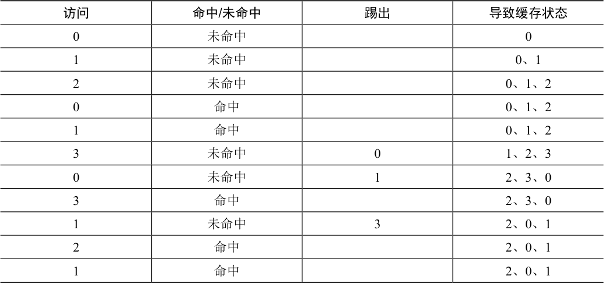
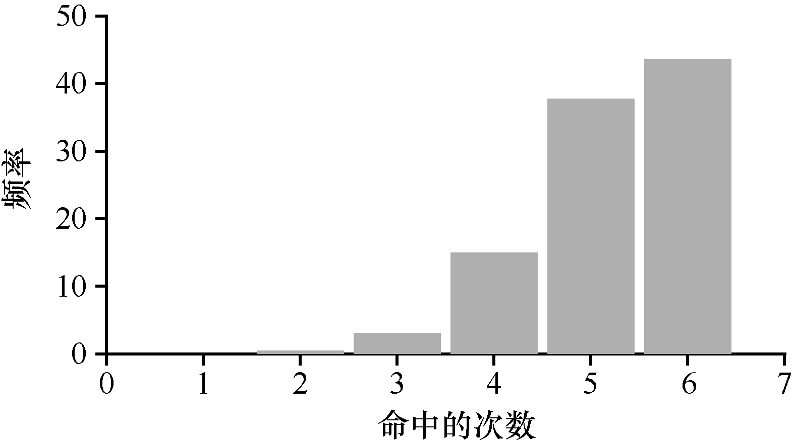

# 22.4 另一简单策略：随机

另一个类似的替换策略是随机，在内存满的时候它随机选择一个页进行替换。随机具有类似于FIFO 的属性。实现起来很简单，但是它在挑选替换哪个页时不够智能。让我们来看看随机策略在我们著名的例子上的引用流程（见表22.3）。

表格文字

| 访问 | 命中/未命中 | 踢出 | 导致缓存状态 |
| --- | --- | --- | --- |
| 0 | 未命中 |  | 0 |
| 1 | 未命中 |  | 0、1 |
| 2 | 未命中 |  | 0、1、2 |
| 0 | 命中 |  | 0、1、2 |
| 1 | 命中 |  | 0、1、2 |
| 3 | 未命中 | 0 | 1、2、3 |
| 0 | 未命中 | 1 | 2、3、0 |
| 3 | 命中 |  | 2、3、0 |
| 1 | 未命中 | 3 | 2、0、1 |
| 2 | 命中 |  | 2、0、1 |
| 1 | 命中 |  | 2、0、1 |

当然，随机的表现完全取决于多幸运（或

不幸）。在上面的例子中，随机比FIFO 好一点，比最优的差一点。事实上，我们可以运行数千次的随机实验，求得一个平均的结果。图22.1显示了10000 次试验后随机策略的平均命中率，每次试验都有不同的随机种子。正如你所看到的，有些时候（仅仅40%的概率），随机和最优策略一样好，在上述例子中，命中内存的次数是6 次。有时候情况会更糟糕，只有2 次或更少。随机策略取决于当时的运气。
