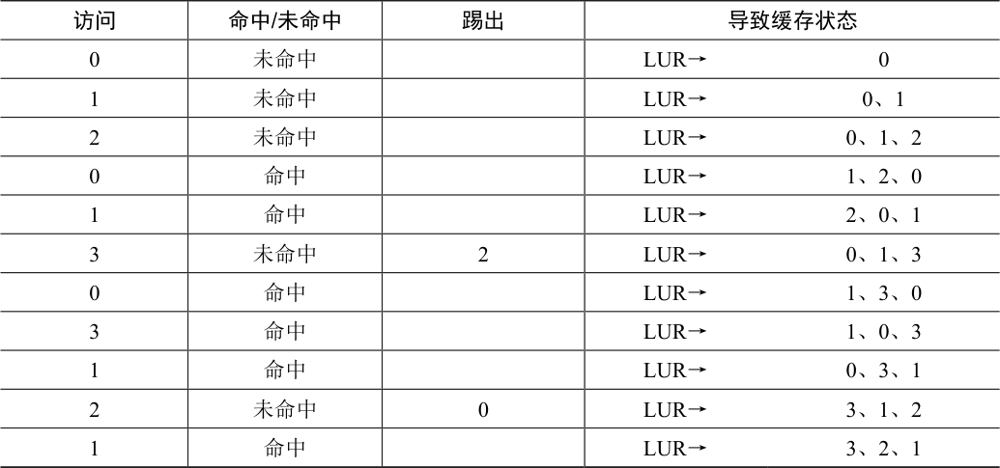

# 22.5 利用历史数据：LRU

遗憾的是，任何像FIFO 或随机这样简单的策略都可能会有一个共同的问题：它可能会踢出一个重要的页，而这个页马上要被引用。先进先出（FIFO）将先进入的页踢出。如果这恰好是一个包含重要代码或数据结构的页，它还是会被踢出，尽管它很快会被重新载入。因此，FIFO、Random 和类似的策略不太可能达到最优，需要更智能的策略。

正如在调度策略所做的那样，为了提高后续的命中率，我们再次通过历史的访问情况作为参考。例如，如果某个程序在过去访问过某个页，则很有可能在不久的将来会再次访问该页。

页替换策略可以使用的一个历史信息是频率（frequency）。如果一个页被访问了很多次，也许它不应该被替换，因为它显然更有价值。页更常用的属性是访问的近期性（recency），越近被访问过的页，也许再次访问的可能性也就越大。

这一系列的策略是基于人们所说的局部性原则（principle of locality）[D70]，基本上只是对程序及其行为的观察。这个原理简单地说就是程序倾向于频繁地访问某些代码（例如循环）和数据结构（例如循环访问的数组）。因此，我们应该尝试用历史数据来确定哪些页面更重要，并在需要踢出页时将这些页保存在内存中。

因此，一系列简单的基于历史的算法诞生了。“最不经常使用”（Least-Frequently-Used，LFU）策略会替换最不经常使用的页。同样，“最少最近使用”（Least-Recently-Used，LRU）策略替换最近最少使用的页面。这些算法很容易记住：一旦知道这个名字，就能确切知道它是什么，这种名字就非常好。

> **补充：局部性类型**

> 程序倾向于表现出两种类型的局部。第一种是空间局部性（spatial locality），它指出如果页P 被访问，可能围绕它的页（比如P−1 或P + 1）也会被访问。第二种是时间局部性（temporal locality），它指出近期访问过的页面很可能在不久的将来再次访问。假设存在这些类型的局部性，对硬件系统的缓存层次结构起着重要作用，硬件系统部署了许多级别的指令、数据和地址转换缓存，以便在存在此类局部性时，能帮助程序快速运行。

> 当然，通常所说的局部性原则（principle of locality）并不是硬性规定，所有的程序都必须遵守。事实上，一些程序以相当随机的方式访问内存（或磁盘），并且在其访问序列中不显示太多或完全没有局部性。因此，尽管在设计任何类型的缓存（硬件或软件）时，局部性都是一件好事，但它并不能保证成功。相反，它是一种经常证明在计算机系统设计中有用的启发式方法。

为了更好地理解LRU，我们来看看LRU 如何在示例引用序列上执行。表22.4 展示了结果。从表中，可以看到LRU 如何利用历史记录，比无状态策略（如随机或FIFO）做得更好。在这个例子中，当第一次需要替换页时，LRU 会踢出页2，因为0 和1 的访问时间更近。然后它替换页0，因为1 和3 最近被访问过。在这两种情况下，基于历史的LRU 的决定证明是更准确的，并且下一个引用也是命中。因此，在我们的简单例子中，LRU 的表现几乎快要赶上最优策略了[^p196-1]。

表格文字

| 访问 | 命中/未命中 | 踢出 | 导致缓存状态 |
| --- | --- | --- | --- |
| 0 | 未命中 |  | LUR→0 |
| 1 | 未命中 |  | LUR→0、1 |
| 2 | 未命中 |  | LUR→0、1、2 |
| 0 | 命中 |  | LUR→1、2、0 |
| 1 | 命中 |  | LUR→2、0、1 |
| 3 | 未命中 | 2 | LUR→0、1、3 |
| 0 | 命中 |  | LUR→1、3、0 |
| 3 | 命中 |  | LUR→1、0、3 |
| 1 | 命中 |  | LUR→0、3、1 |
| 2 | 未命中 | 0 | LUR→3、1、2 |
| 1 | 命中 |  | LUR→3、2、1 |

我们也应该注意到，与这些算法完全相反的算法也是存在：最经常使用策略（Most-Frequently-Used，MFU）和最近使用策略（Most-Recently-Used，MRU）。在大多数情况下（不是全部！），这些策略效果都不好，因为它们忽视了大多数程序都具有的局部性特点。

[^p196-1]: 好吧，我们夸大了结果。但有时候为了证明一个观点，夸大是有必要的。
