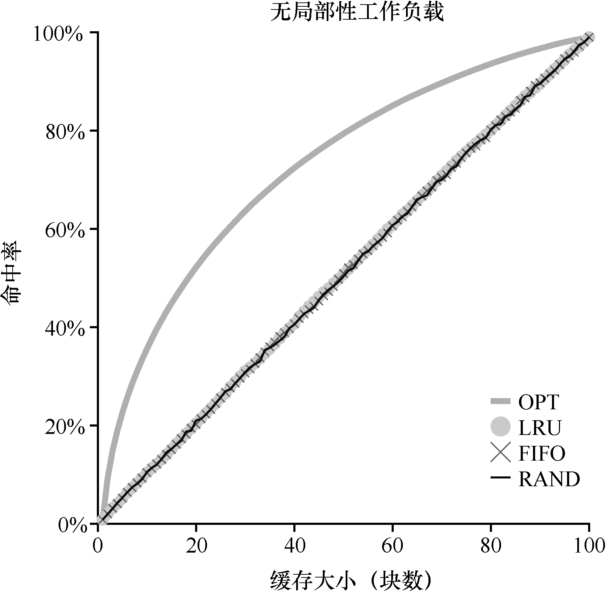
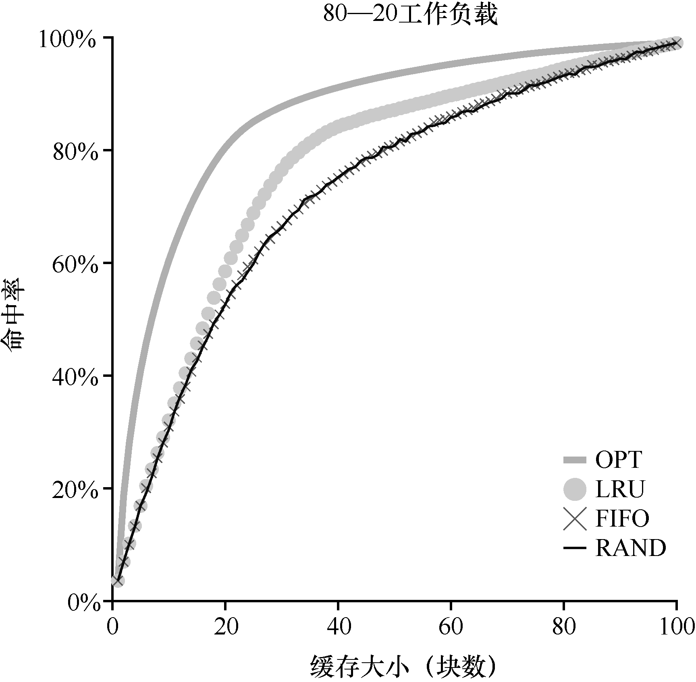
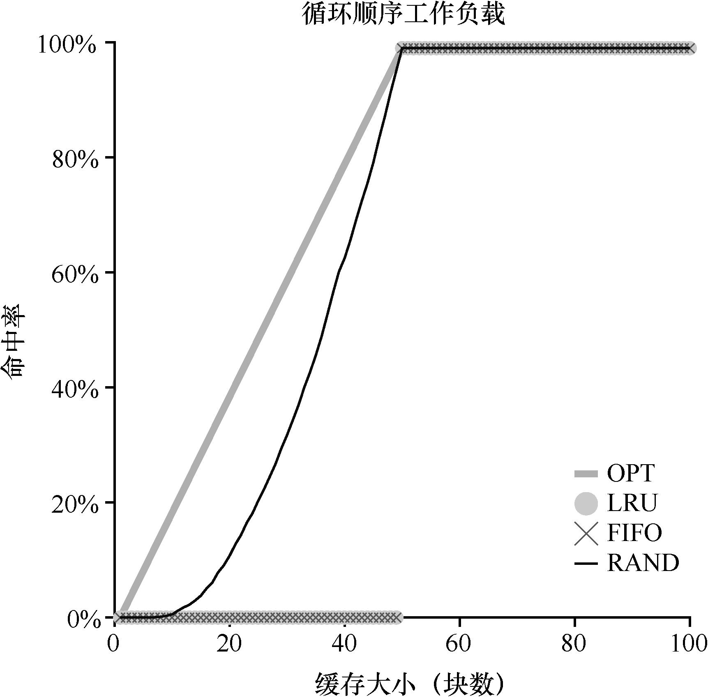

# 22.6 工作负载示例

让我们再看几个例子，以便更好地理解这些策略。在这里，我们将查看更复杂的工作负载（workload），而不是追踪小例子。但是，这些工作负载也被大大简化了。更好的研究应该包含应用程序追踪。

第一个工作负载没有局部性，这意味着每个引用都是访问一个随机页。在这个简单的例子中，工作负载每次访问独立的100 个页，随机选择下一个要引用的页。总体来说，访问了10000 个页。在实验中，我们将缓存大小从非常小（1 页）变化到足以容纳所有页（100页），以便了解每个策略在缓存大小范围内的表现。

图22.2 展示了最优、LRU、随机和FIFO 策略的实验结果。图22.2 中的y 轴显示了每个策略的命中率。如上所述，x 轴表示缓存大小的变化。

我们可以从图22.2 中得出一些结论。首先，当工作负载不存在局部性时，使用的策略区别不大。LRU、FIFO 和随机都执行相同的操作，命中率完全由缓存的大小决定。其次，当缓存足够大到可以容纳所有的数据时，使用哪种策略也无关紧要，所有的策略（甚至是随机的）都有100%的命中率。最后，你可以看到，最优策略的表现明显好于实际的策略。如果有可能的话，偷窥未来，就能做到更好的替换。

我们下一个工作负载就是所谓的“80—20”负载场景，它表现出局部性：80%的引用是访问20%的页（“热门”页）。剩下的20%是对剩余的80%的页（“冷门”页）访问。在我们的负载场景，总共有100 个不同的页。因此，“热门”页是大部分时间访问的页，其余时间访问的是“冷门”页。图22.3 展示了不同策略在这个工作负载下的表现。

从图22.3 中可以看出，尽管随机和FIFO 都很好地运行，但LRU 更好，因为它更可能保持热门页。由于这些页面过去经常被提及，它们很可能在不久的将来再次被提及。优化再次表现得更好，表明LRU 的历史信息并不完美。

你现在可能会想：LRU 对随机和FIFO 的命中率提高真的非常重要么？如往常一样，答案是“视情况而定”。如果每次未命中代价非常大（并不罕见），那么即使小幅提高命中率（降低未命中率）也会对性能产生巨大的影响。如果未命中的代价不那么大，那么LRU 带来的好处就不会那么重要。

让我们看看最后一个工作负载。我们称之为“循环顺序”工作负载，其中依次引用50个页，从0 开始，然后是1，…，49，然后循环，重复访问，总共有10000 次访问50 个单独页。图22.4 展示了这个工作负载下各个策略的行为。

这种工作负载在许多应用程序（包括重要的商业应用，如数据库[CD85]）中非常常见，展示了LRU 或者FIFO 的最差情况。这些算法，在循环顺序的工作负载下，踢出较旧的页。遗憾的是，由于工作负载的循环性质，这些较旧的页将比因为策略决定保存在缓存中的页更早被访问。事实上，即使缓存的大小是49 页，50 个页面的循环连续工作负载也会导致0%的命中率。有趣的是，随机策略明显更好，虽然距离最优策略还有距离，但至少达到了非零的命中率。可以看出随机策略有一些不错的属性，比如不会出现特殊情况下奇怪的结果。
