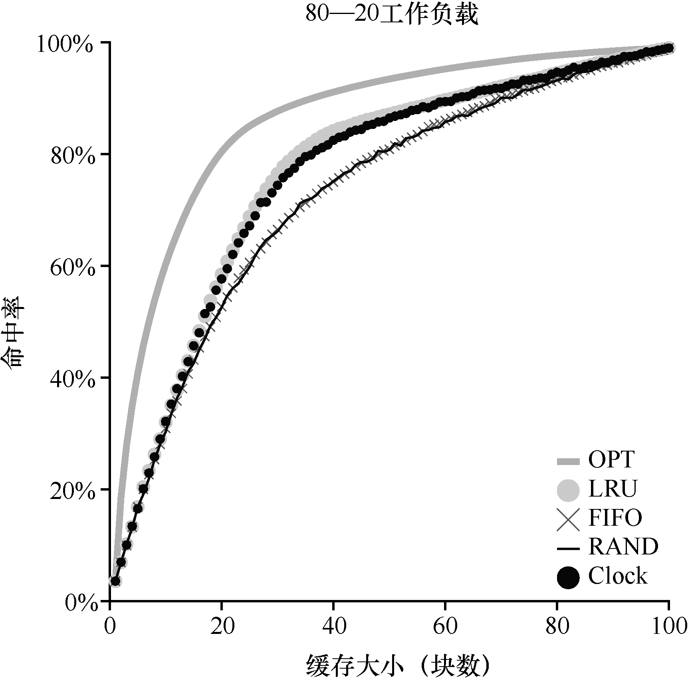

# 22.8 近似LRU

事实证明，答案是肯定的：从计算开销的角度来看，近似LRU 更为可行，实际上这也是许多现代系统的做法。这个想法需要硬件增加一个使用位（use bit，有时称为引用位，reference bit），这种做法在第一个支持分页的系统Atlas one-level store[KE + 62]中实现。系统的每个页有一个使用位，然后这些使用位存储在某个地方（例如，它们可能在每个进程的页表中，或者只在某个数组中）。每当页被引用（即读或写）时，硬件将使用位设置为1。但是，硬件不会清除该位（即将其设置为0），这由操作系统负责。

操作系统如何利用使用位来实现近似LRU？可以有很多方法，有一个简单的方法称作时钟算法（clock algorithm）[C69]。想象一下，系统中的所有页都放在一个循环列表中。时钟指针（clock hand）开始时指向某个特定的页（哪个页不重要）。当必须进行页替换时，操作系统检查当前指向的页P 的使用位是1 还是0。如果是1，则意味着页面P 最近被使用，因此不适合被替换。然后，P 的使用位设置为0，时钟指针递增到下一页（P + 1）。该算法一直持续到找到一个使用位为0 的页，使用位为0 意味着这个页最近没有被使用过（在最坏的情况下，所有的页都已经被使用了，那么就将所有页的使用位都设置为0）。

请注意，这种方法不是通过使用位来实现近似LRU 的唯一方法。实际上，任何周期性地清除使用位，然后通过区分使用位是 1 和 0 来判定该替换哪个页的方法都是可以的。Corbato 的时钟算法只是一个早期成熟的算法，并且具有不重复扫描内存来寻找未使用页的特点，也就是它在最差情况下，只会遍历一次所有内存。

图22.5 展示了时钟算法的一个变种的行为。该变种在需要进行页替换时随机扫描各页，如果遇到一个页的引用位为1，就清除该位（即将它设置为0）。直到找到一个使用位为0的页，将这个页进行替换。如你所见，虽然时钟算法不如完美的LRU 做得好，但它比不考虑历史访问的方法要好。

