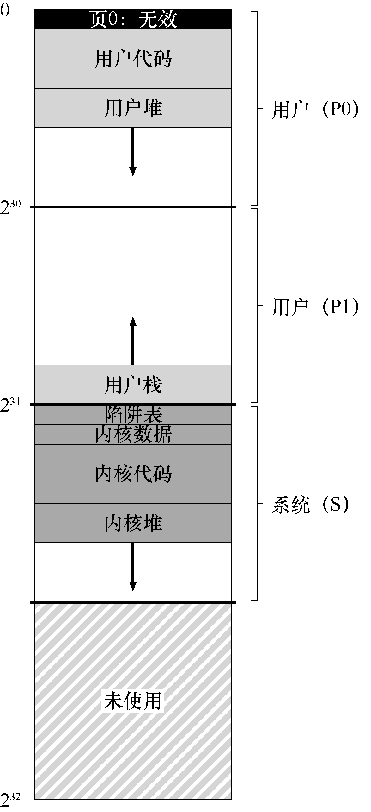

# 23.3 一个真实的地址空间

研究VMS 有一个很好的方面，我们可以看到如何构建一个真正的地址空间（见图23.1）。到目前为止，我们一直假设了一个简单的地址空间，只有用户代码、用户数据和用户堆，但正如我们上面所看到的，真正的地址空间显然更复杂。

> **补充：为什么空指针访问会导致段错误**

> 你现在应该很好地理解一个空指针引用会发生什么。通过这样做，进程生成了一个虚拟地址0：

```c
int *p = NULL; // set p = 0
*p = 10;      // try to store value 10 to virtual address 0
```

> 硬件试图在TLB 中查找VPN（这里也是0），遇到TLB 未命中。查询页表，并且发现VPN 0 的条目被标记为无效。因此，我们遇到无效的访问，将控制权交给操作系统，这可能会终止进程（在UNIX 系统上，会向进程发出一个信号，让它们对这样的错误做出反应。但是如果信号未被捕获，则会终止进程）。

例如，代码段永远不会从第0 页开始。相反，该页被标记为不可访问，以便为检测空指针（null-pointer）访问提供一些支持。因此，设计地址空间时需要考虑的一个问题是对调试的支持，这正是无法访问的零页所提供的。



也许更重要的是，内核虚拟地址空间（即其数据结构和代码）是每个用户地址空间的一部分。在上下文切换时，操作系统改变P0 和P1 寄存器以指向即将运行的进程的适当页表。但是，它不会更改S 基址和界限寄存器，并因此将“相同的”内核结构映射到每个用户的地址空间。

内核映射到每个地址空间，这有一些原因。这种结构使得内核的运转更轻松。例如，如果操作系统收到用户程序（例如，在write()系统调用中）递交的指针，很容易将数据从该指针处复制到它自己的结构。操作系统自然是写好和编译好的，无须担心它访问的数据来自哪里。相反，如果内核完全位于物理内存中，那么将页表的交换页切换到磁盘是非常困难的。如果内核被赋予了自己的地址空间，那么在用户应用程序和内核之间移动数据将再次变得复杂和痛苦。通过这种构造（现在广泛使用），内核几乎就像应用程序库一样，尽管是受保护的。

关于这个地址空间的最后一点与保护有关。显然，操作系统不希望用户应用程序读取或写入操作系统数据或代码。因此，硬件必须支持页面的不同保护级别才能启用该功能。VAX 通过在页表中的保护位中指定CPU 访问特定页面所需的特权级别来实现此目的。因此，系统数据和代码被设置为比用户数据和代码更高的保护级别。试图从用户代码访问这些信息，将会在操作系统中产生一个陷阱，并且（你猜对了）可能会终止违规进程。
