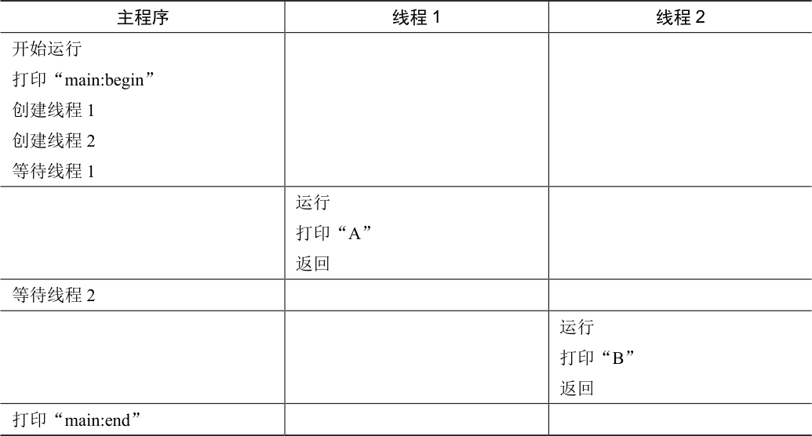
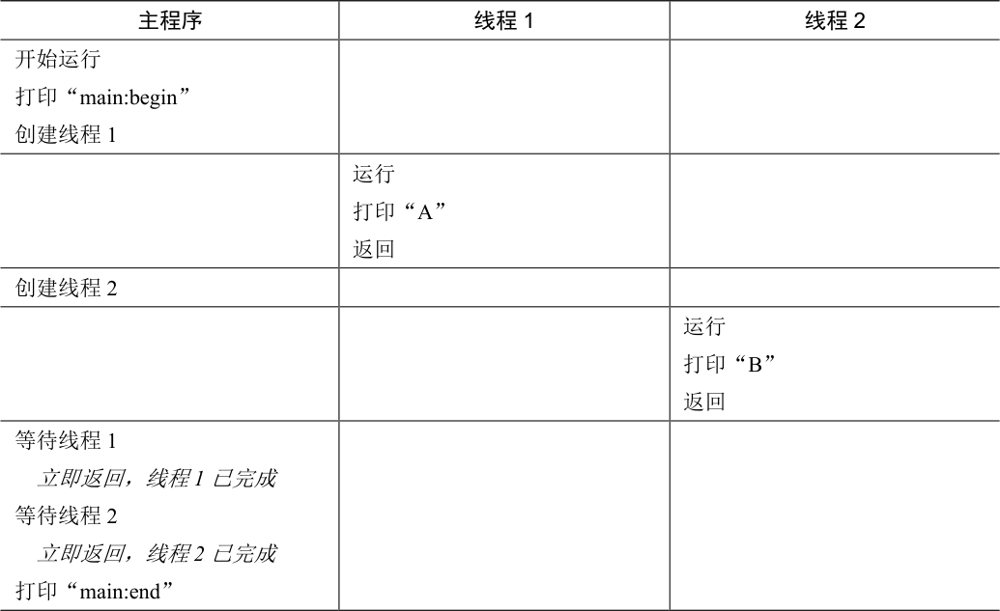
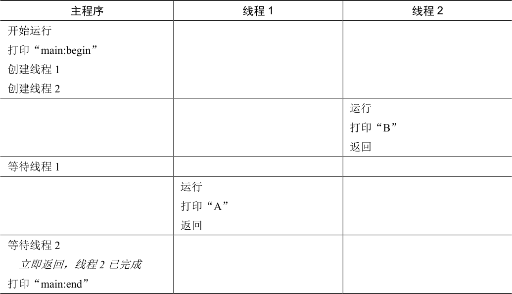

# 26.1 实例：线程创建

假设我们想运行一个程序，它创建两个线程，每个线程都做了一些独立的工作，在这例子中，打印“A”或“B”。代码如图26.2 所示。

主程序创建了两个线程，分别执行函数mythread()，但是传入不同的参数（字符串类型的A 或者B）。一旦线程创建，可能会立即运行（取决于调度程序的兴致），或者处于就绪状态，等待执行。创建了两个线程（T1 和T2）后，主程序调用pthread\_join()，等待特定线程完成。

```c
#include <stdio.h>
#include <assert.h>
#include <pthread.h>

void *mythread(void *arg) {
    printf("%s\n", (char *) arg);
    return NULL;
}

int
main(int argc, char *argv[]) {
    pthread_t p1, p2;
    int rc;
    printf("main: begin\n");
    rc = pthread_create(&p1, NULL, mythread, "A"); assert(rc == 0);
    rc = pthread_create(&p2, NULL, mythread, "B"); assert(rc == 0);
    // join waits for the threads to finish
    rc = pthread_join(p1, NULL); assert(rc == 0);
    rc = pthread_join(p2, NULL); assert(rc == 0);
    printf("main: end\n");
    return 0;
}
```

*图26.2 简单线程创建代码（t0.c）*

让我们来看看这个小程序的可能执行顺序。在表26.1 中，向下方向表示时间增加，每个列显示不同的线程（主线程、线程1 或线程2）何时运行。



<details markdown="1">
<summary>表格文字</summary>

| 主程序 | 线程1 | 线程2 |
| --- | --- | --- |
| 开始运行 打印“main:begin” 创建线程1 创建线程2 等待线程1 |  |  |
|  | 运行 打印“A” 返回 |  |
| 等待线程2 |  |  |
|  |  | 运行 打印“B” 返回 |
| 打印“main:end” |  |  |

</details>

但请注意，这种排序不是唯一可能的顺序。实际上，给定一系列指令，有很多可能的顺序，这取决于调度程序决定在给定时刻运行哪个线程。例如，创建一个线程后，它可能会立即运行，这将导致表26.2 中的执行顺序。



<details markdown="1">
<summary>表格文字</summary>

| 主程序 | 线程1 | 线程2 |
| --- | --- | --- |
| 开始运行 打印“main:begin” 创建线程1 |  |  |
|  | 运行 打印“A” 返回 |  |
| 创建线程2 |  |  |
|  |  | 运行 打印“B” 返回 |
| 等待线程1 立即返回，线程1 已完成 等待线程2 立即返回，线程2 已完成 打印“main:end” |  |  |

</details>

我们甚至可以在“A”之前看到“B”，即使先前创建了线程1，如果调度程序决定先运行线程2，没有理由认为先创建的线程先运行。表26.3 展示了最终的执行顺序，线程2 在线程1 之前先展示它的结果。



<details markdown="1">
<summary>表格文字</summary>

| 主程序 | 线程1 | 线程2 |
| --- | --- | --- |
| 开始运行 打印“main:begin” 创建线程1 创建线程2 |  |  |
|  |  | 运行 打印“B” 返回 |
| 等待线程1 |  |  |
|  | 运行 打印“A” 返回 |  |
| 等待线程2 立即返回，线程2 已完成 打印“main:end” |  |  |

</details>

如你所见，线程创建有点像进行函数调用。然而，并不是首先执行函数然后返回给调用者，而是为被调用的例程创建一个新的执行线程，它可以独立于调用者运行，可能在从创建者返回之前运行，但也许会晚得多。

从这个例子中也可以看到，线程让生活变得复杂：已经很难说出什么时候会运行了！没有并发，计算机也很难理解。遗憾的是，有了并发，情况变得更糟，而且糟糕得多。
