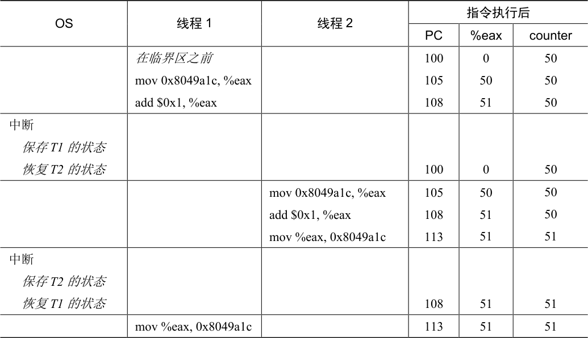

# 26.3 核心问题：不可控的调度

为了理解为什么会发生这种情况，我们必须了解编译器为更新计数器生成的代码序列。在这个例子中，我们只是想给counter 加上一个数字（1）。因此，做这件事的代码序列可能看起来像这样（在x86 中）：

```text
mov 0x8049a1c, %eax
add $0x1, %eax
mov %eax, 0x8049a1c
```

这个例子假定，变量counter 位于地址0x8049a1c。在这3 条指令中，先用x86 的mov指令，从内存地址处取出值，放入eax。然后，给eax 寄存器的值加1（0x1）。最后，eax的值被存回内存中相同的地址。

设想我们的两个线程之一（线程1）进入这个代码区域，并且因此将要增加一个计数器。它将counter 的值（假设它这时是50）加载到它的寄存器eax 中。因此，线程1 的eax = 50。然后它向寄存器加1，因此eax = 51。现在，一件不幸的事情发生了：时钟中断发生。因此，操作系统将当前正在运行的线程（它的程序计数器、寄存器，包括eax 等）的状态保存到线程的TCB。

现在更糟的事发生了：线程2 被选中运行，并进入同一段代码。它也执行了第一条指令，获取计数器的值并将其放入其eax 中 [请记住：运行时每个线程都有自己的专用寄存器。上下文切换代码将寄存器虚拟化（virtualized），保存并恢复它们的值]。此时counter 的值仍为50，因此线程2 的eax = 50。假设线程2 执行接下来的两条指令，将eax 递增1（因此eax= 51），然后将eax 的内容保存到counter（地址0x8049a1c）中。因此，全局变量counter 现在的值是51。

最后，又发生一次上下文切换，线程1 恢复运行。还记得它已经执行过mov 和add 指令，现在准备执行最后一条mov 指令。回忆一下，eax=51。因此，最后的mov 指令执行，将值保存到内存，counter 再次被设置为51。

简单来说，发生的情况是：增加counter 的代码被执行两次，初始值为50，但是结果为51。这个程序的“正确”版本应该导致变量counter 等于52。

为了更好地理解问题，让我们追踪一下详细的执行。假设在这个例子中，上面的代码被加载到内存中的地址100 上，就像下面的序列一样（熟悉类似RISC 指令集的人请注意：x86 具有可变长度指令。这个mov 指令占用 5 个字节的内存，add 只占用3 个字节）：

```text
ov   0x8049a1c, %eax
dd   $0x1, %eax
ov   %eax, 0x8049a1c
```

有了这些假设，发生的情况如表26.4 所示。假设counter 从50 开始，并追踪这个例子，确保你明白发生了什么。

这里展示的情况称为竞态条件（race condition）：结果取决于代码的时间执行。由于运气不好（即在执行过程中发生的上下文切换），我们得到了错误的结果。事实上，可能每次都会得到不同的结果。因此，我们称这个结果是不确定的（indeterminate），而不是确定的（deterministic）计算（我们习惯于从计算机中得到）。不确定的计算不知道输出是什么，它在不同运行中确实可能是不同的。

由于执行这段代码的多个线程可能导致竞争状态，因此我们将此段代码称为临界区（critical section）。临界区是访问共享变量（或更一般地说，共享资源）的代码片段，一定不能由多个线程同时执行。



<details markdown="1">
<summary>表格文字</summary>

| OS | 线程1 | 线程2 | 指令执行后 |  |  |
| --- | --- | --- | --- | --- | --- |
|  |  |  | PC | %eax | counter |
|  | 在临界区之前 mov 0x8049a1c, %eax add $0x1, %eax |  | 100 105 108 | 0 50 51 | 50 50 50 |
| 中断 保存T1 的状态 恢复T2 的状态 |  |  | 100 | 0 | 50 |
|  |  | mov 0x8049a1c, %eax add $0x1, %eax mov %eax, 0x8049a1c | 105 108 113 | 50 51 51 | 50 50 51 |
| 中断 保存T2 的状态 恢复T1 的状态 |  |  | 108 | 51 | 51 |
|  | mov %eax, 0x8049a1c |  | 113 | 51 | 51 |

</details>

我们真正想要的代码就是所谓的互斥（mutual exclusion）。这个属性保证了如果一个线程在临界区内执行，其他线程将被阻止进入临界区。

事实上，所有这些术语都是由Edsger Dijkstra 创造的，他是该领域的先驱，并且因为这项工作和其他工作而获得了图灵奖。请参阅他1968 年关于“Cooperating Sequential Processes”的文章[D68]，该文对这个问题给出了非常清晰的描述。在本书的这一部分，我们将多次看到Dijkstra 的名字。
