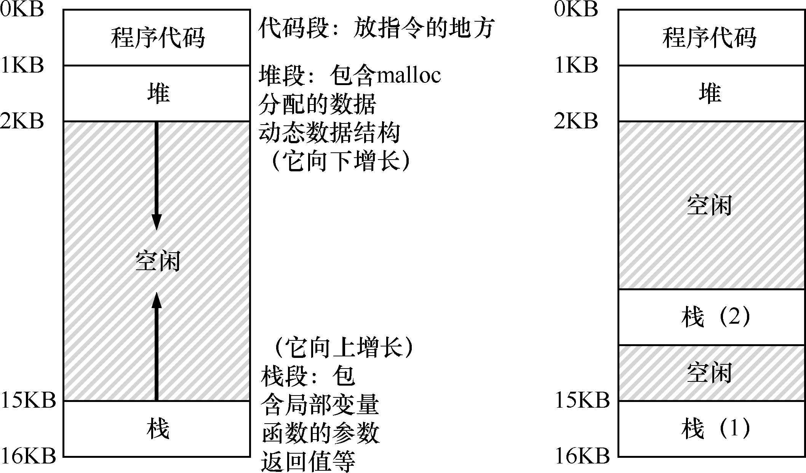

# 第 26 章 并发：介绍

目前为止，我们已经看到了操作系统提供的基本抽象的发展；也看到了如何将一个物理CPU 变成多个虚拟CPU（virtual CPU），从而支持多个程序同时运行的假象；还看到了如何为每个进程创建巨大的、私有的虚拟内存（virtual memory）的假象，这种地址空间（address space）的抽象让每个程序好像拥有自己的内存，而实际上操作系统秘密地让多个地址空间复用物理内存（或者磁盘）。

本章将介绍为单个运行进程提供的新抽象：线程（thread）。经典观点是一个程序只有一个执行点（一个程序计数器，用来存放要执行的指令），但多线程（multi-threaded）程序会有多个执行点（多个程序计数器，每个都用于取指令和执行）。换一个角度来看，每个线程类似于独立的进程，只有一点区别：它们共享地址空间，从而能够访问相同的数据。

因此，单个线程的状态与进程状态非常类似。线程有一个程序计数器（PC），记录程序从哪里获取指令。每个线程有自己的一组用于计算的寄存器。所以，如果有两个线程运行在一个处理器上，从运行一个线程（T1）切换到另一个线程（T2）时，必定发生上下文切换（context switch）。线程之间的上下文切换类似于进程间的上下文切换。对于进程，我们将状态保存到进程控制块（Process Control Block，PCB）。现在，我们需要一个或多个线程控制块（Thread Control Block，TCB），保存每个线程的状态。但是，与进程相比，线程之间的上下文切换有一点主要区别：地址空间保持不变（即不需要切换当前使用的页表）。

线程和进程之间的另一个主要区别在于栈。在简单的传统进程地址空间模型 [我们现在可以称之为单线程（single-threaded）进程] 中，只有一个栈，通常位于地址空间的底部（见图26.1 左图）。

然而，在多线程的进程中，每个线程独立运行，当然可以调用各种例程来完成正在执行的任何工作。不是地址空间中只有一个栈，而是每个线程都有一个栈。假设有一个多线程的进程，它有两个线程，结果地址空间看起来不同（见图26.1 右图）。

在图26.1 中，可以看到两个栈跨越了进程的地址空间。因此，所有位于栈上的变量、参数、返回值和其他放在栈上的东西，将被放置在有时称为线程本地（thread-local）存储的地方，即相关线程的栈。

你可能注意到，多个栈也破坏了地址空间布局的美感。以前，堆和栈可以互不影响地增长，直到空间耗尽。多个栈就没有这么简单了。幸运的是，通常栈不会很大（除了大量使用递归的程序）。
