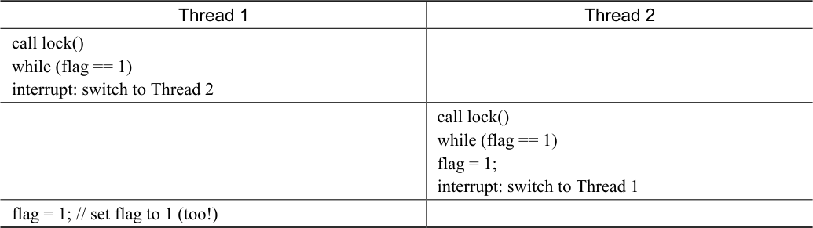

# 28.6 测试并设置指令（原子交换）

因为关闭中断的方法无法工作在多处理器上，所以系统设计者开始让硬件支持锁。最早的多处理器系统，像20 世纪60 年代早期的Burroughs B5000[M82]，已经有这些支持。今天所有的系统都支持，甚至包括单CPU 的系统。

最简单的硬件支持是测试并设置指令（test-and-set instruction），也叫作原子交换（atomic exchange）。为了理解test-and-set 如何工作，我们首先实现一个不依赖它的锁，用一个变量标记锁是否被持有。

在第一次尝试中（见图 28.1），想法很简单：用一个变量来标志锁是否被某些线程占用。第一个线程进入临界区，调用lock()，检查标志是否为1（这里不是1），然后设置标志为1，表明线程持有该锁。结束临界区时，线程调用unlock()，清除标志，表示锁未被持有。

```c
typedef struct  lock_t { int flag; } lock_t;

void init(lock_t *mutex) {
    // 0 -> lock is available, 1 -> held
    mutex->flag = 0;
}

void lock(lock_t *mutex) {
    while (mutex->flag == 1) // TEST the flag
        ; // spin-wait (do nothing)
    mutex->flag = 1;         // now SET it!
}

void unlock(lock_t *mutex) {
    mutex->flag = 0;
}
```

*图28.1 第一次尝试：简单标志*

当第一个线程正处于临界区时，如果另一个线程调用lock()，它会在while 循环中自旋等待（spin-wait)，直到第一个线程调用unlock()清空标志。然后等待的线程会退出while 循环，设置标志，执行临界区代码。

遗憾的是，这段代码有两个问题：正确性和性能。这个正确性问题在并发编程中很常见。假设代码按照表28.1 执行，开始时flag=0。



<details markdown="1">
<summary>表格文字</summary>

| Thread 1 | Thread 2 |
| --- | --- |
| call lock() while (flag == 1) interrupt: switch to Thread 2 |  |
|  | call lock() while (flag == 1) flag = 1; interrupt: switch to Thread 1 |
| flag = 1; // set flag to 1 (too!) |  |

</details>

从这种交替执行可以看出，通过适时的（不合时宜的？）中断，我们很容易构造出两个线程都将标志设置为1，都能进入临界区的场景。这种行为就是专家所说的“不好”，我们显然没有满足最基本的要求：互斥。

性能问题（稍后会有更多讨论）主要是线程在等待已经被持有的锁时，采用了自旋等待（spin-waiting）的技术，就是不停地检查标志的值。自旋等待在等待其他线程释放锁的时候会浪费时间。尤其是在单处理器上，一个等待线程等待的目标线程甚至无法运行（至少在上下文切换之前）！我们要开发出更成熟的解决方案，也应该考虑避免这种浪费。
