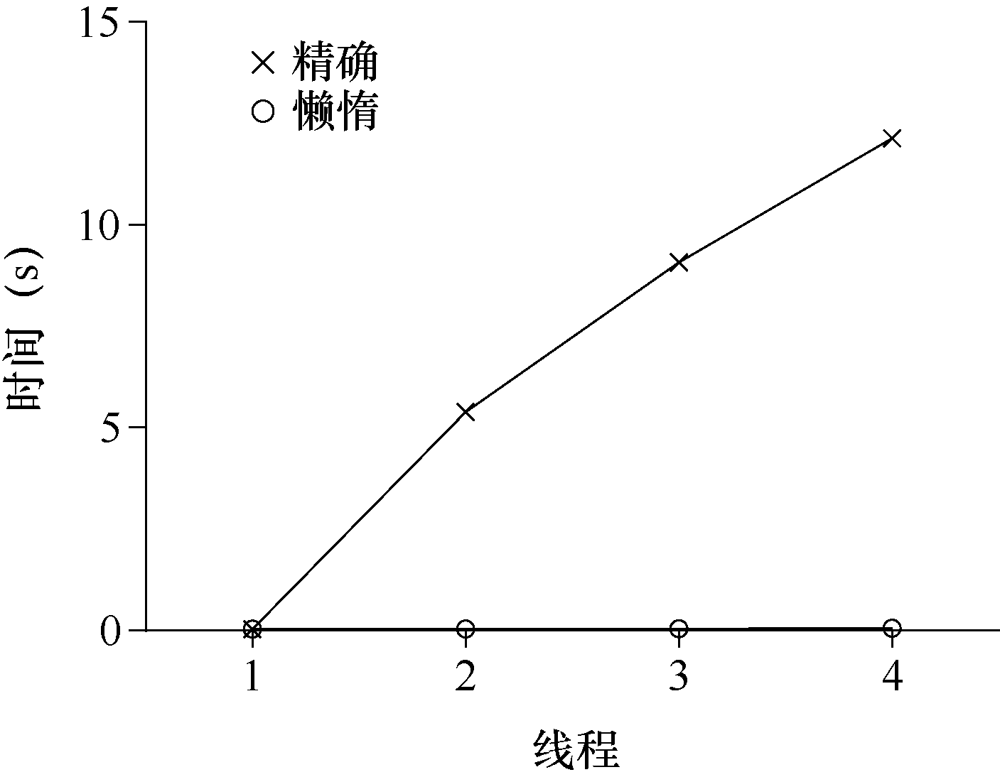
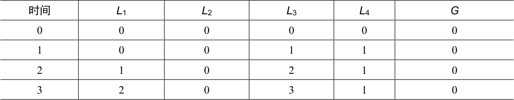
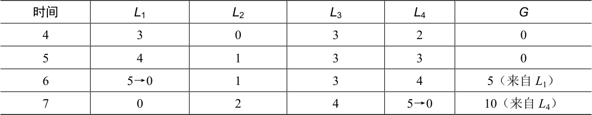
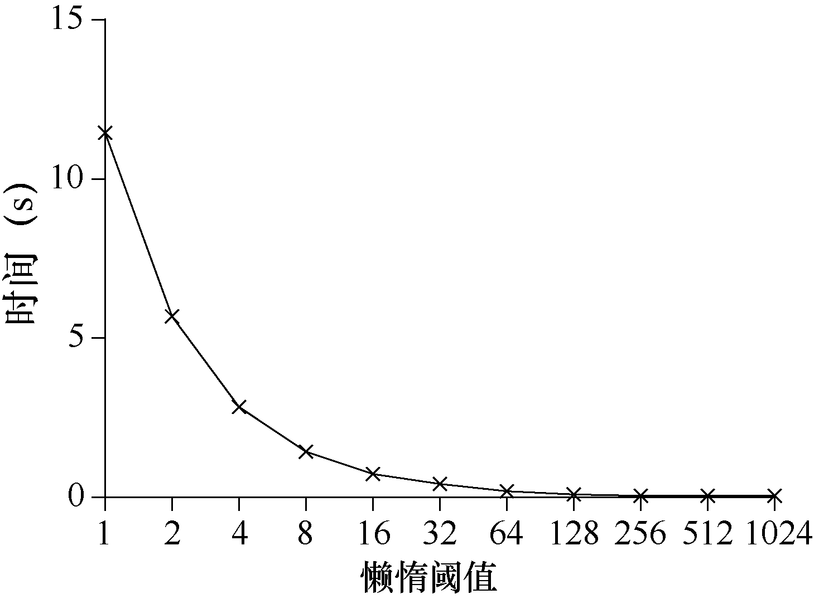

# 29.1 并发计数器

计数器是最简单的一种数据结构，使用广泛而且接口简单。图29.1 中定义了一个非并发的计数器。

```c
typedef struct  counter_t {
    int value;
} counter_t;

void init(counter_t *c) {
    c->value = 0;
}

void increment(counter_t *c) {
    c->value++;
}

void decrement(counter_t *c) {
    c->value--;
}

int get(counter_t *c) {
    return c->value;
}
```

*图29.1 无锁的计数器*

## 简单但无法扩展

你可以看到，没有同步机制的计数器很简单，只需要很少代码就能实现。现在我们的下一个挑战是：如何让这段代码线程安全（thread safe）？图29.2 展示了我们的做法。

```c
typedef struct  counter_t {
    int            value;
    pthread_mutex_t lock;
} counter_t;

void init(counter_t *c) {
    c->value = 0;
    Pthread_mutex_init(&c->lock,  NULL);
}

void increment(counter_t *c) {
    Pthread_mutex_lock(&c->lock);
    c->value++;
    Pthread_mutex_unlock(&c->lock);
}

void decrement(counter_t *c) {
    Pthread_mutex_lock(&c->lock);
    c->value--;
    Pthread_mutex_unlock(&c->lock);
}

int get(counter_t *c) {
    Pthread_mutex_lock(&c->lock);
    int rc = c->value;
    Pthread_mutex_unlock(&c->lock);
    return rc;
}
```

*图29.2 有锁的计数器*

这个并发计数器简单、正确。实际上，它遵循了最简单、最基本的并发数据结构中常见的数据模式：它只是加了一把锁，在调用函数操作该数据结构时获取锁，从调用返回时释放锁。这种方式类似基于观察者（monitor）[BH73]的数据结构，在调用、退出对象方法时，会自动获取锁、释放锁。

现在，有了一个并发数据结构，问题可能就是性能了。如果这个结构导致运行速度太慢，那么除了简单加锁，还需要进行优化。如果需要这种优化，那么本章的余下部分将进行探讨。请注意，如果数据结构导致的运行速度不是太慢，那就没事！如果简单的方案就能工作，就不需要精巧的设计。

为了理解简单方法的性能成本，我们运行一个基准测试，每个线程更新同一个共享计数器固定次数，然后我们改变线程数。图29.3 给出了运行1 个线程到4 个线程的总耗时，其中每个线程更新100 万次计数器。本实验是在4 核Intel 2.7GHz i5 CPU 的iMac 上运行。通过增加CPU，我们希望单位时间能够完成更多的任务。

从图29.3 上方的曲线（标为“精确”）可以看



出，同步的计数器扩展性不好。单线程完成100 万次更新只需要很短的时间（大约0.03s），而两个线程并发执行，每个更新100 万次，性能下降很多（超过5s！）。线程更多时，性能更差。

理想情况下，你会看到多处理上运行的多线程就像单线程一样快。达到这种状态称为完美扩展（perfect scaling）。虽然总工作量增多，但是并行执行后，完成任务的时间并没有增加。

## 可扩展的计数

令人吃惊的是，关于如何实现可扩展的计数器，研究人员已经研究了多年[MS04]。更令人吃惊的是，最近的操作系统性能分析研究[B+10]表明，可扩展的计数器很重要。没有可扩展的计数，一些运行在Linux 上的工作在多核机器上将遇到严重的扩展性问题。

尽管人们已经开发了多种技术来解决这一问题，我们将介绍一种特定的方法。这个方法是最近的研究提出的，称为懒惰计数器（sloppy counter）[B+10]。

懒惰计数器通过多个局部计数器和一个全局计数器来实现一个逻辑计数器，其中每个CPU 核心有一个局部计数器。具体来说，在4 个CPU 的机器上，有4 个局部计数器和1 个全局计数器。除了这些计数器，还有锁：每个局部计数器有一个锁，全局计数器有一个。

懒惰计数器的基本思想是这样的。如果一个核心上的线程想增加计数器，那就增加它的局部计数器，访问这个局部计数器是通过对应的局部锁同步的。因为每个CPU 有自己的局部计数器，不同CPU 上的线程不会竞争，所以计数器的更新操作可扩展性好。

但是，为了保持全局计数器更新（以防某个线程要读取该值），局部值会定期转移给全局计数器，方法是获取全局锁，让全局计数器加上局部计数器的值，然后将局部计数器置零。

这种局部转全局的频度，取决于一个阈值，这里称为S（表示sloppiness）。S 越小，懒惰计数器则越趋近于非扩展的计数器。S 越大，扩展性越强，但是全局计数器与实际计数的偏差越大。我们可以抢占所有的局部锁和全局锁（以特定的顺序，避免死锁），以获得精确值，但这种方法没有扩展性。

为了弄清楚这一点，来看一个例子（见表29.1）。在这个例子中，阈值S 设置为5，4个CPU 上分别有一个线程更新局部计数器L<sub>1</sub>,…, L<sub>4</sub>。随着时间增加，全局计数器G 的值也会记录下来。每一段时间，局部计数器可能会增加。如果局部计数值增加到阈值S，就把局部值转移到全局计数器，局部计数器清零。



<details markdown="1">
<summary>表格文字</summary>

| 时间 | L1 | L2 | L3 | L4 | G |
| --- | --- | --- | --- | --- | --- |
| 0 | 0 | 0 | 0 | 0 | 0 |
| 1 | 0 | 0 | 1 | 1 | 0 |
| 2 | 1 | 0 | 2 | 1 | 0 |
| 3 | 2 | 0 | 3 | 1 | 0 |

</details>

续表



<details markdown="1">
<summary>表格文字</summary>

| 时间 | L1 | L2 | L3 | L4 | G |
| --- | --- | --- | --- | --- | --- |
| 4 | 3 | 0 | 3 | 2 | 0 |
| 5 | 4 | 1 | 3 | 3 | 0 |
| 6 | 5→0 | 1 | 3 | 4 | 5（来自L1） |
| 7 | 0 | 2 | 4 | 5→0 | 10（来自L4） |

</details>

图29.3 中下方的线，是阈值S 为1024 时懒惰计数器的性能。性能很高，4 个处理器更新400 万次的时间和一个处理器更新100 万次的几乎一样。

图29.4 展示了阈值S 的重要性，在4 个CPU 上的4 个线程，分别增加计数器100 万次。如果S 小，性能很差（但是全局计数器精确度高）。如果S 大，性能很好，但是全局计数器会有延时。懒惰计数器就是在准确性和性能之间折中。



图29.5 是这种懒惰计数器的基本实现。阅读它，或者运行它，尝试一些例子，以便更好地理解它的原理。

```c
typedef struct  counter_t {
    int             global;            // global count
    pthread_mutex_t glock;             // global lock
    int             local[NUMCPUS];    // local count (per cpu)
    pthread_mutex_t llock[NUMCPUS];    // ... and locks
    int             threshold;         // update frequency
} counter_t;

// init: record threshold, init locks, init values
//       of all local counts and global count
void init(counter_t *c, int threshold) {
    c->threshold = threshold;

    c->global = 0;
    pthread_mutex_init(&c->glock,  NULL);

    int i;
    for (i = 0; i < NUMCPUS; i++) {
        c->local[i] = 0;
        pthread_mutex_init(&c->llock[i],  NULL);
    }
}

// update: usually, just grab local lock and update local amount
//        once local count has risen by 'threshold', grab global
//        lock and transfer local values to it
void update(counter_t *c, int threadID, int amt) {
    pthread_mutex_lock(&c->llock[threadID]);
    c->local[threadID] += amt;                // assumes amt > 0
    if (c->local[threadID] >= c->threshold) { // transfer to global
        pthread_mutex_lock(&c->glock);
        c->global += c->local[threadID];
        pthread_mutex_unlock(&c->glock);
        c->local[threadID] = 0;
    }
    pthread_mutex_unlock(&c->llock[threadID]);
}

// get: just return global amount (which may not be perfect)
int get(counter_t *c) {
    pthread_mutex_lock(&c->glock);
    int val = c->global;
    pthread_mutex_unlock(&c->glock);
    return val; // only approximate!
}
```

*图29.5 懒惰计数器的实现*
