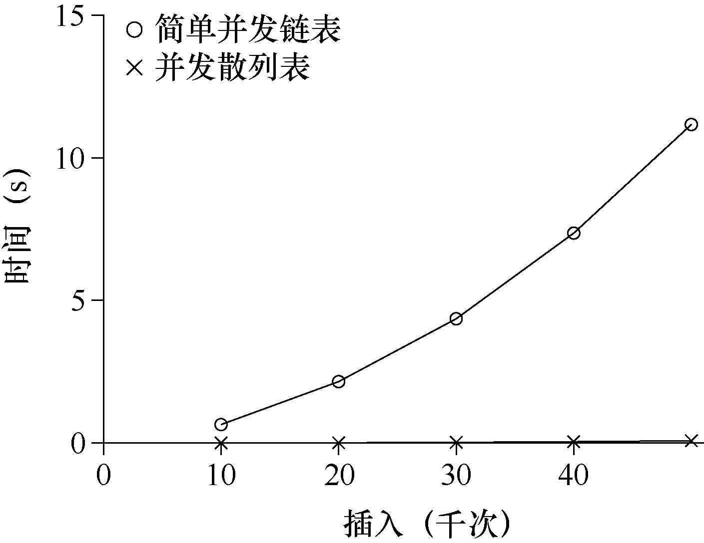

# 29.4 并发散列表

我们讨论最后一个应用广泛的并发数据结构，散列表（见图29.9）。我们只关注不需要调整大小的简单散列表。支持调整大小还需要一些工作，留给读者作为练习。

```c
#define BUCKETS (101)

typedef struct  hash_t {
    list_t lists[BUCKETS];
} hash_t;

void Hash_Init(hash_t *H) {
    int i;
    for (i = 0; i < BUCKETS; i++) {
        List_Init(&H->lists[i]);
    }
}

int Hash_Insert(hash_t *H, int key) {
    int bucket = key % BUCKETS;
    return List_Insert(&H->lists[bucket], key);
}

int Hash_Lookup(hash_t *H, int key) {
    int bucket = key % BUCKETS;
    return List_Lookup(&H->lists[bucket], key);
}
```

*图29.9 并发散列表*



本例的散列表使用我们之前实现的并发链表，性能特别好。每个散列桶（每个桶都是一个链表）都有一个锁，而不是整个散列表只有一个锁，从而支持许多并发操作。

图29.10 展示了并发更新下的散列表的性能（同样在4 CPU 的iMac，4 个线程，每个线程分别执行1 万～5 万次并发更新）。同时，作为比较，我们也展示了单锁链表的性能。可以看出，这个简单的并发散列表扩展性极好，而链表则相反。

建议：避免不成熟的优化（Knuth 定律）

> 实现并发数据结构时，先从最简单的方案开始，也就是加一把大锁来同步。这样做，你很可能构建了正确的锁。如果发现性能问题，那么就改进方法，只要优化到满足需要即可。正如Knuth 的著名说法“不成熟的优化是所有坏事的根源。”

> 许多操作系统，在最初过渡到多处理器时都是用一把大锁，包括Sun 和Linux。在Linux 中，这个锁甚至有个名字，叫作BKL（大内核锁，big kernel lock）。这个方案在很多年里都很有效，直到多CPU系统普及，内核只允许一个线程活动成为性能瓶颈。终于到了为这些系统优化并发性能的时候了。Linux采用了简单的方案，把一个锁换成多个。Sun 则更为激进，实现了一个最开始就能并发的新系统，Solaris。读者可以通过Linux 和Solaris 的内核资料了解更多信息[BC05，MM00]。
