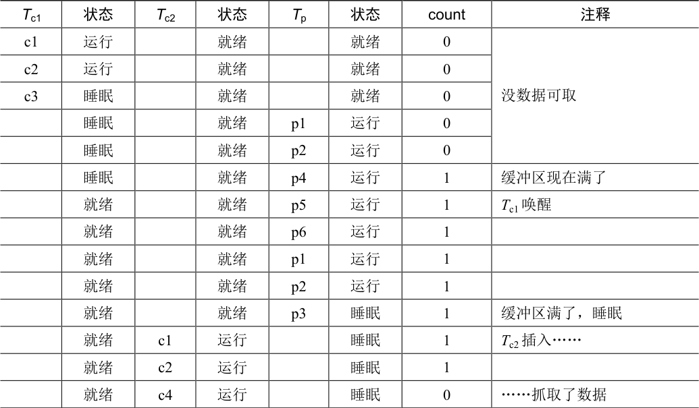
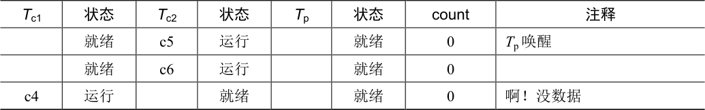
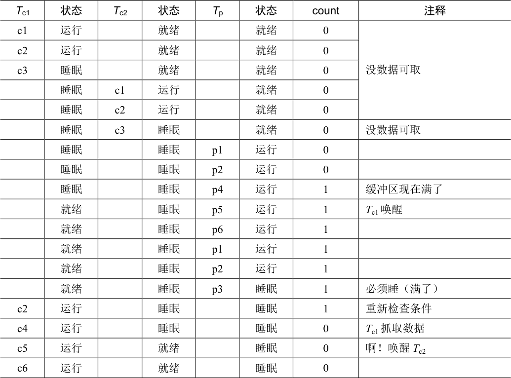
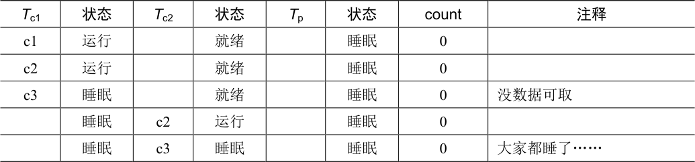

# 30.2 生产者/消费者（有界缓冲区）问题

本章要面对的下一个问题，是生产者/消费者（producer/consumer）问题，也叫作有界缓冲区（bounded buffer）问题。这一问题最早由Dijkstra 提出[D72]。实际上也正是通过研究这一问题，Dijkstra 和他的同事发明了通用的信号量（它可用作锁或条件变量）[D01]。

假设有一个或多个生产者线程和一个或多个消费者线程。生产者把生成的数据项放入缓冲区；消费者从缓冲区取走数据项，以某种方式消费。

很多实际的系统中都会有这种场景。例如，在多线程的网络服务器中，一个生产者将HTTP 请求放入工作队列（即有界缓冲区），消费线程从队列中取走请求并处理。

我们在使用管道连接不同程序的输出和输入时，也会使用有界缓冲区，例如grep foo file.txt | wc -l。这个例子并发执行了两个进程，grep 进程从file.txt 中查找包括“foo”的行，写到标准输出；UNIX shell 把输出重定向到管道（通过pipe 系统调用创建）。管道的另一端是wc 进程的标准输入，wc 统计完行数后打印出结果。因此，grep 进程是生产者，wc 是进程是消费者，它们之间是内核中的有界缓冲区，而你在这个例子里只是一个开心的用户。

因为有界缓冲区是共享资源，所以我们必须通过同步机制来访问它，以免[^p271-1]产生竞态条件。为了更好地理解这个问题，我们来看一些实际的代码。

首先需要一个共享缓冲区，让生产者放入数据，消费者取出数据。简单起见，我们就拿一个整数来做缓冲区（你当然可以想到用一个指向数据结构的指针来代替），两个内部函数将值放入缓冲区，从缓冲区取值。图30.4 为相关代码。

```c
int buffer;
int count = 0; // initially, empty

void put(int value) {
    assert(count == 0);
    count = 1;
    buffer = value;
}

int get() {
    assert(count == 1);
    count = 0;
    return buffer;
}
```

*图30.4 put 和get 函数（第1 版）*

很简单，不是吗？put()函数会假设缓冲区是空的，把一个值存在缓冲区，然后把count设置为1 表示缓冲区满了。get()函数刚好相反，把缓冲区清空后（即将count 设置为0），并返回该值。不用担心这个共享缓冲区只能存储一条数据，稍后我们会一般化，用队列保存更多数据项，这会比听起来更有趣。

现在我们需要编写一些函数，知道何时可以访问缓冲区，以便将数据放入缓冲区或从缓冲区取出数据。条件是显而易见的：仅在count 为0 时（即缓冲器为空时），才将数据放入缓冲器中。仅在计数为1 时（即缓冲器已满时），才从缓冲器获得数据。如果我们编写同步代码，让生产者将数据放入已满的缓冲区，或消费者从空的数据获取数据，就做错了（在这段代码中，断言将触发）。

这项工作将由两种类型的线程完成，其中一类我们称之为生产者（producer）线程，另一类我们称之为消费者（consumer）线程。图30.5 展示了一个生产者的代码，它将一个整数放入共享缓冲区loops 次，以及一个消费者，它从该共享缓冲区中获取数据（永远不停），每次打印出从共享缓冲区中提取的数据项。

```c
void *producer(void *arg) {
    int i;
    int loops = (int) arg;
    for (i = 0; i < loops; i++) {
        put(i);
    }
}

void *consumer(void *arg) {
    int i;
    while (1) {
        int tmp = get();
        printf("%d\n", tmp);
    }
}
```

*图30.5 生产者/消费者线程（第1 版）*

## 有问题的方案

假设只有一个生产者和一个消费者。显然，put()和get()函数之中会有临界区，因为put()更新缓冲区，get()读取缓冲区。但是，给代码加锁没有用，我们还需别的东西。不奇怪，别的东西就是某些条件变量。在这个（有问题的）首次尝试中（见图30.6），我们用了条件变量cond 和相关的锁mutex。

```c
cond_t cond;
mutex_t mutex;

void *producer(void *arg) {
    int i;
    for (i = 0; i < loops; i++) {
        Pthread_mutex_lock(&mutex);           // p1
        if (count == 1)                       // p2
            Pthread_cond_wait(&cond, &mutex); // p3
        put(i);                               // p4
        Pthread_cond_signal(&cond);           // p5
        Pthread_mutex_unlock(&mutex);         // p6
    }
}

void *consumer(void *arg) {
    int i;
    for (i = 0; i < loops; i++) {
        Pthread_mutex_lock(&mutex);           // c1
        if (count == 0)                       // c2
            Pthread_cond_wait(&cond, &mutex); // c3
        int tmp = get();                      // c4
        Pthread_cond_signal(&cond);           // c5
        Pthread_mutex_unlock(&mutex);         // c6
        printf("%d\n", tmp);
    }
}
```

*图30.6 生产者/消费者：一个条件变量和if 语句*

来看看生产者和消费者之间的信号逻辑。当生产者想要填充缓冲区时，它等待缓冲区变空（p1～p3）。消费者具有完全相同的逻辑，但等待不同的条件——变满（c1～c3）。

当只有一个生产者和一个消费者时，图30.6 中的代码能够正常运行。但如果有超过一个线程（例如两个消费者），这个方案会有两个严重的问题。哪两个问题？

……（暂停思考一下）……

我们来理解第一个问题，它与等待之前的if 语句有关。假设有两个消费者（Tc1 和Tc2），一个生产者（T<sub>p</sub>）。首先，一个消费者（T<sub>c1</sub>）先开始执行，它获得锁（c1），检查缓冲区是否可以消费（c2），然后等待（c3）（这会释放锁）。

接着生产者（T<sub>p</sub>）运行。它获取锁（p1），检查缓冲区是否满（p2），发现没满就给缓冲区加入一个数字（p4）。然后生产者发出信号，说缓冲区已满（p5）。关键的是，这让第一个消费者（Tc1）不再睡在条件变量上，进入就绪队列。Tc1 现在可以运行（但还未运行）。生产者继续执行，直到发现缓冲区满后睡眠（p6,p1-p3）。

这时问题发生了：另一个消费者（T<sub>c2</sub>）抢先执行，消费了缓冲区中的值（c1,c2,c4,c5,c6，跳过了c3 的等待，因为缓冲区是满的）。现在假设Tc1 运行，在从wait 返回之前，它获取了锁，然后返回。然后它调用了get() (p4)，但缓冲区已无法消费！断言触发，代码不能像预期那样工作。显然，我们应该设法阻止Tc1 去消费，因为Tc2 插进来，消费了缓冲区中之前生产的一个值。表30.1 展示了每个线程的动作，以及它的调度程序状态（就绪、运行、睡眠）随时间的变化。



<details markdown="1">
<summary>表格文字</summary>

| Tc1 | 状态 | Tc2 | 状态 | Tp | 状态 | count | 注释 |
| --- | --- | --- | --- | --- | --- | --- | --- |
| c1 | 运行 |  | 就绪 |  | 就绪 | 0 | 没数据可取 |
| c2 | 运行 |  | 就绪 |  | 就绪 | 0 |  |
| c3 | 睡眠 |  | 就绪 |  | 就绪 | 0 |  |
|  | 睡眠 |  | 就绪 | p1 | 运行 | 0 |  |
|  | 睡眠 |  | 就绪 | p2 | 运行 | 0 |  |
|  | 睡眠 |  | 就绪 | p4 | 运行 | 1 | 缓冲区现在满了 |
|  | 就绪 |  | 就绪 | p5 | 运行 | 1 | Tc1 唤醒 |
|  | 就绪 |  | 就绪 | p6 | 运行 | 1 |  |
|  | 就绪 |  | 就绪 | p1 | 运行 | 1 |  |
|  | 就绪 |  | 就绪 | p2 | 运行 | 1 |  |
|  | 就绪 |  | 就绪 | p3 | 睡眠 | 1 | 缓冲区满了，睡眠 |
|  | 就绪 | c1 | 运行 |  | 睡眠 | 1 | Tc2 插入…… |
|  | 就绪 | c2 | 运行 |  | 睡眠 | 1 |  |
|  | 就绪 | c4 | 运行 |  | 睡眠 | 0 | ……抓取了数据 |

</details>

续表



<details markdown="1">
<summary>表格文字</summary>

| Tc1 | 状态 | Tc2 | 状态 | Tp | 状态 | count | 注释 |
| --- | --- | --- | --- | --- | --- | --- | --- |
|  | 就绪 | c5 | 运行 |  | 就绪 | 0 | Tp 唤醒 |
|  | 就绪 | c6 | 运行 |  | 就绪 | 0 |  |
| c4 | 运行 |  | 就绪 |  | 就绪 | 0 | 啊！没数据 |

</details>

问题产生的原因很简单：在Tc1 被生产者唤醒后，但在它运行之前，缓冲区的状态改变了（由于T<sub>c2</sub>）。发信号给线程只是唤醒它们，暗示状态发生了变化（在这个例子中，就是值已被放入缓冲区），但并不会保证在它运行之前状态一直是期望的情况。信号的这种释义常称为Mesa 语义（Mesa semantic），为了纪念以这种方式建立条件变量的首次研究[LR80]。另一种释义是Hoare 语义（Hoare semantic），虽然实现难度大，但是会保证被唤醒线程立刻执行[H74]。实际上，几乎所有系统都采用了Mesa 语义。

## 较好但仍有问题的方案：使用While 语句替代If

幸运的是，修复这个问题很简单（见图30.7）：把if 语句改为while。当消费者Tc1 被唤醒后，立刻再次检查共享变量（c2）。如果缓冲区此时为空，消费者就会回去继续睡眠（c3）。生产者中相应的if 也改为while（p2）。

```c
cond_t cond;
mutex_t mutex;

void *producer(void *arg) {
    int i;
    for (i = 0; i < loops; i++) {
        Pthread_mutex_lock(&mutex);                // p1
        while (count == 1)                         // p2
            Pthread_cond_wait(&cond, &mutex);      // p3
        put(i);                                    // p4
        Pthread_cond_signal(&cond);                // p5
        Pthread_mutex_unlock(&mutex);              // p6
    }
}

void *consumer(void *arg) {
    int i;
    for (i = 0; i < loops; i++) {
        Pthread_mutex_lock(&mutex);                // c1
        while (count == 0)                         // c2
            Pthread_cond_wait(&cond, &mutex);       // c3
        int tmp = get();                           // c4
        Pthread_cond_signal(&cond);                // c5
        Pthread_mutex_unlock(&mutex);              // c6
        printf("%d\n", tmp);
    }
}
```

*图30.7 生产者/消费者：一个条件变量和while 语句*

由于Mesa 语义，我们要记住一条关于条件变量的简单规则：总是使用while 循环（always use while loop）。虽然有时候不需要重新检查条件，但这样做总是安全的，做了就开心了。

但是，这段代码仍然有一个问题，也是上文提到的两个问题之一。你能想到吗？它和我们只用了一个条件变量有关。尝试弄清楚这个问题是什么，再继续阅读。想一下！

……（暂停想一想，或者闭一下眼）……

我们来确认一下你想得对不对。假设两个消费者（Tc1 和Tc2）先运行，都睡眠了（c3）。生产者开始运行，在缓冲区放入一个值，唤醒了一个消费者（假定是T<sub>c1</sub>），并开始睡眠。现在是一个消费者马上要运行（Tc1），两个线程（Tc2 和Tp）都等待在同一个条件变量上。问题马上就要出现了：让人感到兴奋！

消费者Tc1 醒过来并从wait()调用返回（c3），重新检查条件（c2），发现缓冲区是满的，消费了这个值（c4）。这个消费者然后在该条件上发信号（c5），唤醒一个在睡眠的线程。但是，应该唤醒哪个线程呢？

因为消费者已经清空了缓冲区，很显然，应该唤醒生产者。但是，如果它唤醒了T<sub>c2</sub>（这绝对是可能的，取决于等待队列是如何管理的），问题就出现了。具体来说，消费者Tc2 会醒过来，发现队列为空（c2），又继续回去睡眠（c3）。生产者Tp 刚才在缓冲区中放了一个值，现在在睡眠。另一个消费者线程Tc1 也回去睡眠了。3 个线程都在睡眠，显然是一个缺陷。由表30.2 可以看到这个可怕灾难的步骤。



<details markdown="1">
<summary>表格文字</summary>

| Tc1 | 状态 | Tc2 | 状态 | Tp | 状态 | count | 注释 |
| --- | --- | --- | --- | --- | --- | --- | --- |
| c1 | 运行 |  | 就绪 |  | 就绪 | 0 | 没数据可取 |
| c2 | 运行 |  | 就绪 |  | 就绪 | 0 |  |
| c3 | 睡眠 |  | 就绪 |  | 就绪 | 0 |  |
|  | 睡眠 | c1 | 运行 |  | 就绪 | 0 |  |
|  | 睡眠 | c2 | 运行 |  | 就绪 | 0 |  |
|  | 睡眠 | c3 | 睡眠 |  | 就绪 | 0 | 没数据可取 |
|  | 睡眠 |  | 睡眠 | p1 | 运行 | 0 |  |
|  | 睡眠 |  | 睡眠 | p2 | 运行 | 0 |  |
|  | 睡眠 |  | 睡眠 | p4 | 运行 | 1 | 缓冲区现在满了 |
|  | 就绪 |  | 睡眠 | p5 | 运行 | 1 | Tc1 唤醒 |
|  | 就绪 |  | 睡眠 | p6 | 运行 | 1 |  |
|  | 就绪 |  | 睡眠 | p1 | 运行 | 1 |  |
|  | 就绪 |  | 睡眠 | p2 | 运行 | 1 |  |
|  | 就绪 |  | 睡眠 | p3 | 睡眠 | 1 | 必须睡（满了） |
| c2 | 运行 |  | 睡眠 |  | 睡眠 | 1 | 重新检查条件 |
| c4 | 运行 |  | 睡眠 |  | 睡眠 | 0 | Tc1 抓取数据 |
| c5 | 运行 |  | 就绪 |  | 睡眠 | 0 | 啊！唤醒Tc2 |
| c6 | 运行 |  | 就绪 |  | 睡眠 | 0 |  |

</details>

续表



<details markdown="1">
<summary>表格文字</summary>

| Tc1 | 状态 | Tc2 | 状态 | Tp | 状态 | count | 注释 |
| --- | --- | --- | --- | --- | --- | --- | --- |
| c1 | 运行 |  | 就绪 |  | 睡眠 | 0 |  |
| c2 | 运行 |  | 就绪 |  | 睡眠 | 0 |  |
| c3 | 睡眠 |  | 就绪 |  | 睡眠 | 0 | 没数据可取 |
|  | 睡眠 | c2 | 运行 |  | 睡眠 | 0 |  |
|  | 睡眠 | c3 | 睡眠 |  | 睡眠 | 0 | 大家都睡了…… |

</details>

信号显然需要，但必须更有指向性。消费者不应该唤醒消费者，而应该只唤醒生产者，反之亦然。

## 单值缓冲区的生产者/消费者方案

解决方案也很简单：使用两个条件变量，而不是一个，以便正确地发出信号，在系统状态改变时，哪类线程应该唤醒。图30.8 展示了最终的代码。

```c
cond_t empty, fill;
mutex_t mutex;

void *producer(void *arg) {
    int i;
    for (i = 0; i < loops; i++) {
        Pthread_mutex_lock(&mutex);
        while (count == 1)
            Pthread_cond_wait(&empty,  &mutex);
        put(i);
        Pthread_cond_signal(&fill);
        Pthread_mutex_unlock(&mutex);
    }
}

void *consumer(void *arg) {
    int i;
    for (i = 0; i < loops; i++) {
        Pthread_mutex_lock(&mutex);
        while (count == 0)
            Pthread_cond_wait(&fill, &mutex);
        int tmp = get();
        Pthread_cond_signal(&empty);
        Pthread_mutex_unlock(&mutex);
        printf("%d\n", tmp);
    }
}
```

*图30.8 生产者/消费者：两个条件变量和while 语句*

在上述代码中，生产者线程等待条件变量empty，发信号给变量fill。相应地，消费者线程等待fill，发信号给empty。这样做，从设计上避免了上述第二个问题：消费者再也不会唤醒消费者，生产者也不会唤醒生产者。

## 最终的生产者/消费者方案

我们现在有了可用的生产者/消费者方案，但不太通用。我们最后的修改是提高并发和效率。具体来说，增加更多缓冲区槽位，这样在睡眠之前，可以生产多个值。同样，睡眠之前可以消费多个值。单个生产者和消费者时，这种方案因为上下文切换少，提高了效率。多个生产者和消费者时，它甚至支持并发生产和消费，从而提高了并发。幸运的是，和现有方案相比，改动也很小。

第一处修改是缓冲区结构本身，以及对应的put()和get()方法（见图30.9）。我们还稍稍修改了生产者和消费者的检查条件，以便决定是否要睡眠。图30.10 展示了最终的等待和信号逻辑。生产者只有在缓冲区满了的时候才会睡眠（p2），消费者也只有在队列为空的时候睡眠（c2）。至此，我们解决了生产者/消费者问题。

```c
int buffer[MAX];
int fill = 0;
int use   = 0;
int count = 0;

void put(int value) {
    buffer[fill] = value;
    fill = (fill + 1) % MAX;
    count++;
}

int get() {
    int tmp = buffer[use];
    use = (use + 1) % MAX;
    count--;
    return tmp;
}
```

*图30.9 最终的put()和get()方法*

```c
cond_t empty, fill;
mutex_t mutex;

void *producer(void *arg) {
    int i;
    for (i = 0; i < loops; i++) {
        Pthread_mutex_lock(&mutex);                // p1
        while (count == MAX)                       // p2
            Pthread_cond_wait(&empty, &mutex);     // p3
        put(i);                                    // p4
        Pthread_cond_signal(&fill);                // p5
        Pthread_mutex_unlock(&mutex);              // p6
    }
}

void *consumer(void *arg) {
    int i;
    for (i = 0; i < loops; i++) {
        Pthread_mutex_lock(&mutex);                // c1
        while (count == 0)                         // c2
            Pthread_cond_wait(&fill, &mutex);     // c3
        int tmp = get();                           // c4
        Pthread_cond_signal(&empty);               // c5
        Pthread_mutex_unlock(&mutex);              // c6
        printf("%d\n", tmp);
    }
}
```

*图30.10 最终有效方案*

> **提示：对条件变量使用while（不是if）**

> 多线程程序在检查条件变量时，使用while 循环总是对的。if 语句可能会对，这取决于发信号的语义。因此，总是使用while，代码就会符合预期。

> 对条件变量使用while 循环，这也解决了假唤醒（spurious wakeup）的情况。某些线程库中，由于实现的细节，有可能出现一个信号唤醒两个线程的情况[L11]。再次检查线程的等待条件，假唤醒是另一个原因。

[^p271-1]: 这里我们用了某种严肃的古英语和虚拟语气形式。
