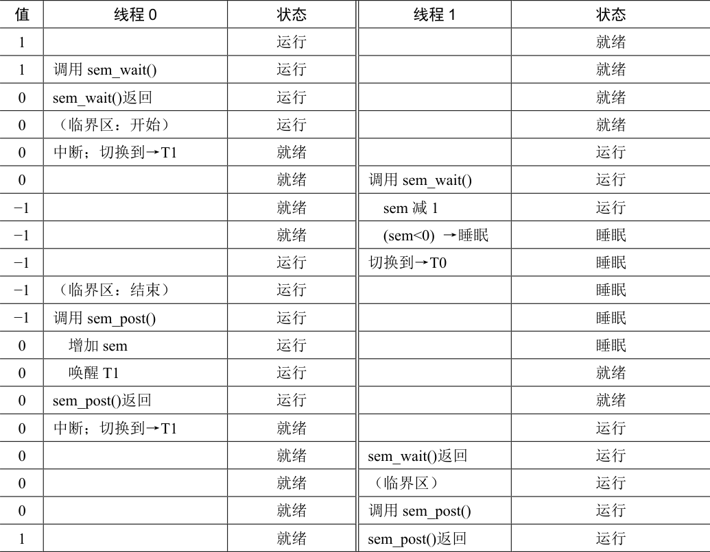

# 31.2 二值信号量（锁）

现在我们要使用信号量了。信号量的第一种用法是我们已经熟悉的：用信号量作为锁。在图31.3 所示的代码片段里，我们直接把临界区用一对sem\_wait()/sem\_post()环绕。但是，为了使这段代码正常工作，信号量m 的初始值（图中初始化为X）是至关重要的。X 应该是多少呢？

```c
sem_t m;
sem_init(&m, 0, X); // initialize semaphore to X; what should X be?

sem_wait(&m);
// critical section here
sem_post(&m);
```

*图31.3 二值信号量（就是锁）*

……（读者先思考一下再继续学习）……

回顾sem\_wait()和sem\_post()函数的定义，我们发现初值应该是1。

为了说明清楚，我们假设有两个线程的场景。第一个线程（线程0）调用了sem\_wait()，它把信号量的值减为0。然后，它只会在值小于0 时等待。因为值是0，调用线程从函数返回并继续，线程0 现在可以自由进入临界区。线程0 在临界区中，如果没有其他线程尝试获取锁，当它调用sem\_post()时，会将信号量重置为1（因为没有等待线程，不会唤醒其他线程）。表31.1 追踪了这一场景。


<details markdown="1">
<summary>表格文字</summary>

| 信号量的值 | 线程0 | 线程1 |
| --- | --- | --- |
| 1 |  |  |
| 1 | 调用sem\_wait() |  |
| 0 | sem\_wait()返回 |  |
| 0 | （临界区） |  |
| 0 | 调用sem\_post() |  |
| 1 | sem\_post()返回 |  |

</details>

如果线程0 持有锁（即调用了sem\_wait()之后，调用sem\_post()之前），另一个线程（线程1）调用sem\_wait()尝试进入临界区，那么更有趣的情况就发生了。这种情况下，线程1把信号量减为−1，然后等待（自己睡眠，放弃处理器）。线程0 再次运行，它最终调用sem\_post()，将信号量的值增加到0，唤醒等待的线程（线程1），然后线程1 就可以获取锁。线程1 执行结束时，再次增加信号量的值，将它恢复为1。

表 31.2 追踪了这个例子。除了线程的动作，表中还显示了每一个线程的调度程序状态（scheduler state）：运行、就绪（即可运行但没有运行）和睡眠。特别要注意，当线程1 尝试获取已经被持有的锁时，陷入睡眠。只有线程0 再次运行之后，线程1 才可能会唤醒并继续运行。



<details markdown="1">
<summary>表格文字</summary>

| 值 | 线程0 | 状态 | 线程1 | 状态 |
| --- | --- | --- | --- | --- |
| 1 |  | 运行 |  | 就绪 |
| 1 | 调用sem\_wait() | 运行 |  | 就绪 |
| 0 | sem\_wait()返回 | 运行 |  | 就绪 |
| 0 | （临界区：开始） | 运行 |  | 就绪 |
| 0 | 中断；切换到→T1 | 就绪 |  | 运行 |
| 0 |  | 就绪 | 调用sem\_wait() | 运行 |
| −1 |  | 就绪 | sem 减1 | 运行 |
| −1 |  | 就绪 | (sem&lt;0) →睡眠 | 睡眠 |
| −1 |  | 运行 | 切换到→T0 | 睡眠 |
| −1 | （临界区：结束） | 运行 |  | 睡眠 |
| −1 | 调用sem\_post() | 运行 |  | 睡眠 |
| 0 | 增加sem | 运行 |  | 睡眠 |
| 0 | 唤醒T1 | 运行 |  | 就绪 |
| 0 | sem\_post()返回 | 运行 |  | 就绪 |
| 0 | 中断；切换到→T1 | 就绪 |  | 运行 |
| 0 |  | 就绪 | sem\_wait()返回 | 运行 |
| 0 |  | 就绪 | （临界区） | 运行 |
| 0 |  | 就绪 | 调用sem\_post() | 运行 |
| 1 |  | 就绪 | sem\_post()返回 | 运行 |

</details>

如果你想追踪自己的例子，那么请尝试一个场景，多个线程排队等待锁。在这样的追踪中，信号量的值会是什么？

我们可以用信号量来实现锁了。因为锁只有两个状态（持有和没持有），所以这种用法有时也叫作二值信号量（binary semaphore）。事实上这种信号量也有一些更简单的实现，我们这里使用了更为通用的信号量作为锁。
