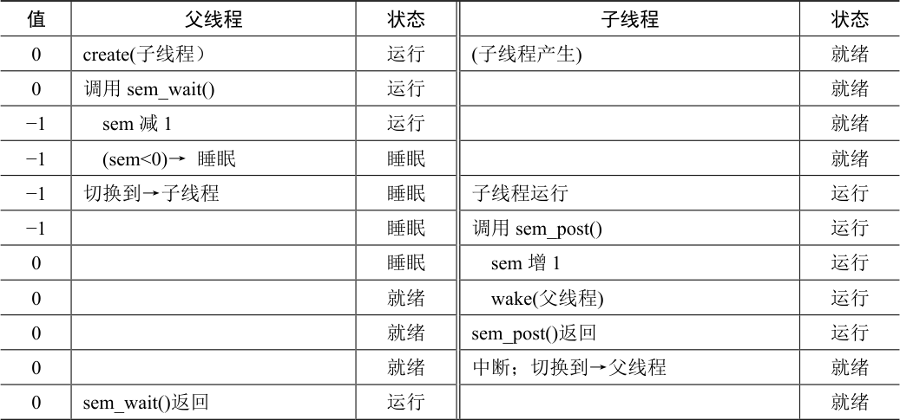
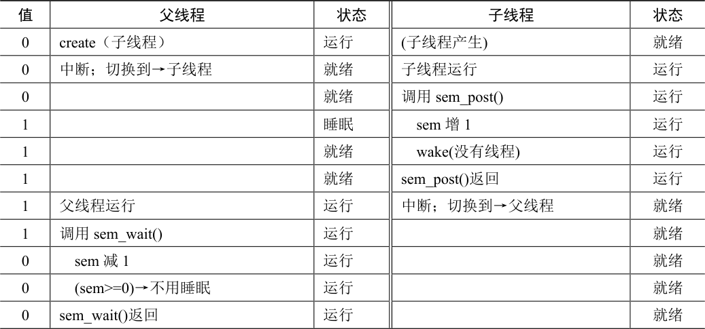

# 31.3 信号量用作条件变量

信号量也可以用在一个线程暂停执行，等待某一条件成立的场景。例如，一个线程要等待一个链表非空，然后才能删除一个元素。在这种场景下，通常一个线程等待条件成立，另外一个线程修改条件并发信号给等待线程，从而唤醒等待线程。因为等待线程在等待某些条件（condition）发生变化，所以我们将信号量作为条件变量（condition variable）。

下面是一个简单例子。假设一个线程创建另外一线程，并且等待它结束（见图31.4）。

```c
sem_t s;

void *
child(void *arg) {
    printf("child\n");
    sem_post(&s); // signal here: child is done
    return NULL;
}

int
main(int argc, char *argv[]) {
    sem_init(&s, 0, X); // what should X be?
    printf("parent: begin\n");
    pthread_t c;
    Pthread_create(c, NULL, child, NULL);
    sem_wait(&s); // wait here for child
    printf("parent: end\n");
    return 0;
}
```

*图31.4 父线程等待子线程*

该程序运行时，我们希望能看到这样的输出：

```text
parent: begin
child
parent: end
```

然后问题就是如何用信号量来实现这种效果。结果表明，答案也很容易理解。从代码中可知，父线程调用sem\_wait()，子线程调用sem\_post()，父线程等待子线程执行完成。但是，问题来了：信号量的初始值应该是多少？（再想一下，然后继续阅读）

当然，答案是信号量初始值应该是0。有两种情况需要考虑。第一种，父线程创建了子线程，但是子线程并没有运行。这种情况下（见表31.3），父线程调用sem\_wait()会先于子线程调用sem\_post()。我们希望父线程等待子线程运行。为此，唯一的办法是让信号量的值不大于0。因此，0 为初值。父线程运行，将信号量减为−1，然后睡眠等待；子线程运行的时候，调用sem\_post()，信号量增加为0，唤醒父线程，父线程然后从sem\_wait()返回，完成该程序。



<details markdown="1">
<summary>表格文字</summary>

| 值 | 父线程 | 状态 | 子线程 | 状态 |
| --- | --- | --- | --- | --- |
| 0 | create(子线程） | 运行 | (子线程产生) | 就绪 |
| 0 | 调用sem\_wait() | 运行 |  | 就绪 |
| −1 | sem 减1 | 运行 |  | 就绪 |
| −1 | (sem&lt;0)→睡眠 | 睡眠 |  | 就绪 |
| −1 | 切换到→子线程 | 睡眠 | 子线程运行 | 运行 |
| −1 |  | 睡眠 | 调用sem\_post() | 运行 |
| 0 |  | 睡眠 | sem 增1 | 运行 |
| 0 |  | 就绪 | wake(父线程) | 运行 |
| 0 |  | 就绪 | sem\_post()返回 | 运行 |
| 0 |  | 就绪 | 中断；切换到→父线程 | 就绪 |
| 0 | sem\_wait()返回 | 运行 |  | 就绪 |

</details>

第二种情况是子线程在父线程调用sem\_wait()之前就运行结束（见表31.4）。在这种情况下，子线程会先调用sem\_post()，将信号量从0 增加到1。然后当父线程有机会运行时，会调用sem\_wait()，发现信号量的值为1。于是父线程将信号量从1 减为0，没有等待，直接从sem\_wait()返回，也达到了预期效果。



<details markdown="1">
<summary>表格文字</summary>

| 值 | 父线程 | 状态 | 子线程 | 状态 |
| --- | --- | --- | --- | --- |
| 0 | create（子线程） | 运行 | (子线程产生) | 就绪 |
| 0 | 中断；切换到→子线程 | 就绪 | 子线程运行 | 运行 |
| 0 |  | 就绪 | 调用sem\_post() | 运行 |
| 1 |  | 睡眠 | sem 增1 | 运行 |
| 1 |  | 就绪 | wake(没有线程) | 运行 |
| 1 |  | 就绪 | sem\_post()返回 | 运行 |
| 1 | 父线程运行 | 运行 | 中断；切换到→父线程 | 就绪 |
| 1 | 调用sem\_wait() | 运行 |  | 就绪 |
| 0 | sem 减1 | 运行 |  | 就绪 |
| 0 | (sem&gt;=0)→不用睡眠 | 运行 |  | 就绪 |
| 0 | sem\_wait()返回 | 运行 |  | 就绪 |

</details>
