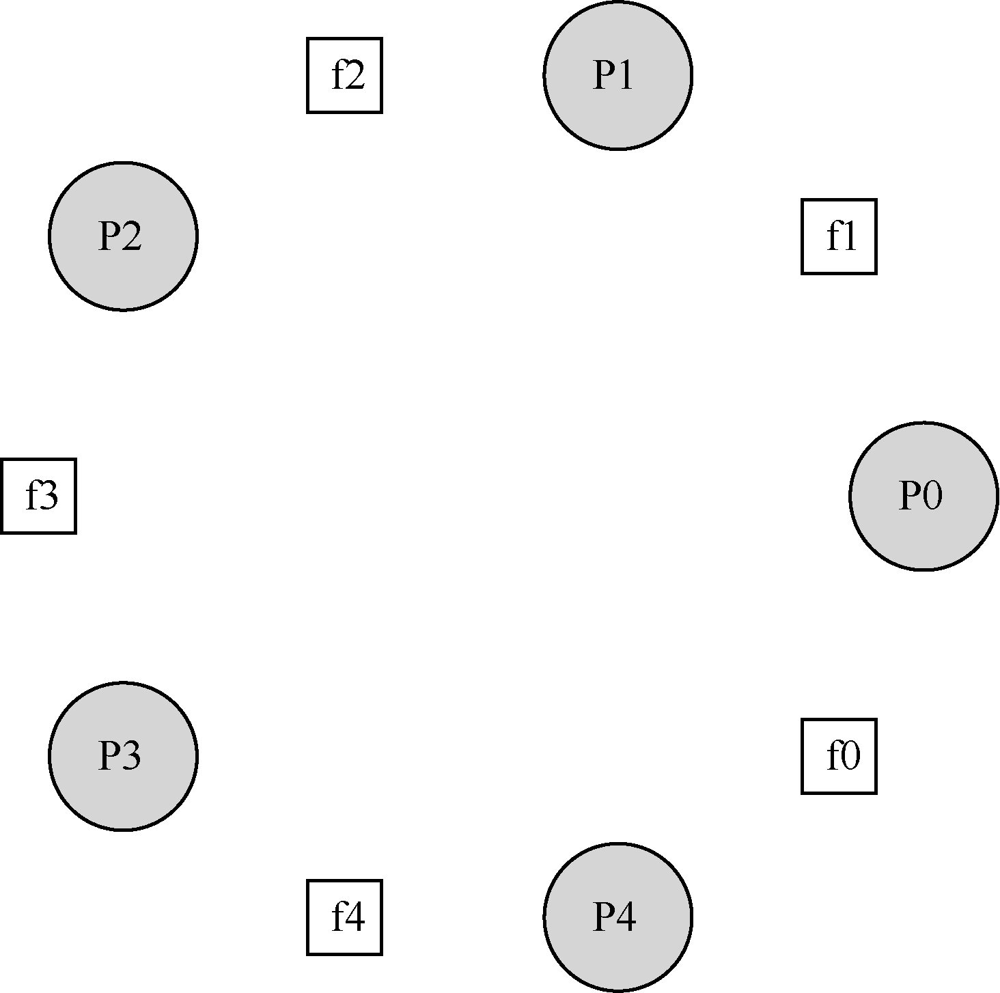

# 31.6 哲学家就餐问题

哲学家就餐问题（dining philosopher’s problem）是一个著名的并发问题，它由Dijkstra提出来并解决[DHO71]。这个问题之所以出名，



是因为它很有趣，引人入胜，但其实用性却不强。可是，它的名气让我们在这里必须讲。实际上，你可能会在面试中遇到这一问题，假如老师没有提过，导致你们没有通过面试，你们会责怪操作系统老师的。因此，我们这里会讨论这一问题。假如你们因为这个问题得到工作，可以向操作系统老师发感谢信，或者发一些股票期权。

这个问题的基本情况是（见图31.10）：假定有5 位“哲学家”围着一个圆桌。每两位哲学家之间有一把餐叉（一共5 把）。哲学家有时要思考一会，不需要餐叉；有时又要就餐。而一位哲学家只有同时拿到了左手边和右手边的两把餐叉，才能吃到东西。关于餐叉的竞争以及随之而来的同步问题，就是我们在并发编程中研究它的原因。

下面是每个哲学家的基本循环：

```text
while (1) {
  think();
  getforks();
  eat();
  putforks();
}
```

关键的挑战就是如何实现getforks()和putforks()函数，保证没有死锁，没有哲学家饿死，并且并发度更高（尽可能让更多哲学家同时吃东西）。

根据Downey 的解决方案[D08]，我们会用一些辅助函数，帮助构建解决方案。它们是：

```c
int left(int p) { return p; }
int right(int p) { return (p + 1) % 5; }
```

如果哲学家p 希望用左手边的叉子，他们就调用left(p)。类似地，右手边的叉子就用right(p)。模运算解决了最后一个哲学家（p = 4）右手边叉子的编号问题，就是餐叉0。

我们需要一些信号量来解决这个问题。假设需要5 个，每个餐叉一个：sem\_t forks[5]。

## 有问题的解决方案

我们开始第一次尝试。假设我们把每个信号量（在fork 数组中）都用1 初始化。同时假设每个哲学家知道自己的编号（p）。我们可以写出getforks()和putforks()函数，如图31.11所示。

```c
void getforks() {
  sem_wait(forks[left(p)]);
  sem_wait(forks[right(p)]);
}

void putforks() {
  sem_post(forks[left(p)]);
  sem_post(forks[right(p)]);

```

*图31.11 getforks()和putforks()函数*

这个（有问题的）解决方案背后的思路如下。为了拿到餐叉，我们依次获取每把餐叉的锁——先是左手边的，然后是右手边的。结束就餐时，释放掉锁。很简单，不是吗？但是，在这个例子中，简单是有问题的。你能看到问题吗？想一想。

问题是死锁（deadlock）。假设每个哲学家都拿到了左手边的餐叉，他们每个都会阻塞住，并且一直等待另一个餐叉。具体来说，哲学家0 拿到了餐叉0，哲学家1 拿到了餐叉1，哲学家2 拿到餐叉2，哲学家3 拿到餐叉3，哲学家4 拿到餐叉4。所有的餐叉都被占有了，所有的哲学家都阻塞着，并且等待另一个哲学家占有的餐叉。我们在后续章节会深入学习死锁，这里只要知道这个方案行不通就可以了。

## 一种方案：破除依赖

解决上述问题最简单的方法，就是修改某个或者某些哲学家的取餐叉顺序。事实上，Dijkstra 自己也是这样解决的。具体来说，假定哲学家4（编写最大的一个）取餐叉的顺序不同。相应的代码如下：

```c
void getforks() {
  if (p == 4) {
    sem_wait(forks[right(p)]);
    sem_wait(forks[left(p)]);
  } else {
    sem_wait(forks[left(p)]);
    sem_wait(forks[right(p)]);
  }
}
```

因为最后一个哲学家会尝试先拿右手边的餐叉，然后拿左手边，所以不会出现每个哲学家都拿着一个餐叉，卡住等待另一个的情况，等待循环被打破了。想想这个方案的后果，让你自己相信它有效。

还有其他一些类似的“著名”问题，比如吸烟者问题（cigarette smoker’s problem），理发师问题（sleeping barber problem）。大多数问题只是让我们去理解并发，某些问题的名字很吸引人。感兴趣的读者可以去查阅相关资料，或者通过一些更实际的思考去理解并发行为[D08]。
