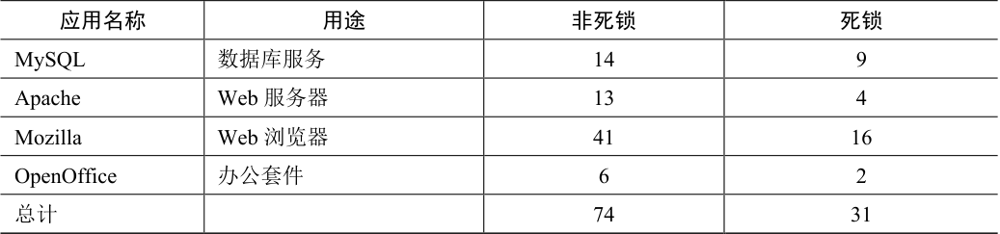

# 32.1 有哪些类型的缺陷

第一个最明显的问题就是：在复杂并发程序中，有哪些类型的缺陷呢？一般来说，这个问题很难回答，好在其他人已经做过相关的工作。具体来说，Lu 等人[L+08]详细分析了一些流行的并发应用，以理解实践中有哪些类型的缺陷。

研究集中在4 个重要的开源应用：MySQL（流行的数据库管理系统）、Apache（著名的Web 服务器）、Mozilla（著名的Web 浏览器）和OpenOffice（微软办公套件的开源版本）。研究人员通过检查这几个代码库已修复的并发缺陷，将开发者的工作变成量化的缺陷分析。理解这些结果，有助于我们了解在成熟的代码库中，实际出现过哪些类型的并发问题。

表32.1 是Lu 及其同事的研究结论。可以看出，共有105 个缺陷，其中大多数是非死锁相关的（74 个），剩余31 个是死锁缺陷。另外，可以看出每个应用的缺陷数目，OpenOffice只有8 个，而Mozilla 有接近60 个。

表格文字

| 应用名称 | 用途 | 非死锁 | 死锁 |
| --- | --- | --- | --- |
| MySQL | 数据库服务 | 14 | 9 |
| Apache | Web 服务器 | 13 | 4 |
| Mozilla | Web 浏览器 | 41 | 16 |
| OpenOffice | 办公套件 | 6 | 2 |
| 总计 |  | 74 | 31 |

我们现在来深入分析这两种类型的缺陷。对于第一类非死锁的缺陷，我们通过该研究的例子来讨论。对于第二类死锁缺陷，我们讨论人们在阻止、避免和处理死锁上完成的大量工作。
