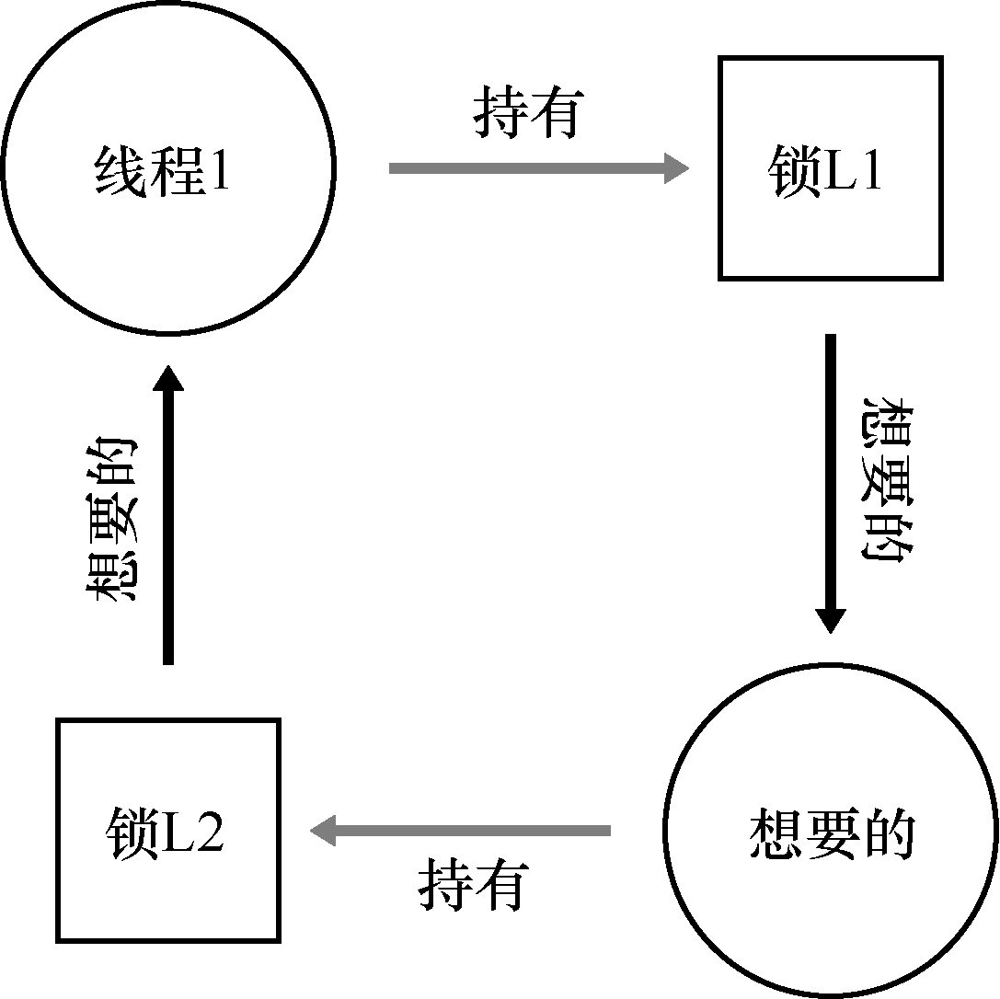
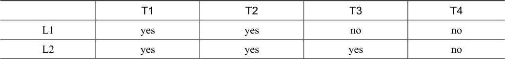
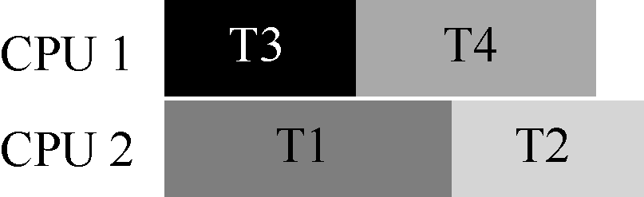
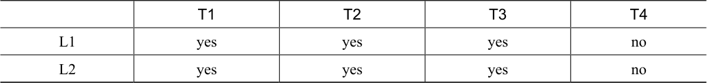
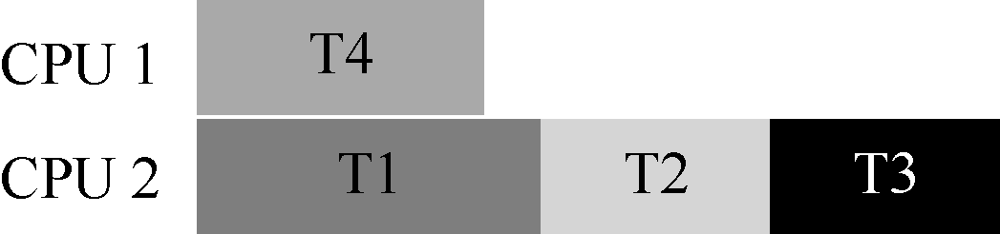

# 32.3 死锁缺陷

除了上面提到的并发缺陷，死锁（deadlock）是一种在许多复杂并发系统中出现的经典问题。例如，当线程1 持有锁L1，正在等待另外一个锁L2，而线程2 持有锁L2，却在等待锁L1 释放时，死锁就产生了。以下的代码片段就可能出现这种死锁：

```text
Thread 1:    Thread 2:
lock(L1);    lock(L2);
lock(L2);    lock(L1);
```

这段代码运行时，不是一定会出现死锁的。当线程1 占有锁L1，上下文切换到线程2。线程2 锁住L2，试图锁住L1。这时才产生了死锁，两个线程互相等待。如图32.1 所示，其中的圈（cycle）表明了死锁。



该图应该有助于描述清楚问题。程序员在编写代码中应该如何处理死锁呢？

> **关键问题：如何对付死锁**

> 我们在实现系统时，如何避免或者能够检测、恢复死锁呢？这是目前系统中的真实问题吗？

## 为什么发生死锁

你可能在想，上文提到的这个死锁的例子，很容易就可以避免。例如，只要线程1 和线程2 都用相同的抢锁顺序，死锁就不会发生。那么，死锁为什么还会发生？

其中一个原因是在大型的代码库里，组件之间会有复杂的依赖。以操作系统为例。虚拟内存系统在需要访问文件系统才能从磁盘读到内存页；文件系统随后又要和虚拟内存交互，去申请一页内存，以便存放读到的块。因此，在设计大型系统的锁机制时，你必须要仔细地去避免循环依赖导致的死锁。

另一个原因是封装（encapsulation）。软件开发者一直倾向于隐藏实现细节，以模块化的方式让软件开发更容易。然而，模块化和锁不是很契合。Jula 等人指出[J+08]，某些看起来没有关系的接口可能会导致死锁。以Java 的Vector 类和AddAll()方法为例，我们这样调用这个方法：

```text
Vector v1, v2;
v1.AddAll(v2);
```

在内部，这个方法需要多线程安全，因此针对被添加向量（v1）和参数（v2）的锁都需要获取。假设这个方法，先给v1 加锁，然后再给v2 加锁。如果另外某个线程几乎同时在调用v2.AddAll(v1)，就可能遇到死锁。

## 产生死锁的条件

死锁的产生需要如下4 个条件[C+71]。

互斥：线程对于需要的资源进行互斥的访问（例如一个线程抢到锁）。

持有并等待：线程持有了资源（例如已将持有的锁），同时又在等待其他资源（例

如，需要获得的锁）。

非抢占：线程获得的资源（例如锁），不能被抢占。

循环等待：线程之间存在一个环路，环路上每个线程都额外持有一个资源，而这

个资源又是下一个线程要申请的。

如果这4 个条件的任何一个没有满足，死锁就不会产生。因此，我们首先研究一下预防死锁的方法；每个策略都设法阻止某一个条件，从而解决死锁的问题。

## 预防

循环等待

也许最实用的预防技术（当然也是经常采用的），就是让代码不会产生循环等待。最直接的方法就是获取锁时提供一个全序（total ordering）。假如系统共有两个锁（L1 和L2），那么我们每次都先申请L1 然后申请L2，就可以避免死锁。这样严格的顺序避免了循环等待，也就不会产生死锁。

当然，更复杂的系统中不会只有两个锁，锁的全序可能很难做到。因此，偏序（partial ordering）可能是一种有用的方法，安排锁的获取并避免死锁。Linux 中的内存映射代码就是一个偏序锁的好例子[T+94]。代码开头的注释表明了10 组不同的加锁顺序，包括简单的关系，比如i\_mutex 早于i\_mmap\_mutex，也包括复杂的关系，比如i\_mmap\_mutex 早于private\_lock，早于swap\_lock，早于mapping-&gt;tree\_lock。

你可以想到，全序和偏序都需要细致的锁策略的设计和实现。另外，顺序只是一种约定，粗心的程序员很容易忽略，导致死锁。最后，有序加锁需要深入理解代码库，了解各种函数的调用关系，即使一个错误，也会导致“D”字[^p302-1]。

> **提示：通过锁的地址来强制锁的顺序**

> 当一个函数要抢多个锁时，我们需要注意死锁。比如有一个函数：do\_something(mutex t \*m1, mutex t \*m2)，如果函数总是先抢m1，然后m2，那么当一个线程调用do\_something(L1, L2)，而另一个线程调用do\_something(L2, L1)时，就可能会产生死锁。

> 为了避免这种特殊问题，聪明的程序员根据锁的地址作为获取锁的顺序。按照地址从高到低，或者从低到高的顺序加锁，do\_something()函数就可以保证不论传入参数是什么顺序，函数都会用固定的顺序加锁。具体的代码如下：

```c
if (m1 > m2) { // grab locks in high-to-low address order
  pthread_mutex_lock(m1);
  pthread_mutex_lock(m2);
} else {
  pthread_mutex_lock(m2);
  pthread_mutex_lock(m1);
}
// Code assumes that m1 != m2 (it is not the same lock)
```

> 在获取多个锁时，通过简单的技巧，就可以确保简单有效的无死锁实现。

持有并等待

死锁的持有并等待条件，可以通过原子地抢锁来避免。实践中，可以通过如下代码来实现：

```text
lock(prevention);
lock(L1);
lock(L2);
...
unlock(prevention);
```

先抢到prevention 这个锁之后，代码保证了在抢锁的过程中，不会有不合时宜的线程切换，从而避免了死锁。当然，这需要任何线程在任何时候抢占锁时，先抢到全局的prevention锁。例如，如果另一个线程用不同的顺序抢锁L1 和L2，也不会有问题，因为此时，线程已经抢到了prevention 锁。

注意，出于某些原因，这个方案也有问题。和之前一样，它不适用于封装：因为这个方案需要我们准确地知道要抢哪些锁，并且提前抢到这些锁。因为要提前抢到所有锁（同时），而不是在真正需要的时候，所以可能降低了并发。

非抢占

在调用unlock 之前，都认为锁是被占有的，多个抢锁操作通常会带来麻烦，因为我们等待一个锁时，同时持有另一个锁。很多线程库提供更为灵活的接口来避免这种情况。具体来说，trylock()函数会尝试获得锁，或者返回−1，表示锁已经被占有。你可以稍后重试一下。

可以用这一接口来实现无死锁的加锁方法：

```text
top:
  lock(L1);
  if (trylock(L2) == -1) {
    unlock(L1);
    goto top;
}
```

注意，另一个线程可以使用相同的加锁方式，但是不同的加锁顺序（L2 然后L1），程序仍然不会产生死锁。但是会引来一个新的问题：活锁（livelock）。两个线程有可能一直重复这一序列，又同时都抢锁失败。这种情况下，系统一直在运行这段代码（因此不是死锁），但是又不会有进展，因此名为活锁。也有活锁的解决方法：例如，可以在循环结束的时候，先随机等待一个时间，然后再重复整个动作，这样可以降低线程之间的重复互相干扰。

关于这个方案的最后一点：使用trylock 方法可能会有一些困难。第一个问题仍然是封装：如果其中的某一个锁，是封装在函数内部的，那么这个跳回开始处就很难实现。如果代码在中途获取了某些资源，必须要确保也能释放这些资源。例如，在抢到L1 后，我们的代码分配了一些内存，当抢L2 失败时，并且在返回开头之前，需要释放这些内存。当然，在某些场景下（例如，之前提到的Java 的vector 方法），这种方法很有效。

互斥

最后的预防方法是完全避免互斥。通常来说，代码都会存在临界区，因此很难避免互斥。那么我们应该怎么做呢？

Herlihy 提出了设计各种无等待（wait-free）数据结构的思想[H91]。想法很简单：通过强大的硬件指令，我们可以构造出不需要锁的数据结构。

举个简单的例子，假设我们有比较并交换（compare-and-swap）指令，是一种由硬件提供的原子指令，做下面的事：

```c
int CompareAndSwap(int *address, int expected, int new) {
  if (*address == expected) {
    *address = new;
    return 1; // success
  }
  return 0;   // failure
}
```

假定我们想原子地给某个值增加特定的数量。我们可以这样实现：

```c
void AtomicIncrement(int *value, int amount) {
  do {
    int old = *value;
  } while (CompareAndSwap(value, old, old + amount) == 0);
}
```

无须获取锁，更新值，然后释放锁这些操作，我们使用比较并交换指令，反复尝试将值更新到新的值。这种方式没有使用锁，因此不会有死锁（有可能产生活锁）。

我们来考虑一个更复杂的例子：链表插入。这是在链表头部插入元素的代码：

```c
void insert(int value) {
  node_t *n = malloc(sizeof(node_t));
  assert(n != NULL);
  n->value = value;
  n->next = head;
  head     = n;
}
```

这段代码在多线程同时调用的时候，会有临界区（看看你是否能弄清楚原因）。当然，我们可以通过给相关代码加锁，来解决这个问题：

```c
void insert(int value) {
  node_t *n = malloc(sizeof(node_t));
  assert(n != NULL);
  n->value = value;
  lock(listlock);    // begin critical section
  n->next = head;
  head    = n;
  unlock(listlock); // end of critical section
}
```

上面的方案中，我们使用了传统的锁[^p305-1]。这里我们尝试用比较并交换指令（compare-and-swap)来实现插入操作。一种可能的实现是：

```c
void insert(int value) {
  node_t *n = malloc(sizeof(node_t));
  assert(n != NULL);
  n->value = value;
  do {
    n->next = head;
  } while (CompareAndSwap(&head, n->next, n) == 0);
}
```

这段代码，首先把next 指针指向当前的链表头（head），然后试着把新节点交换到链表头。但是，如果此时其他的线程成功地修改了head 的值，这里的交换就会失败，导致这个线程根据新的head 值重试。

当然，只有插入操作是不够的，要实现一个完善的链表还需要删除、查找等其他工作。如果你有兴趣，可以去查阅关于无等待同步的丰富文献。

## 通过调度避免死锁

除了死锁预防，某些场景更适合死锁避免（avoidance）。我们需要了解全局的信息，包括不同线程在运行中对锁的需求情况，从而使得后续的调度能够避免产生死锁。

例如，假设我们需要在两个处理器上调度4 个线程。更进一步，假设我们知道线程1（T1）需要用锁L1 和L2，T2 也需要抢L1 和L2，T3 只需要L2，T4 不需要锁。我们用表32.2 来表示线程对锁的需求。



<details markdown="1">
<summary>表格文字</summary>

|  | T1 | T2 | T3 | T4 |
| --- | --- | --- | --- | --- |
| L1 | yes | yes | no | no |
| L2 | yes | yes | yes | no |

</details>

一种比较聪明的调度方式是，只要T1 和T2 不同时运行，就不会产生死锁。下面就是这种方式：



请注意，T3 和T1 重叠，或者和T2 重叠都是可以的。虽然T3 会抢占锁L2，但是由于它只用到一把锁，和其他线程并发执行都不会产生死锁。

我们再来看另一个竞争更多的例子。在这个例子中，对同样的资源（又是锁L1 和L2）有更多的竞争。锁和线程的竞争如表32.3 所示。



<details markdown="1">
<summary>表格文字</summary>

|  | T1 | T2 | T3 | T4 |
| --- | --- | --- | --- | --- |
| L1 | yes | yes | yes | no |
| L2 | yes | yes | yes | no |

</details>

特别是，线程T1、T2 和T3 执行过程中，都需要持有锁L1 和L2。下面是一种不会产生死锁的可行方案：



你可以看到，T1、T2 和T3 运行在同一个处理器上，这种保守的静态方案会明显增加完成任务的总时间。尽管有可能并发运行这些任务，但为了避免死锁，我们没有这样做，付出了性能的代价。

Dijkstra 提出的银行家算法[D64]是一种类似的著名解决方案，文献中也描述了其他类似的方案。遗憾的是，这些方案的适用场景很局限。例如，在嵌入式系统中，你知道所有任务以及它们需要的锁。另外，和上文的第二个例子一样，这种方法会限制并发。因此，通过调度来避免死锁不是广泛使用的通用方案。

## 检查和恢复

最后一种常用的策略就是允许死锁偶尔发生，检查到死锁时再采取行动。举个例子，如果一个操作系统一年死机一次，你会重启系统，然后愉快地（或者生气地）继续工作。如果死锁很少见，这种不是办法的办法也是很实用的。

> **提示：不要总是完美（TOM WEST 定律）**

> Tom West 是经典的计算机行业小说《Soul of a New Machine》[K81]的主人公，有一句很棒的工程格言：“不是所有值得做的事情都值得做好”。如果坏事很少发生，并且造成的影响很小，那么我们不应该去花费大量的精力去预防它。当然，如果你在制造航天飞机，事故会导致航天飞机爆炸，那么你应该忽略这个建议。

很多数据库系统使用了死锁检测和恢复技术。死锁检测器会定期运行，通过构建资源图来检查循环。当循环（死锁）发生时，系统需要重启。如果还需要更复杂的数据结构相关的修复，那么需要人工参与。

读者可以在其他地方找到更多的关于数据库并发、死锁和相关问题的资料[B+87，K87]。阅读这些著作，当然最好可以通过学习数据库的课程，深入地了解这一有趣而且丰富的主题。

[^p302-1]: “D”表示“Deadlock”。

[^p305-1]: 聪明的读者可能会问，为什么我们这么晚才抢锁，而不是就在进入insert()时。聪明的读者，你可以弄清楚为什么这可能是正确的？
