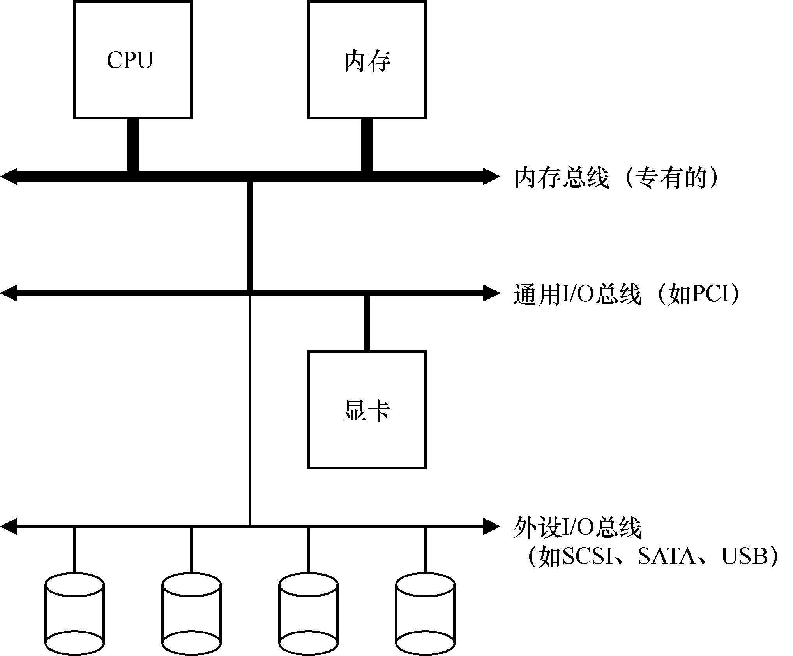

# 36.1 系统架构

开始讨论之前，我们先看一个典型系统的架构（见图 36.1）。其中，CPU 通过某种内存总线（memory bus）或互连电缆连接到系统内存。图像或者其他高性能I/O 设备通过常规的I/O 总线（I/O bus）连接到系统，在许多现代系统中会是PCI 或它的衍生形式。最后，更下面是外围总线（peripheral bus），比如SCSI、SATA 或者USB。它们将最慢的设备连接到系统，包括磁盘、鼠标及其他类似设备。

你可能会问：为什么要用这样的分层架构？简单回答：因为物理布局及造价成本。越快的总线越短，因此高性能的内存总线没有足够的空间连接太多设备。另外，在工程上高性能总线的造价非常高。所以，系统的设计采用了这种分层的方式，这样可以让要求高性能的设备（比如显卡）离CPU 更近一些，低性能的设备离CPU 远一些。将磁盘和其他低速设备连到外围总线的好处很多，其中较为突出的好处就是你可以在外围总线上连接大量的设备。
