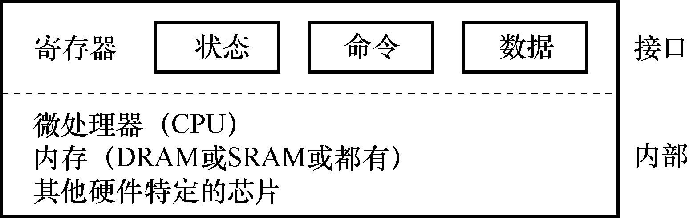

# 36.2 标准设备

现在来看一个标准设备（不是真实存在的），通过它来帮助我们更好地理解设备交互的机制。从图36.2 中，可以看到一个包含两部

分重要组件的设备。第一部分是向系统其他部分展现的硬件接口（interface）。同软件一样，硬件也需要一些接口，让系统软件来控制它的操作。因此，所有设备都有自己的特定接口以及典型交互的协议。

第2 部分是它的内部结构（internal structure）。这部分包含设备相关的特定实现，负责具体实现设备展示给系统的抽象接口。非常简单的设备通常用一个或几个芯片来实现它们的功能。更复杂的设备会包含简单的CPU、一些通用内存、设备相关的特定芯片，来完成它们的工作。例如，现代RAID 控制器通常包含成百上千行固件（firmware，即硬件设备中的软件），以实现其功能。
