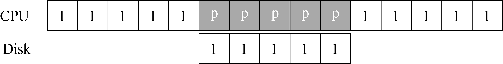
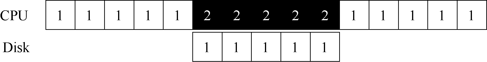

# 36.4 利用中断减少CPU 开销

多年前，工程师们发明了我们目前已经很常见的中断（interrupt）来减少CPU 开销。有了中断后，CPU 不再需要不断轮询设备，而是向设备发出一个请求，然后就可以让对应进程睡眠，切换执行其他任务。当设备完成了自身操作，会抛出一个硬件中断，引发CPU 跳转执行操作系统预先定义好的中断服务例程（Interrupt Service Routine，ISR），或更为简单的中断处理程序（interrupt handler）。中断处理程序是一小段操作系统代码，它会结束之前的请求（比如从设备读取到了数据或者错误码）并且唤醒等待I/O 的进程继续执行。

因此，中断允许计算与I/O 重叠（overlap），这是提高CPU 利用率的关键。下面的时间线展示了这一点：

其中，进程1 在CPU 上运行一段时间（对应CPU 那一行上重复的1），然后发出一个读取数据的I/O 请求给磁盘。如果没有中断，那么操作系统就会简单自旋，不断轮询设备状态，直到设备完成I/O 操作（对应其中的p）。当设备完成请求的操作后，进程1 又可以继续运行。

如果我们利用中断并允许重叠，操作系统就可以在等待磁盘操作时做其他事情：

在这个例子中，在磁盘处理进程1 的请求时，操作系统在CPU 上运行进程2。磁盘处理完成后，触发一个中断，然后操作系统唤醒进程1 继续运行。这样，在这段时间，无论CPU 还是磁盘都可以有效地利用。

注意，使用中断并非总是最佳方案。假如有一个非常高性能的设备，它处理请求很快：通常在CPU 第一次轮询时就可以返回结果。此时如果使用中断，反而会使系统变慢：切换到其他进程，处理中断，再切换回之前的进程代价不小。因此，如果设备非常快，那么最好的办法反而是轮询。如果设备比较慢，那么采用允许发生重叠的中断更好。如果设备的速度未知，或者时快时慢，可以考虑使用混合（hybrid）策略，先尝试轮询一小段时间，如果设备没有完成操作，此时再使用中断。这种两阶段（two-phased）的办法可以实现两种方法的好处。

> **提示：中断并非总是比PIO 好**

> 尽管中断可以做到计算与I/O 的重叠，但这仅在慢速设备上有意义。否则，额外的中断处理和上下文切换的代价反而会超过其收益。另外，如果短时间内出现大量的中断，可能会使得系统过载并且引发活锁[MR96]。这种情况下，轮询的方式可以在操作系统自身的调度上提供更多的控制，反而更有效。

另一个最好不要使用中断的场景是网络。网络端收到大量数据包，如果每一个包都发生一次中断，那么有可能导致操作系统发生活锁（livelock），即不断处理中断而无法处理用户层的请求。例如，假设一个Web 服务器因为“点杠效应”而突然承受很重的负载。这种情况下，偶尔使用轮询的方式可以更好地控制系统的行为，并允许Web 服务器先服务一些用户请求，再回去检查网卡设备是否有更多数据包到达。

另一个基于中断的优化就是合并（coalescing）。设备在抛出中断之前往往会等待一小段时间，在此期间，其他请求可能很快完成，因此多次中断可以合并为一次中断抛出，从而降低处理中断的代价。当然，等待太长会增加请求的延迟，这是系统中常见的折中。参见Ahmad 等人的文章[A+11]，有精彩的总结。
