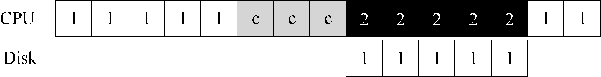
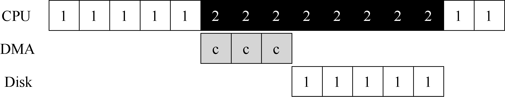

# 36.5 利用DMA 进行更高效的数据传送

标准协议还有一点需要我们注意。具体来说，如果使用编程的I/O 将一大块数据传给设备，CPU 又会因为琐碎的任务而变得负载很重，浪费了时间和算力，本来更好是用于运行其他进程。下面的时间线展示了这个问题：

进程1 在运行过程中需要向磁盘写一些数据，所以它开始进行I/O 操作，将数据从内存拷贝到磁盘（其中标示c 的过程）。拷贝结束后，磁盘上的I/O 操作开始执行，此时CPU 才可以处理其他请求。

> **关键问题：如何减少PIO 的开销**

> 使用PIO 的方式，CPU 的时间会浪费在向设备传输数据或从设备传出数据的过程中。如何才能分离这项工作，从而提高CPU 的利用率？

解决方案就是使用DMA（Direct Memory Access）。DMA 引擎是系统中的一个特殊设备，它可以协调完成内存和设备间的数据传递，不需要CPU 介入。

DMA 工作过程如下。为了能够将数据传送给设备，操作系统会通过编程告诉DMA 引擎数据在内存的位置，要拷贝的大小以及要拷贝到哪个设备。在此之后，操作系统就可以处理其他请求了。当DMA 的任务完成后，DMA 控制器会抛出一个中断来告诉操作系统自己已经完成数据传输。修改后的时间线如下：

从时间线中可以看到，数据的拷贝工作都是由DMA 控制器来完成的。因为CPU 在此时是空闲的，所以操作系统可以让它做一些其他事情，比如此处调度进程2 到CPU 来运行。因此进程2 在进程1 再次运行之前可以使用更多的CPU。
