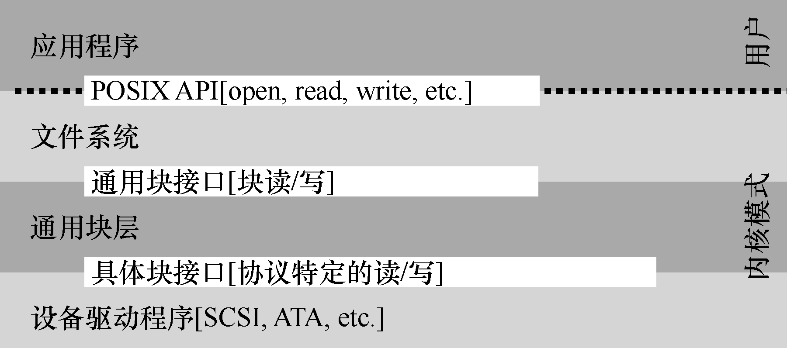

# 36.7 纳入操作系统：设备驱动程序

最后我们要讨论一个问题：每个设备都有非常具体的接口，如何将它们纳入操作系统，而我们希望操作系统尽可能通用。例如文件系统，我们希望开发一个文件系统可以工作在SCSI 硬盘、IDE 硬盘、USB 钥匙串设备等设备之上，并且希望这个文件系统不那么清楚对这些不同设备发出读写请求的全部细节。因此，我们的问题如下。

> **关键问题：如何实现一个设备无关的操作系统**

> 如何保持操作系统的大部分与设备无关，从而对操作系统的主要子系统隐藏设备交互的细节？

这个问题可以通过古老的抽象（abstraction）技术来解决。在最底层，操作系统的一部分软件清楚地知道设备如何工作，我们将这部分软件称为设备驱动程序（device driver），所有设备交互的细节都封装在其中。

我们来看看Linux 文件系统栈，理解抽象技术如何应用于操作系统的设计和实现。图36.3 粗略地展示了Linux 软件的组织方式。可以看出，文件系统（当然也包括在其之上的应用程序）完全不清楚它使用的是什么类型的磁盘。它只需要简单地向通用块设备层发送读写请求即可，块设备层会将这些请求路由给对应的设备驱动，然后设备驱动来完成真正的底层操作。尽管比较简单，但图36.3 展示了这些细节如何对操作系统的大部分进行隐藏。

注意，这种封装也有不足的地方。例如，如果有一个设备可以提供很多特殊的功能，但为了兼容大多数操作系统它不得不提供一个通用的接口，这样就使得自身的特殊功能无法使用。这种情况在使用SCSI 设备的Linux 中就发生了。SCSI 设备提供非常丰富的报告错误信息，但其他的块设备（比如ATA/IDE）只提供非常简单的报错处理，这样上层的所有软件只能在出错时收到一个通用的EIO 错误码（一般IO 错误），SCSI 可能提供的所有附加信息都不能报告给文件系统[G08]。

有趣的是，因为所有需要插入系统的设备都需要安装对应的驱动程序，所以久而久之，驱动程序的代码在整个内核代码中的占比越来越大。查看Linux 内核代码会发现，超过70%的代码都是各种驱动程序。在Windows 系统中，这样的比例同样很高。因此，如果有人跟你说操作系统包含上百万行代码，实际的意思是包含上百万行驱动程序代码。当然，任何安装进操作系统的驱动程序，大部分默认都不是激活状态（只有一小部分设备是在系统刚开启时就需要连接）。更加令人沮丧的是，因为驱动程序的开发者大部分是“业余的”（不是全职内核开发者），所以他们更容易写出缺陷，因此是内核崩溃的主要贡献者[S03]。
