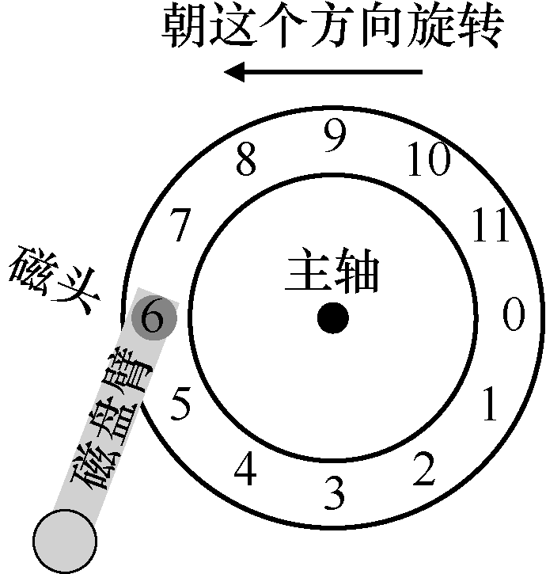
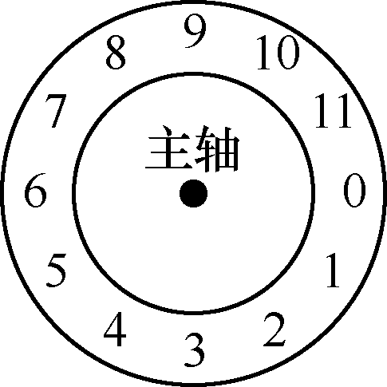
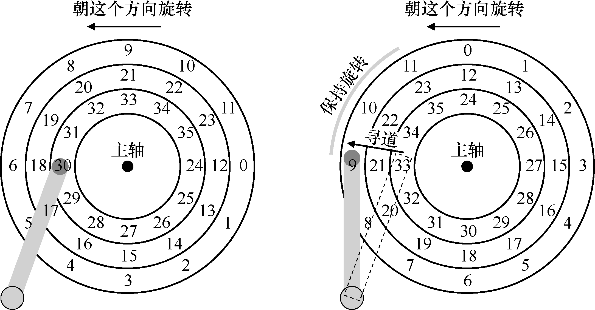
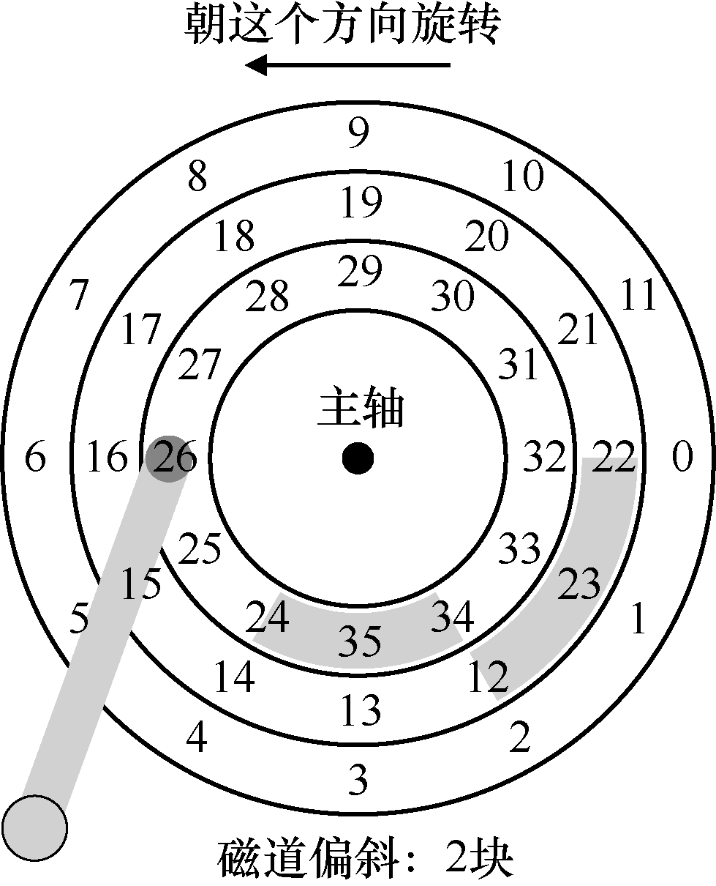
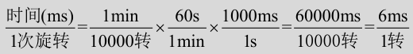
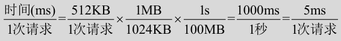

# 37.3 简单的磁盘驱动器

让我们每次构建一个磁道的模型，来了解磁盘是如何工作的。假设我们有一个单一磁道的简单磁盘（见图37.1）。

该磁道只有12 个扇区，每个扇区的大小为512 字节（典型的扇区大小，回忆一下），因此用0 到11 的数字表示。这里的单个盘片围绕主轴旋转，电机连接到主轴。当然，磁道本身并不太有趣，我们希望能够读取或写入这些扇区，因此需要一个连接到磁盘臂上的磁头，如我们现在所见（见图37.2）。

在图37.2 中，连接到磁盘臂末端的磁头位于扇形部分6 的上方，磁盘表面逆时针旋转。

## 单磁道延迟：旋转延迟

要理解如何在简单的单道磁盘上处理请求，请想象我们现在收到读取块0 的请求。磁盘应如何处理该请求？

在我们的简单磁盘中，磁盘不必做太多工作。具体来说，它必须等待期望的扇区旋转到磁头下。这种等待在现代驱动器中经常发生，并且是I/O 服务时间的重要组成部分，它有一个特殊的名称：旋转延迟（rotational delay，有时称为rotation delay，尽管听起来很奇怪）。在这个例子中，如果完整的旋转延迟是R，那么磁盘必然产生大约为R/2 的旋转延迟，以等待0 来到读/写磁头下面（如果我们从6 开始）。对这个单一磁道，最坏情况的请求是第5 扇区，这导致接近完整的旋转延迟，才能服务这种请求。

## 多磁道：寻道时间

到目前为止，我们的磁盘只有一条磁道，这是不太现实的。现代磁盘当然有数以百万计的磁道。因此，我们来看看更具现实感的磁盘表面，这个表面有3 条磁道（见图37.3 左图）。

在该图中，磁头当前位于最内圈的磁道上（它包含扇区24～35）。下一个磁道包含下一组扇区（12～23），最外面的磁道包含最前面的扇区（0～11）。

为了理解驱动器如何访问给定的扇区，我们现在追踪请求发生在远处扇区的情况，例如，读取扇区11。为了服务这个读取请求，驱动器必须首先将磁盘臂移动到正确的磁道（在这种情况下，是最外面的磁道），通过一个所谓的寻道（seek）过程。寻道，以及旋转，是最昂贵的磁盘操作之一。

应该指出的是，寻道有许多阶段：首先是磁盘臂移动时的加速阶段。然后随着磁盘臂全速移动而惯性滑动。然后随着磁盘臂减速而减速。最后，在磁头小心地放置在正确的磁道上时停下来。停放时间（settling time）通常不小，例如0.5～2ms，因为驱动器必须确定找到正确的磁道（想象一下，如果它只是移到附近！）。

寻道之后，磁盘臂将磁头定位在正确的磁道上。图37.3（右图）描述了寻道。

如你所见，在寻道过程中，磁盘臂已经移动到所需的磁道上，并且盘片当然已经开始旋转，在这个例子中，大约旋转了3 个扇区。因此，扇区9 即将通过磁头下方，我们只能承受短暂的转动延迟，以便完成传输。

当扇区11 经过磁盘磁头时，I/O 的最后阶段将发生，称为传输（transfer），数据从表面读取或写入表面。因此，我们得到了完整的I/O 时间图：首先寻道，然后等待转动延迟，最后传输。

## 一些其他细节

尽管我们不会花费太多时间，但还有一些关于磁盘驱动器操作的令人感兴趣的细节。许多驱动器采用某种形式的磁道偏斜（track skew），以确保即使在跨越磁道边界时，顺序读取也可以方便地服务。在我们的简单示例磁盘中，这可能看起来如图37.4 所示。

扇区往往会偏斜，因为从一个磁道切换到另一个磁道

时，磁盘需要时间来重新定位磁头（即便移到相邻磁道）。如果没有这种偏斜，磁头将移动到下一个磁道，但所需的下一个块已经旋转到磁头下，因此驱动器将不得不等待整个旋转延迟，才能访问下一个块。

另一个事实是，外圈磁道通常比内圈磁道具有更多扇区，这是几何结构的结果。那里空间更多。这些磁道通常被称为多区域（multi-zoned）磁盘驱动器，其中磁盘被组织成多个区域，区域是表面上连续的一组磁道。每个区域每个磁道具有相同的扇区数量，并且外圈区域具有比内圈区域更多的扇区。

最后，任何现代磁盘驱动器都有一个重要组成部分，即它的缓存（cache），由于历史原因有时称为磁道缓冲区（track buffer）。该缓存只是少量的内存（通常大约8MB 或16MB），驱动器可以使用这些内存来保存从磁盘读取或写入磁盘的数据。例如，当从磁盘读取扇区时，驱动器可能决定读取该磁道上的所有扇区并将其缓存在其存储器中。这样做可以让驱动器快速响应所有后续对同一磁道的请求。

在写入时，驱动器面临一个选择：它应该在将数据放入其内存之后，还是写入实际写入磁盘之后，回报写入完成？前者被称为后写（write back）缓存（有时称为立即报告，immediate reporting），后者则称为直写（write through）。后写缓存有时会使驱动器看起来“更快”，但可能有危险。如果文件系统或应用程序要求将数据按特定顺序写入磁盘以保证正确性，后写缓存可能会导致问题（请阅读文件系统日志的章节以了解详细信息）。

> **补充：量纲分析**
>
> 回忆一下在化学课上，你如何通过简单地选择单位，从而消掉这些单位，结果答案就跳出来了。这几乎能解决所有问题。这种化学魔法有一个高大上的名字，即量纲分析（dimensional analysis），事实证明，它在计算机系统分析中也很有用。
>
> 让我们举个例子，看看量纲分析是如何工作的，以及它为什么有用。在这个例子中，假设你必须计算磁盘旋转一周所需的时间（以 ms 为单位）。遗憾的是，你只能得到磁盘的 RPM，或每分钟的旋转次数（rotations per minute）。假设我们正在谈论一个 10K RPM 磁盘（每分钟旋转 10000 次）。如何通过量纲分析，得到以毫秒为单位的每转时间？
>
> 要做到这一点，我们先将所需单位置于左侧。在这个例子中，我们希望获得每次旋转所需的时间（以毫秒为单位），所以我们就写下：时间（ms）/1次旋转。然后写下我们所知道的一切，确保在可能的情况下消掉单位。首先，我们得到 1min/10000次旋转（将旋转保持在分母，因为左侧它也在分母），然后用 60s/1min 将分钟转换成秒，然后用 1000ms/1s 将秒转换成毫秒。最终结果如下（单位很好地消掉了）：

> 从这个例子中可以看出，量纲分析使得一个简单而可重复的过程变得很明显。除了上面的RPM 计算之外，它也经常用于I/O 分析。例如，经常会给你磁盘的传输速率，例如100MB/s，然后问：传输512KB数据块需要多长时间（以ms 为单位）？利用量纲分析，这很容易：

> 从这个例子中可以看出，量纲分析使得一个简单而可重复的过程变得很明显。除了上面的RPM 计算之外，它也经常用于I/O 分析。例如，经常会给你磁盘的传输速率，例如100MB/s，然后问：传输512KB数据块需要多长时间（以ms 为单位）？利用量纲分析，这很容易。
