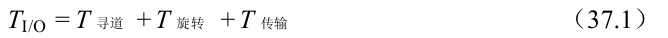
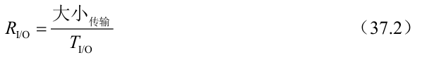
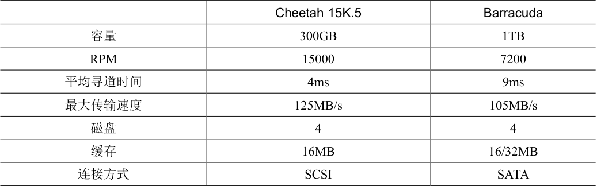
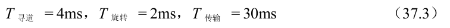
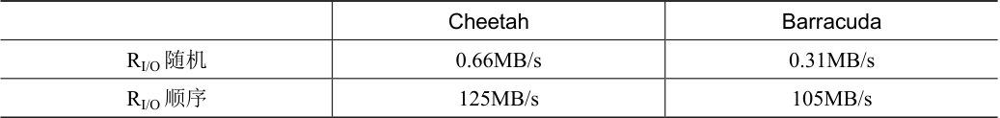
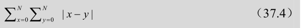
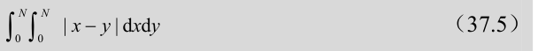
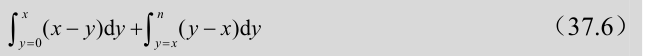
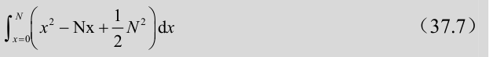
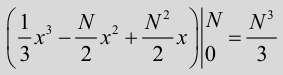

# 37.4 I/O 时间：用数学

既然我们有了一个抽象的磁盘模型，就可以通过一些分析来更好地理解磁盘性能。具体来说，现在可以将I/O 时间表示为3 个主要部分之和：

请注意，通常比较驱动器用I/O 速率（RI/O）更容易（如下所示），它很容易从时间计算出来。只要将传输的大小除以所花的时间：

为了更好地感受I/O 时间，我们执行以下计算。假设有两个我们感兴趣的工作负载。第一个工作负载称为随机（random）工作负载，它向磁盘上的随机位置发出小的（例如4KB）读取请求。随机工作负载在许多重要的应用程序中很常见，包括数据库管理系统。第二种称为顺序（sequential）工作负载，只是从磁盘连续读取大量的扇区，不会跳过。顺序访问模式很常见，因此也很重要。

为了理解随机和顺序工作负载之间的性能差异，我们首先需要对磁盘驱动器做一些假设。我们来看看希捷的几个现代磁盘。第一个名为Cheetah 15K.5 [S09b]，是高性能SCSI驱动器。第二个名为Barracuda [S09a]，是一个为容量而生的驱动器。有关两者的详细信息如表37.1 所示。

如你所见，这些驱动器具有完全不同的特性，并且从很多方面很好地总结了磁盘驱动器市场的两个重要部分。首先是“高性能”驱动器市场，驱动器的设计尽可能快，提供低寻道时间，并快速传输数据。其次是“容量”市场，每字节成本是最重要的方面。因此，驱动器速度较慢，但将尽可能多的数据放到可用空间中。

表格文字

|  | Cheetah 15K.5 | Barracuda |
| --- | --- | --- |
| 容量 | 300GB | 1TB |
| RPM | 15000 | 7200 |
| 平均寻道时间 | 4ms | 9ms |
| 最大传输速度 | 125MB/s | 105MB/s |
| 磁盘 | 4 | 4 |
| 缓存 | 16MB | 16/32MB |
| 连接方式 | SCSI | SATA |

根据这些数据，我们可以开始计算驱动器在上述两个工作负载下的性能。我们先看看随机工作负载。假设每次读取4KB 发生在磁盘的随机位置，我们可以计算每次读取需要多长时间。在Cheetah 上：

> **提示：顺序地使用磁盘**

> 尽可能以顺序方式将数据传输到磁盘，并从磁盘传输数据。如果顺序不可行，至少应考虑以大块传输数据：越大越好。如果I/O 是以小而随机方式完成的，则I/O 性能将受到显著影响。而且，用户也会痛苦。而且，你也会痛苦，因为你知道正是你不小心的随机I/O 让你痛苦。

平均寻道时间（4ms）就采用制造商报告的平均时间。请注意，完全寻道（从表面的一端到另一端）可能需要两到三倍的时间。平均旋转延迟直接根据RPM 计算。15000 RPM 等于250 RPS（每秒转速）。因此，每次旋转需要4ms。平均而言，磁盘将会遇到半圈旋转，因此平均时间为2ms。最后，传输时间就是传输大小除以峰值传输速率。在这里它小得几乎看不见（30μs，注意，需要1000μs 才是1ms！）。

因此，根据我们上面的公式，Cheetah 的TI/O 大致等于6ms。为了计算I/O 的速率，我们只需将传输的大小除以平均时间，因此得到Cheetah 在随机工作负载下的RI/O 大约是0.66MB/s。对Barracuda 进行同样的计算，得到TI/O 约为13.2ms，慢两倍多，因此速率约为0.31MB/s。

现在让我们看看顺序工作负载。在这里我们可以假定在一次很长的传输之前只有一次寻道和旋转。简单起见，假设传输的大小为100MB。因此，Barracuda 和Cheetah 的TI/O 分别约为800ms 和950ms。因此I/O 的速率几乎接近125MB/s 和105MB/s 的峰值传输速率，如表37.2 所示。

表37.2 展示了一些重要的事情。第一点，也是最重要的一点，随机和顺序工作负载之间的驱动性能差距很大，对于Cheetah 来说几乎是200 左右，而对于Barracuda 来说差不多是300 倍。因此我们得出了计算历史上最明显的设计提示。

第二点更微妙：高端“性能”驱动器与低端“容量”驱动器之间的性能差异很大。出于这个原因（和其他原因），人们往往愿意为前者支付最高的价格，同时尽可能便宜地获得后者。

表格文字

|  | Cheetah | Barracuda |
| --- | --- | --- |
| RI/O 随机 | 0.66MB/s | 0.31MB/s |
| RI/O 顺序 | 125MB/s | 105MB/s |

> **补充：计算“平均”寻道时间**

> 在许多书籍和论文中，引用的平均磁盘寻道时间大约为完整寻道时间的三分之一。这是怎么来的？

> 原来，它是基于平均寻道距离而不是时间的简单计算而产生的。将磁盘想象成一组从0 到N 的磁道。因此任何两个磁道x 和y 之间的寻道距离计算为它们之间差值的绝对值：| x − y |。

> 要计算平均搜索距离，只需首先将所有可能的搜索距离相加即可：

> 然后，将其除以不同可能的搜索次数：N2。为了计算总和，我们将使用积分形式：

> 为了计算内层积分，我们分离绝对值：

> 这得到：

> 记住，我们仍然必须除以寻道总数（N2）来计算平均寻道距离：（N3/3）/（N2）= N/3。因此，在所有可能的寻道中，磁盘上的平均寻道距离是全部距离的1/3。现在，如果听到平均寻道时间是完整寻道时间的1/3，你就会知道是怎么来的。
