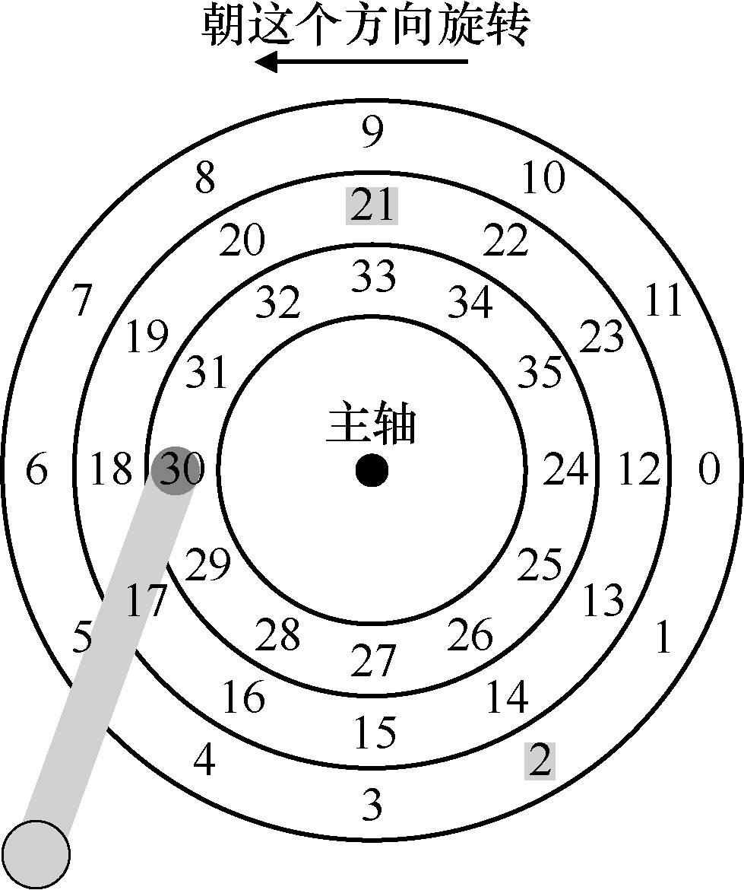
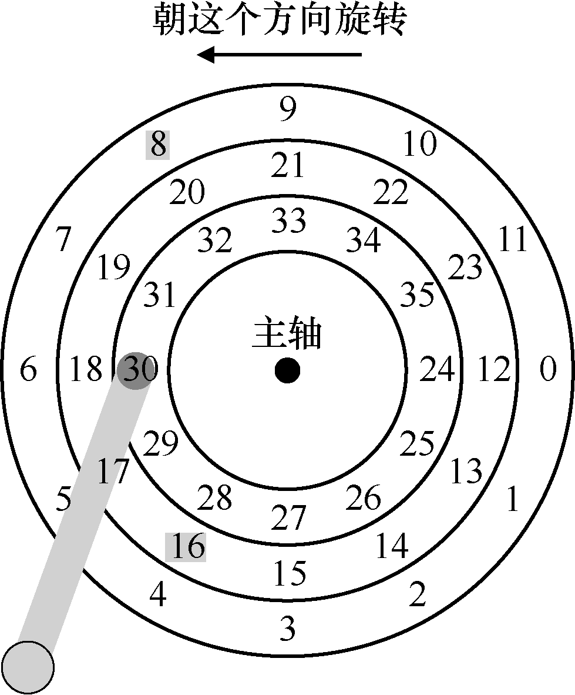

# 37.5 磁盘调度

由于I/O 的高成本，操作系统在决定发送给磁盘的I/O 顺序方面历来发挥作用。更具体地说，给定一组I/O 请求，磁盘调度程序检查请求并决定下一个要调度的请求[SCO90，JW91]。

与任务调度不同，每个任务的长度通常是不知道的，对于磁盘调度，我们可以很好地猜测“任务”（即磁盘请求）需要多长时间。通过估计请求的查找和可能的旋转延迟，磁盘调度程序可以知道每个请求将花费多长时间，因此（贪婪地）选择先服务花费最少时间的请求。因此，磁盘调度程序将尝试在其操作中遵循SJF（最短任务优先）的原则（principle of SJF，shortest job first）。

## SSTF：最短寻道时间优先

一种早期的磁盘调度方法被称为最短寻道时间优先

（Shortest-Seek-Time-First，SSTF）（也称为最短寻道优先，Shortest-Seek-First，SSF）。SSTF 按磁道对I/O 请求队列排序，选择在最近磁道上的请求先完成。例如，假设磁头当前位置在内圈磁道上，并且我们请求扇区21（中间磁道）和2（外圈磁道），那么我们会首先发出对21 的请求，等待它完成，然后发出对2 的请求（见图37.5）。

在这个例子中，SSTF 运作良好，首先寻找中间磁道，然后寻找外圈磁道。但SSTF 不是万能的，原因如下。第一个问题，主机操作系统无法利用驱动器的几何结构，而是只会看到一系列的块。幸运的是，这个问题很容易解决。操作系统可以简单地实现最近块优先（Nearest-Block-First，NBF），而不是SSTF，然后用最近的块地址来调度请求。

第二个问题更为根本：饥饿（starvation）。想象一下，在我们上面的例子中，是否有对磁头当前所在位置的内圈磁道有稳定的请求。然后，纯粹的SSTF 方法将完全忽略对其他磁道的请求。因此关键问题如下。

> **关键问题：如何处理磁盘饥饿**

> 我们如何实现类SSTF 调度，但避免饥饿？

## 电梯（又称SCAN 或C-SCAN）

这个问题的答案是很久以前得到的（参见[CKR72]中的例子），并且相对比较简单。该算法最初称为SCAN，简单地以跨越磁道的顺序来服务磁盘请求。我们将一次跨越磁盘称为扫一遍。因此，如果请求的块所属的磁道在这次扫一遍中已经服务过了，它就不会立即处理，而是排队等待下次扫一遍。

SCAN 有许多变种，所有这些变种都是一样的。例如，Coffman 等人引入了F-SCAN，它在扫一遍时冻结队列以进行维护[CKR72]。这个操作会将扫一遍期间进入的请求放入队列中，以便稍后处理。这样做可以避免远距离请求饥饿，延迟了迟到（但更近）请求的服务。

C-SCAN 是另一种常见的变体，即循环SCAN（Circular SCAN）的缩写。不是在一个方向扫过磁盘，该算法从外圈扫到内圈，然后从内圈扫到外圈，如此下去。

由于现在应该很明显的原因，这种算法（及其变种）有时被称为电梯（elevator）算法，因为它的行为像电梯，电梯要么向上要么向下，而不只根据哪层楼更近来服务请求。试想一下，如果你从10 楼下降到1 楼，有人在3 楼上来并按下4 楼，那么电梯就会上升到4 楼，因为它比1 楼更近！如你所见，电梯算法在现实生活中使用时，可以防止电梯中发生战斗。在磁盘中，它就防止了饥饿。

然而，SCAN 及其变种并不是最好的调度技术。特别是，SCAN（甚至SSTF）实际上并没有严格遵守SJF 的原则。具体来说，它们忽视了旋转。因此，另一个关键问题如下。

> **关键问题：如何计算磁盘旋转开销**

> 如何同时考虑寻道和旋转，实现更接近SJF 的算法？

## SPTF：最短定位时间优先

在讨论最短定位时间优先调度之前（Shortest Positioning Time First，SPTF，有时也称为最短接入时间优先，Shortest Access Time First，SATF。这是

解决我们问题的方法），让我们确保更详细地了解问题。图 37.6 给出了一个例子。

在这个例子中，磁头当前定位在内圈磁道上的扇区30上方。因此，调度程序必须决定：下一个请求应该为安排扇区16（在中间磁道上）还是扇区8（在外圈磁道上）。接下来应该服务哪个请求？

答案当然是“视情况而定”。在工程中，事实证明“视情况而定”几乎总是答案，这反映了取舍是工程师生活的一部分。这样的格言也很好，例如，当你不知道老板问题的答案时，也许可以试试这句好话。然而，知道为什么视情况而定总是更好，我们在这里讨论要讨论这一点。

这里的情况是旋转与寻道相比的相对时间。如果在我们的例子中，寻道时间远远高于旋转延迟，那么SSTF（和变体）就好了。但是，想象一下，如果寻道比旋转快得多。然后，在我们的例子中，寻道远一点的、在外圈磁道的服务请求8，比寻道近一点的、在中间磁道的服务请求16 更好，后者必须旋转很长的距离才能移到磁头下。

在现代驱动器中，正如上面所看到的，查找和旋转大致相当（当然，视具体的请求而定），因此SPTF 是有用的，它提高了性能。然而，它在操作系统中实现起来更加困难，操作系统通常不太清楚磁道边界在哪，也不知道磁头当前的位置（旋转到了哪里）。因此，SPTF通常在驱动器内部执行，如下所述。

> **提示：总是视情况而定（LIVNY 定律）**

> 正如我们的同事Miron Livny 总是说的那样，几乎任何问题都可以用“视情况而定”来回答。但是，要谨慎使用，因为如果你以这种方式回答太多问题，人们就不会再问你问题。例如，有人问：“想去吃午饭吗？”你回答：“视情况而定。你是一个人来吗？”

## 其他调度问题

在这个基本磁盘操作，调度和相关主题的简要描述中，还有很多问题我们没有讨论。其中一个问题是：在现代系统上执行磁盘调度的地方在哪里？在较早的系统中，操作系统完成了所有的调度。在查看一系列挂起的请求之后，操作系统会选择最好的一个，并将其发送到磁盘。当该请求完成时，将选择下一个，如此下去。磁盘当年比较简单，生活也是。

在现代系统中，磁盘可以接受多个分离的请求，它们本身具有复杂的内部调度程序（它们可以准确地实现SPTF。在磁盘控制器内部，所有相关细节都可以得到，包括精确的磁头位置）。因此，操作系统调度程序通常会选择它认为最好的几个请求（如16），并将它们全部发送到磁盘。磁盘然后利用其磁头位置和详细的磁道布局信息等内部知识，以最佳可能（SPTF）顺序服务于这些请求。

磁盘调度程序执行的另一个重要相关任务是I/O 合并（I/O merging）。例如，设想一系列请求读取块33，然后是8，然后是34，如图37.8 所示。在这种情况下，调度程序应该将块33 和34 的请求合并（merge）为单个两块请求。调度程序执行的所有请求都基于合并后的请求。合并在操作系统级别尤其重要，因为它减少了发送到磁盘的请求数量，从而降低了开销。

现代调度程序关注的最后一个问题是：在向磁盘发出I/O 之前，系统应该等待多久？有人可能天真地认为，即使有一个磁盘I/O，也应立即向驱动器发出请求。这种方法被称为工作保全（work-conserving），因为如果有请求要服务，磁盘将永远不会闲下来。然而，对预期磁盘调度的研究表明，有时最好等待一段时间[ID01] ，即所谓的非工作保全（non-work-conserving）方法。通过等待，新的和“更好”的请求可能会到达磁盘，从而整体效率提高。当然，决定何时等待以及多久可能会非常棘手。请参阅研究论文以了解详细信息，或查看Linux 内核实现，以了解这些想法如何转化为实践（如果你对自己要求很高）。
