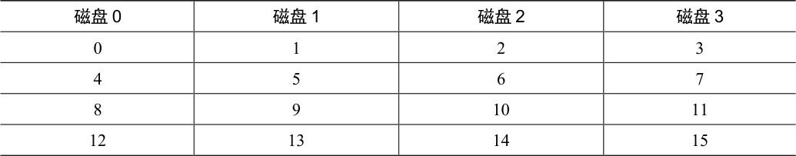
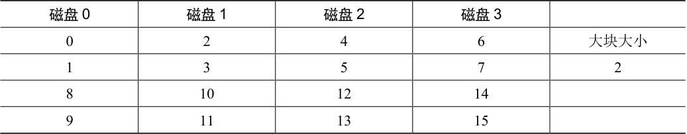
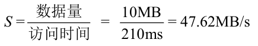
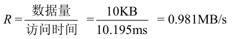

# 38.4 RAID 0 级：条带化

第一个RAID 级别实际上不是RAID 级别，因为没有冗余。但是，RAID 0 级（即条带化，striping）因其更为人所知，可作为性能和容量的优秀上限，所以值得了解。

最简单的条带形式将按表38.1 所示的方式在系统的磁盘上将块条带化（stripe），假设此处为4 个磁盘阵列。

表格文字

| 磁盘0 | 磁盘1 | 磁盘2 | 磁盘3 |
| --- | --- | --- | --- |
| 0 | 1 | 2 | 3 |
| 4 | 5 | 6 | 7 |
| 8 | 9 | 10 | 11 |
| 12 | 13 | 14 | 15 |

通过表38.1，你了解了基本思想：以轮转方式将磁盘阵列的块分布在磁盘上。这种方法的目的是在对数组的连续块进行请求时，从阵列中获取最大的并行性（例如，在一个大的顺序读取中）。我们将同一行中的块称为条带，因此，上面的块0、1、2 和3 在相同的条带中。

在这个例子中，我们做了一个简化的假设，在每个磁盘上只有1 个块（每个大小为4KB）放在下一个磁盘上。但是，这种安排不是必然的。例如，我们可以像表38.2 那样在磁盘上安排块。

表格文字

| 磁盘0 | 磁盘1 | 磁盘2 | 磁盘3 |  |
| --- | --- | --- | --- | --- |
| 0 | 2 | 4 | 6 | 大块大小 |
| 1 | 3 | 5 | 7 | 2 |
| 8 | 10 | 12 | 14 |  |
| 9 | 11 | 13 | 15 |  |

在这个例子中，我们在每个磁盘上放置两个4KB 块，然后移动到下一个磁盘。因此，此RAID 阵列的大块大小（chunk size）为8KB，因此条带由4 个大块（或32KB）数据组成。

> **补充：RAID 映射问题**

> 在研究RAID 的容量、可靠性和性能特征之前，我们首先提出一个问题，我们称之为映射问题（the mapping problem）。这个问题出现在所有RAID 阵列中。简单地说，给定一个逻辑块来读或写，RAID 如何确切地知道要访问哪个物理磁盘和偏移量？

> 对于这些简单的RAID 级别，我们不需要太多复杂计算，就能正确地将逻辑块映射到其物理位置。以上面的第一个条带为例（大块大小= 1 块= 4KB）。在这种情况下，给定逻辑块地址A，RAID 可以使用两个简单的公式轻松计算要访问的磁盘和偏移量：

> 请注意，这些都是整数运算（例如，4/3 = 1 而不是1.33333…）。我们来看看这些公式如何用于一个简单的例子。假设在上面的第一个RAID 中，对块15 的请求到达。鉴于有4 个磁盘，这意味着我们感兴趣的磁盘是（14 % 4 = 2）：磁盘2。确切的块计算为（14 / 4 = 3）：块3。因此，应在第三个磁盘（磁盘2，从0 开始）的第四个块（块3，从0 开始）处找到块14，该块恰好位于该位置。

> 你可以考虑如何修改这些公式来支持不同的块大小。尝试一下！这不太难。

## 大块大小

一方面，大块大小主要影响阵列的性能。例如，大小较小的大块意味着许多文件将跨多个磁盘进行条带化，从而增加了对单个文件的读取和写入的并行性。但是，跨多个磁盘访问块的定位时间会增加，因为整个请求的定位时间由所有驱动器上请求的最大定位时间决定。

另一方面，较大的大块大小减少了这种文件内的并行性，因此依靠多个并发请求来实现高吞吐量。但是，较大的大块大小减少了定位时间。例如，如果一个文件放在一个块中并放置在单个磁盘上，则访问它时发生的定位时间将只是单个磁盘的定位时间。

因此，确定“最佳”的大块大小是很难做到的，因为它需要大量关于提供给磁盘系统的工作负载的知识[CL95]。对于本讨论的其余部分，我们将假定该数组使用单个块（4KB）的大块大小。大多数阵列使用较大的大块大小（例如，64KB），但对于我们在下面讨论的问题，确切的块大小无关紧要。因此，简单起见，我们用一个单独的块。

## 回到RAID-0 分析

现在让我们评估条带化的容量、可靠性和性能。从容量的角度来看，它是顶级的：给定N 个磁盘，条件化提供N 个磁盘的有用容量。从可靠性的角度来看，条带化也是顶级的，但是最糟糕：任何磁盘故障都会导致数据丢失。最后，性能非常好：通常并行使用所有磁盘来为用户I/O 请求提供服务。

## 评估RAID 性能

在分析RAID 性能时，可以考虑两种不同的性能指标。首先是单请求延迟。了解单个I/O 请求对RAID 的满意度非常有用，因为它可以揭示单个逻辑I/O 操作期间可以存在多少并行性。第二个是RAID 的稳态吞吐量，即许多并发请求的总带宽。由于RAID 常用于高性能环境，因此稳态带宽至关重要，因此将成为我们分析的主要重点。

为了更详细地理解吞吐量，我们需要提出一些感兴趣的工作负载。对于本次讨论，我们将假设有两种类型的工作负载：顺序（sequential）和随机（random）。对于顺序的工作负载，我们假设对阵列的请求大部分是连续的。例如，一个请求（或一系列请求）访问1MB数据，始于块（B），终于（B+1MB），这被认为是连续的。顺序工作负载在很多环境中都很常见（想想在一个大文件中搜索关键字），因此被认为是重要的。

对于随机工作负载，我们假设每个请求都很小，并且每个请求都是到磁盘上不同的随机位置。例如，随机请求流可能首先在逻辑地址10 处访问4KB，然后在逻辑地址550000处访问，然后在20100 处访问，等等。一些重要的工作负载（例如数据库管理系统（DBMS）上的事务工作负载）表现出这种类型的访问模式，因此它被认为是一种重要的工作负载。

当然，真正的工作负载不是那么简单，并且往往混合了顺序和类似随机的部分，行为介于两者之间。简单起见，我们只考虑这两种可能性。

你知道，顺序和随机工作负载会导致磁盘的性能特征差异很大。对于顺序访问，磁盘以最高效的模式运行，花费很少时间寻道并等待旋转，大部分时间都在传输数据。对于随机访问，情况恰恰相反：大部分时间花在寻道和等待旋转上，花在传输数据上的时间相对较少。为了在分析中捕捉到这种差异，我们将假设磁盘可以在连续工作负载下以S MB/s 传输数据，并且在随机工作负载下以R MB/s 传输数据。一般来说，S 比R 大得多。

为了确保理解这种差异，我们来做一个简单的练习。具体来说，给定以下磁盘特征，计算S 和R。假设平均大小为10MB 的连续传输，平均为10KB 的随机传输。另外，假设以下磁盘特征：

平均寻道时间7ms

平均旋转延迟3ms

磁盘传输速率50MB/s

要计算S，我们需要首先计算在典型的10MB 传输中花费的时间。首先，我们花7ms寻找，然后3ms 旋转。最后，传输开始。10MB @ 50MB/s 导致1/5s，即200ms 的传输时间。因此，对于每个10MB 的请求，花费了210ms 完成请求。要计算S，只需要除一下：

如你所见，由于大量时间用于传输数据，S 非常接近磁盘的峰值带宽（寻道和旋转成本已经摊销）。

我们可以类似地计算R。寻道和旋转是一样的。然后我们计算传输所花费的时间，即10KB @ 50MB/s，即0.195ms。

如你所见，R 小于1MB/s，S/R 几乎为50 倍。

## 再次回到RAID-0 分析

现在我们来评估条带化的性能。正如我们上面所说的，它通常很好。例如，从延迟角度来看，单块请求的延迟应该与单个磁盘的延迟几乎相同。毕竟，RAID-0 将简单地将该请求重定向到其磁盘之一。

从稳态吞吐量的角度来看，我们期望获得系统的全部带宽。因此，吞吐量等于N（磁盘数量）乘以S（单个磁盘的顺序带宽）。对于大量的随机I/O，我们可以再次使用所有的磁盘，从而获得N·R MB/s。我们在后面会看到，这些值都是最简单的计算值，并且将作为与其他RAID 级别比较的上限。
