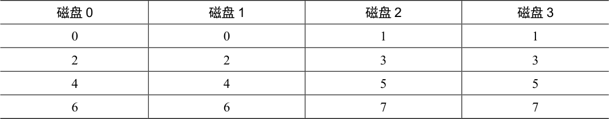

# 38.5 RAID 1 级：镜像

第一个超越条带化的RAID 级别称为RAID 1 级，即镜像。对于镜像系统，我们只需生成系统中每个块的多个副本。当然，每个副本应该放在一个单独的磁盘上。通过这样做，我们可以容许磁盘故障。

在一个典型的镜像系统中，我们将假设对于每个逻辑块，RAID 保留两个物理副本。表38.3 所示的是一个例子。

表格文字

| 磁盘0 | 磁盘1 | 磁盘2 | 磁盘3 |
| --- | --- | --- | --- |
| 0 | 0 | 1 | 1 |
| 2 | 2 | 3 | 3 |
| 4 | 4 | 5 | 5 |
| 6 | 6 | 7 | 7 |

在这个例子中，磁盘0 和磁盘1 具有相同的内容，而磁盘2 和磁盘3 也具有相同的内容。数据在这些镜像对之间条带化。实际上，你可能已经注意到有多种不同的方法可以在磁盘上放置块副本。上面的安排是常见的安排，有时称为RAID-10（或RAID 1+0），因为它使用镜像对（RAID-1），然后在其上使用条带化（RAID-0）。另一种常见安排是RAID-01（或RAID 0+1），它包含两个大型条带化（RAID-0）阵列，然后是镜像（RAID-1）。目前，我们的讨论只是假设上面布局的镜像。

从镜像阵列读取块时，RAID 有一个选择：它可以读取任一副本。例如，如果对RAID发出对逻辑块5 的读取，则可以自由地从磁盘2 或磁盘3 读取它。但是，在写入块时，不存在这样的选择：RAID 必须更新两个副本的数据，以保持可靠性。但请注意，这些写入可以并行进行。例如，对逻辑块5 的写入可以同时在磁盘2 和3 上进行。

## RAID-1 分析

让我们评估一下RAID-1。从容量的角度来看，RAID-1 价格昂贵。在镜像级别=2 的情况下，我们只能获得峰值有用容量的一半。因此，对于N 个磁盘，镜像的有用容量为N/2。

从可靠性的角度来看，RAID-1 表现良好。它可以容许任何一个磁盘的故障。你也许会注意到RAID-1 实际上可以做得比这更好，只需要一点运气。想象一下，在表38.3 中，磁盘0 和磁盘2 都故障了。在这种情况下，没有数据丢失！更一般地说，镜像系统（镜像级别为2）肯定可以容许一个磁盘故障，最多可容许N/2 个磁盘故障，这取决于哪些磁盘故障。在实践中，我们通常不喜欢把这样的事情交给运气。因此，大多数人认为镜像对于处理单个故障是很好的。

最后，我们分析性能。从单个读取请求的延迟角度来看，我们可以看到它与单个磁盘上的延迟相同。所有RAID-1 都会将读取导向一个副本。写入有点不同：在完成写入之前，需要完成两次物理写入。这两个写入并行发生，因此时间大致等于单次写入的时间。然而，因为逻辑写入必须等待两个物理写入完成，所以它遭遇到两个请求中最差的寻道和旋转延迟，因此（平均而言）比写入单个磁盘略高。

> **补充：RAID 一致更新问题**

> 在分析RAID-1 之前，让我们先讨论所有多磁盘RAID 系统都会出现的问题，称为一致更新问题（consistent-update problem）[DAA05]。对于任何在单个逻辑操作期间必须更新多个磁盘的RAID，会出现这个问题。在这里，假设考虑镜像磁盘阵列。

> 想象一下写入发送到RAID，然后RAID 决定它必须写入两个磁盘，即磁盘0 和磁盘1。然后，RAID向磁盘0 写入数据，但在RAID 发出请求到磁盘1 之前，发生掉电（或系统崩溃）。在这个不幸的情况下，让我们假设对磁盘0 的请求已完成（但对磁盘1 的请求显然没有完成，因为它从未发出）。

> 这种不合时宜的掉电，导致现在数据块的两个副本不一致（inconsistent）。磁盘0 上的副本是新版本，而磁盘1 上的副本是旧的。我们希望的是两个磁盘的状态都原子地（atomically）改变，也就是说，两者都应该最终成为新版本或者两者都不是。

> 解决此问题的一般方法，是使用某种预写日志（write-ahead log），在做之前首先记录RAID 将要执行的操作（即用某个数据更新两个磁盘）。通过采取这种方法，我们可以确保在发生崩溃时，会发生正确的事情。通过运行一个恢复（recovery）过程，将所有未完成的事务重新在RAID 上执行，我们可以确保两个镜像副本（在RAID-1 情况下）同步。

> 最后一个注意事项：每次写入都在磁盘上记录日志，这个代价昂贵得不行，因此大多数RAID 硬件都包含少量非易失性RAM（例如电池有备份的），用于执行此类记录。因此，既提供了一致的更新，又不需要花费高昂的代价，将日志记录到磁盘。

要分析稳态吞吐量，让我们从顺序工作负载开始。顺序写入磁盘时，每个逻辑写入必定导致两个物理写入。例如，当我们写入逻辑块 0（在表 38.3 中）时，RAID 在内部会将它写入磁盘 0 和磁盘 1。因此，我们可以得出结论，顺序写入镜像阵列期间获得的最大带宽是 (N/2) · S，即峰值带宽的一半。

遗憾的是，我们在顺序读取过程中获得了完全相同的性能。有人可能会认为顺序读取可能会更好，因为它只需要读取一个数据副本，而不是两个副本。但是，让我们用一个例子来说明为什么这没有多大帮助。想象一下，我们需要读取块0、1、2、3、4、5、6 和7。假设我们将0 读到磁盘0，将1 读到磁盘2，将2 读到磁盘1，读取3 到磁盘3。我们继续分别向磁盘0、2、1 和3 发出读取请求4、5、6 和7。有人可能天真地认为，因为我们正在利用所有磁盘，所以得到了阵列的全部带宽。

但是，要看到情况并非如此，请考虑单个磁盘接收的请求（例如磁盘 0）。首先，它收到块 0 的请求。然后，它收到块 4 的请求（跳过块 2）。实际上，每个磁盘都会接收到每个其他块的请求。当它在跳过的块上旋转时，不会为客户提供有用的带宽。因此，每个磁盘只能提供一半的峰值带宽。因此，顺序读取只能获得 (N/2) · S MB/s 的带宽。

随机读取是镜像RAID 的最佳案例。在这种情况下，我们可以在所有磁盘上分配读取数据，从而获得完整的可用带宽。因此，对于随机读取，RAID-1 提供N·R MB/s。

最后，随机写入按照你预期的方式执行：(N/2) · R MB/s。每个逻辑写入必须变成两个物理写入，因此在所有磁盘都将被使用的情况下，客户只会看到可用带宽的一半。尽管对逻辑块 X 的写入变为对两个不同物理磁盘的两个并行写入，但许多小型请求的带宽只能达到我们看到的条带化的一半。我们很快会看到，获得一半的可用带宽实际上相当不错！
