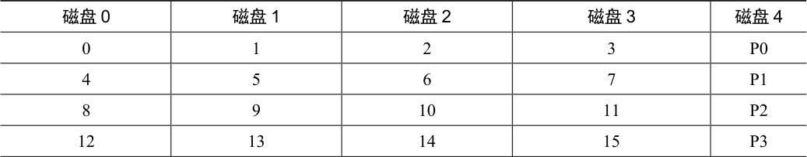
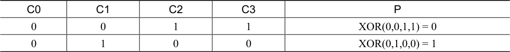
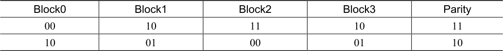
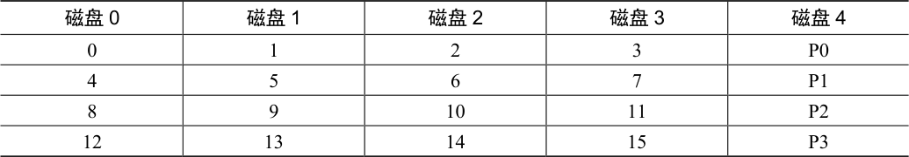
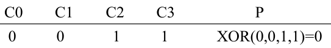
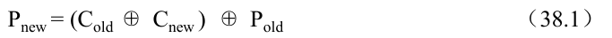
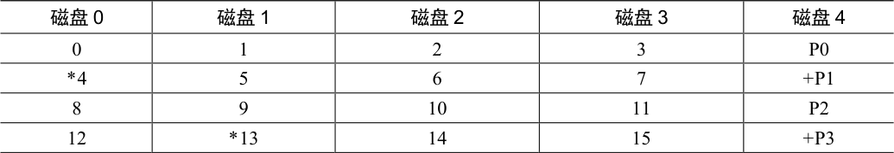

# 38.6 RAID 4 级：通过奇偶校验节省空间

我们现在展示一种向磁盘阵列添加冗余的不同方法，称为奇偶校验（parity）。基于奇偶校验的方法试图使用较少的容量，从而克服由镜像系统付出的巨大空间损失。不过，这样做的代价是——性能。

这是5 个磁盘的RAID-4 系统的例子（见表38.4）。对于每一条数据，我们都添加了一个奇偶校验（parity）块，用于存储该条块的冗余信息。例如，奇偶校验块P1 具有从块4、5、6 和7 计算出的冗余信息。

表格文字

| 磁盘0 | 磁盘1 | 磁盘2 | 磁盘3 | 磁盘4 |
| --- | --- | --- | --- | --- |
| 0 | 1 | 2 | 3 | P0 |
| 4 | 5 | 6 | 7 | P1 |
| 8 | 9 | 10 | 11 | P2 |
| 12 | 13 | 14 | 15 | P3 |

为了计算奇偶性，我们需要使用一个数学函数，使我们能够承受条带中任何一个块的损失。事实表明，简单异或（XOR）函数相当不错。对于给定的一组比特，如果比特中有偶数个1，则所有这些比特的XOR 返回0，如果有奇数个1，则返回1 如表38.5 所示。

表格文字

| C0 | C1 | C2 | C3 | P |
| --- | --- | --- | --- | --- |
| 0 | 0 | 1 | 1 | XOR(0,0,1,1) = 0 |
| 0 | 1 | 0 | 0 | XOR(0,1,0,0) = 1 |

在第一行（0、0、1、1）中，有两个1（C2、C3），因此所有这些值的异或是0（P）。同样，在第二行中只有一个1（C1），因此XOR 必须是1（P）。你可以用一种简单的方法记住这一点：任何一行中的1 的数量必须是偶数（而不是奇数）。这是RAID 必须保持的不变性（invariant），以便奇偶校验正确。

从上面的例子中，你也许可以猜出，如何利用奇偶校验信息从故障中恢复。想象一下标为C2 的列丢失了。要找出该列中肯定存在的值，我们只需读取该行中的所有其他值（包括XOR 的奇偶校验位）并重构（reconstruct）正确的答案。具体来说，假设C2 列中第一行的值丢失（它是1）。通过读取该行中的其他值（C0 中的0，C1 中的0，C3 中的1 以及奇偶校验列P 中的0），我们得到值0、0、1 和0。因为我们知道XOR 保持每行有偶数个1，所以就知道丢失的数据肯定是什么——1。这就是重构在基于异或的方案中的工作方式！还要注意如何计算重构值：只要将数据位和奇偶校验位异或，就像开始计算奇偶校验一样。

现在你可能会想：我们正在讨论所有这些位的异或，然而上面我们知道RAID 在每个磁盘上放置了4KB（或更大）的块。如何将XOR 应用于一堆块来计算奇偶校验？事实证明这很容易。只需在数据块的每一位上执行按位XOR。将每个按位XOR 的结果放入奇偶校验块的相应位置中。例如，如果我们有4 位大小的块（是的，这个块仍然比4KB 块小很多，但是你看到了全景），它们可能看起来如表38.6 所示。

表格文字

| Block0 | Block1 | Block2 | Block3 | Parity |
| --- | --- | --- | --- | --- |
| 00 | 10 | 11 | 10 | 11 |
| 10 | 01 | 00 | 01 | 10 |

可以看出，每个块的每个比特计算奇偶校验，结果放在奇偶校验块中。

## RAID-4 分析

现在让我们分析一下RAID-4。从容量的角度来看，RAID-4 使用1 个磁盘作为它所保护的每组磁盘的奇偶校验信息。因此，RAID 组的有用容量是（N−1）。

可靠性也很容易理解：RAID-4 容许1 个磁盘故障，不容许更多。如果丢失多个磁盘，则无法重建丢失的数据。

最后，是性能。这一次，让我们从分析稳态吞吐量开始。连续读取性能可以利用除奇偶校验磁盘以外的所有磁盘，因此可提供（N−1）·S MB/s（简单情况）的峰值有效带宽。

要理解顺序写入的性能，我们必须首先了解它们是如何完成的。将大块数据写入磁盘时，RAID-4 可以执行一种简单优化，称为全条带写入（full-stripe write）。例如，设想块0、1、2 和3 作为写请求的一部分发送到RAID（见表38.7）。

表格文字

| 磁盘0 | 磁盘1 | 磁盘2 | 磁盘3 | 磁盘4 |
| --- | --- | --- | --- | --- |
| 0 | 1 | 2 | 3 | P0 |
| 4 | 5 | 6 | 7 | P1 |
| 8 | 9 | 10 | 11 | P2 |
| 12 | 13 | 14 | 15 | P3 |

在这种情况下，RAID 可以简单地计算P0 的新值（通过在块0、1、2 和3 上执行XOR），然后将所有块（包括奇偶块）并行写入上面的5 个磁盘（在图中以灰色突出显示）。因此，全条带写入是RAID-4 写入磁盘的最有效方式。

一旦我们理解了全条带写入，计算RAID-4 上顺序写入的性能就很容易。有效带宽也是（N−1）·S MB/s。即使奇偶校验磁盘在操作过程中一直处于使用状态，客户也无法从中获得性能优势。

现在让我们分析随机读取的性能。从表38.7 中还可以看到，一组1 块的随机读取将分布在系统的数据磁盘上，而不是奇偶校验磁盘上。因此，有效性能是：（N−1）·R MB/s。

随机写入，我们留到了最后，展示了RAID-4 最引人注目的情况。想象一下，我们希望在上面的例子中覆盖写入块1。我们可以继续并覆盖它，但这会给我们带来一个问题：奇偶校验块P0 将不再准确地反映条带的正确奇偶校验值。在这个例子中，P0 也必须更新。我们如何正确并有效地更新它？

存在两种方法。第一种称为加法奇偶校验（additive parity），要求我们做以下工作。为了计算新奇偶校验块的值，并行读取条带中所有其他数据块（在本例中为块0、2 和3），并与新块（1）进行异或。结果是新的校验块。为了完成写操作，你可以将新数据和新奇偶校验写入其各自的磁盘，也是并行写入。

这种技术的问题在于它随磁盘数量而变化，因此在较大的RAID 中，需要大量的读取来计算奇偶校验。因此，导致了减法奇偶校验（subtractive parity）方法。

例如，想象下面这串位（4 个数据位，一个奇偶校验位）：

想象一下，我们希望用一个新值来覆盖C2 位，称之为C2new。减法方法分三步工作。首先，我们读入C2（C2old = 1）和旧数据（Pold = 0）的旧数据。

然后，比较旧数据和新数据。如果它们相同（例如，C2new = C2old），那么我们知道奇偶校验位也将保持相同（即Pnew = Pold）。但是，如果它们不同，那么我们必须将旧的奇偶校验位翻转到其当前状态的相反位置，也就是说，如果（Pold == 0），Pnew将被设置为0。如果（Pold == 0），Pnew将被设置为1。我们可以用XOR（⊕是XOR 运算符）漂亮地表达完整的复杂情况：

由于所处理的是块而不是位，因此我们对块中的所有位执行此计算（例如，每个块中的4096 个字节乘以每个字节的8 位）。在大多数情况下，新块与旧块不同，因此新的奇偶块也会不同。

你现在应该能够确定何时使用加法奇偶校验计算，何时使用减法方法。考虑系统中需要多少个磁盘，导致加法方法比减法方法执行更少的I/O。哪里是交叉点？

对于这里的性能分析，假定使用减法方法。因此，对于每次写入，RAID 必须执行4 次物理I/O（两次读取和两次写入）。现在想象有很多提交给RAID 的写入。RAID-4 可以并行执行多少个？为了理解，让我们再看一下RAID-4 的布局（见表38.8）。

表格文字

| 磁盘0 | 磁盘1 | 磁盘2 | 磁盘3 | 磁盘4 |
| --- | --- | --- | --- | --- |
| 0 | 1 | 2 | 3 | P0 |
| \*4 | 5 | 6 | 7 | +P1 |
| 8 | 9 | 10 | 11 | P2 |
| 12 | \*13 | 14 | 15 | +P3 |

现在想象几乎同时向RAID-4 提交2 个小的请求，写入块4 和块13（在表38.8 中标出）。

这些磁盘的数据位于磁盘0 和1 上，因此对数据的读写操作可以并行进行，这很好。出现的问题是奇偶校验磁盘。这两个请求都必须读取4 和13 的奇偶校验块，即奇偶校验块1 和3（用+标记）。估计你已明白了这个问题：在这种类型的工作负载下，奇偶校验磁盘是瓶颈。因此我们有时将它称为基于奇偶校验的RAID 的小写入问题（small-write problem）。因此，即使可以并行访问数据磁盘，奇偶校验磁盘也不会实现任何并行。由于奇偶校验磁盘，所有对系统的写操作都将被序列化。由于奇偶校验磁盘必须为每个逻辑I/O 执行两次I/O（一次读取，一次写入），我们可以通过计算奇偶校验磁盘在这两个I/O 上的性能来计算RAID-4 中的小的随机写入的性能，从而得到（R / 2）MB/s。随机小写入下的RAID-4 吞吐量很糟糕，向系统添加磁盘也不会改善。

我们最后来分析RAID-4 中的I/O 延迟。你现在知道，单次读取（假设没有失败）只映射到单个磁盘，因此其延迟等同于单个磁盘请求的延迟。单次写入的延迟需要两次读取，然后两次写入。读操作可以并行进行，写操作也是如此，因此总延迟大约是单个磁盘的两倍。（有一些差异，因为我们必须等待两个读取操作完成，所以会得到最差的定位时间，但是之后，更新不会导致寻道成本，因此可能是比平均水平更好的定位成本。）
