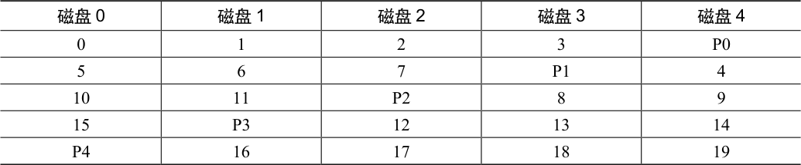

# 38.7 RAID 5 级：旋转奇偶校验

为解决小写入问题（至少部分解决），Patterson、Gibson 和Katz 推出了RAID-5。RAID-5的工作原理与RAID-4 几乎完全相同，只是它将奇偶校验块跨驱动器旋转（见表38.9）。

表格文字

| 磁盘0 | 磁盘1 | 磁盘2 | 磁盘3 | 磁盘4 |
| --- | --- | --- | --- | --- |
| 0 | 1 | 2 | 3 | P0 |
| 5 | 6 | 7 | P1 | 4 |
| 10 | 11 | P2 | 8 | 9 |
| 15 | P3 | 12 | 13 | 14 |
| P4 | 16 | 17 | 18 | 19 |

如你所见，每个条带的奇偶校验块现在都在磁盘上旋转，以消除RAID-4 的奇偶校验磁盘瓶颈。

## RAID-5 分析

RAID-5 的大部分分析与RAID-4 相同。例如，两级的有效容量和容错能力是相同的。顺序读写性能也是如此。单个请求（无论是读还是写）的延迟也与RAID-4 相同。

随机读取性能稍好一点，因为我们可以利用所有的磁盘。最后，RAID-4 的随机写入性能明显提高，因为它允许跨请求进行并行处理。想象一下写入块 1 和写入块 10。这将变成对磁盘 1 和磁盘 4（对于块 1 及其奇偶校验）的请求以及对磁盘 0 和磁盘 2（对于块 10 及其奇偶校验）的请求。因此，它们可以并行进行。事实上，我们通常可以假设，如果有大量的随机请求，我们将能够保持所有磁盘均匀忙碌。如果是这样的话，那么我们用于小写入的总带宽将是 (N/4) · R MB/s。4 倍损失是由于每个 RAID-5 写入仍然产生总计 4 个 I/O 操作，这就是使用基于奇偶校验的 RAID 的成本。

由于RAID-5 基本上与RAID-4 相同，只是在少数情况下它更好，所以它几乎完全取代了市场上的RAID-4。唯一没有取代的地方是系统知道自己绝不会执行大写入以外的任何事情，从而完全避免了小写入问题[HLM94]。在这些情况下，有时会使用RAID-4，因为它的构建稍微简单一些。
