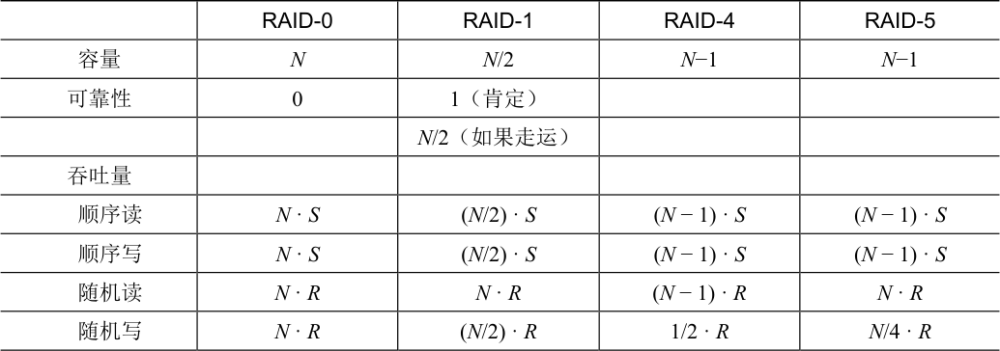
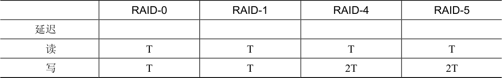

# 38.8 RAID 比较：总结

现在简单总结一下表38.10 中各级RAID 的比较。请注意，我们省略了一些细节来简化分析。例如，在镜像系统中写入时，平均查找时间比写入单个磁盘时稍高，因为寻道时间是两个寻道时间（每个磁盘上一个）的最大值。因此，对两个磁盘的随机写入性能通常会比单个磁盘的随机写入性能稍差。此外，在RAID-4/5 中更新奇偶校验磁盘时，旧奇偶校验的第一次读取可能会导致完全寻道和旋转，但第二次写入奇偶校验只会导致旋转。

表格文字

|  | RAID-0 | RAID-1 | RAID-4 | RAID-5 |
| --- | --- | --- | --- | --- |
| 容量 | N | N/2 | N−1 | N−1 |
| 可靠性 | 0 | 1（肯定） |  |  |
|  |  | N/2（如果走运） |  |  |
| 吞吐量 |  |  |  |  |
| 顺序读 | N · S | (N/2) · S | (N − 1) · S | (N − 1) · S |
| 顺序写 | N · S | (N/2) · S | (N − 1) · S | (N − 1) · S |
| 随机读 | N · R | N · R | (N − 1) · R | N · R |
| 随机写 | N · R | (N/2) · R | 1/2 · R | N/4 · R |

续表

表格文字

|  | RAID-0 | RAID-1 | RAID-4 | RAID-5 |
| --- | --- | --- | --- | --- |
| 延迟 |  |  |  |  |
| 读 | T | T | T | T |
| 写 | T | T | 2T | 2T |

但是，表38.10 中的比较确实抓住了基本差异，对于理解RAID 各级之间的折中很有用。对于延迟分析，我们就使用T 来表示对单个磁盘的请求所需的时间。

总之，如果你严格要求性能而不关心可靠性，那么条带显然是最好的。但是，如果你想要随机I/O 的性能和可靠性，镜像是最好的，你付出的代价是容量下降。如果容量和可靠性是你的主要目标，那么RAID-5 胜出，你付出的代价是小写入的性能。最后，如果你总是在按顺序执行I/O 操作并希望最大化容量，那么RAID-5 也是最有意义的。
