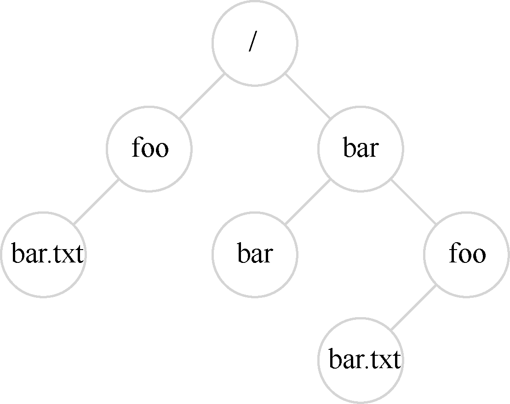

# 39.1 文件和目录

随着时间的推移，存储虚拟化形成了两个关键的抽象。第一个是文件（file）。文件就是一个线性字节数组，每个字节都可以读取或写入。每个文件都有某种低级名称（low-level name），通常是某种数字。用户通常不知道这个名字（我们稍后会看到）。由于历史原因，文件的低级名称通常称为inode 号（inode number）。我们将在以后的章节中学习更多关于inode 的知识。现在，只要假设每个文件都有一个与其关联的inode 号。

在大多数系统中，操作系统不太了解文件的结构（例如，它是图片、文本文件还是C代码）。相反，文件系统的责任仅仅是将这些数据永久存储在磁盘上，并确保当你再次请求数据时，得到你原来放在那里的内容。做到这一点并不像看起来那么简单！

第二个抽象是目录（directory）。一个目录，像一个文件一样，也有一个低级名字（即inode 号），但是它的内容非常具体：它包含一个（用户可读名字，低级名字）对的列表。例如，假设存在一个低级别名称为“10”的文件，它的用户可读的名称为“foo”。“foo”所在的目录因此会有条目（“foo”，“10”），将用户可读名称映射到低级名称。目录中的每个条目都指向文件或其他目录。通过将目录放入其他目录中，用户可以构建任意的目录树（directory tree，或目录层次结构，directory hierarchy），在该目录树下存储所有文件和目录。

目录层次结构从根目录（root directory）开始（在基于UNIX 的系统中，根目录就记为“/”），并使用某种分隔符（separator）来命名后续子目录

（sub-directories），直到命名所需的文件或目录。例如，如果用户在根目录中创建了一个目录foo，然后在目录foo中创建了一个文件bar.txt，我们就可以通过它的绝对路径名（absolute pathname）来引用该文件，在这个例子中，它将是/foo/bar.txt。更复杂的目录树，请参见图39.1。示例中的有效目录是/，/foo，/bar，/bar/bar，/bar/foo，有效的文件是/foo/bar.txt 和/bar/foo/bar.txt。目录和文件可以具有相同的名称，只要它们位于文件系统树的不同位置（例如，图中有两个名为bar.txt 的文件：/foo/bar.txt 和/bar/foo/bar.txt）。

> **提示：请仔细考虑命名**

> 命名是计算机系统的一个重要方面[SK09]。在UNIX 系统中，你几乎可以想到的所有内容都是通过文件系统命名的。除了文件、设备、管道，甚至进程[K84]都可以在一个看似普通的旧文件系统中看到。这种命名的一致性简化了系统的概念模型，使系统更简单、更模块化。因此，无论何时创建系统或接口，都要仔细考虑你使用的是什么名称。

你可能还会注意到，这个例子中的文件名通常包含两部分：bar 和txt，以句点分隔。第一部分是任意名称，而文件名的第二部分通常用于指示文件的类型（type），例如，它是C代码（例如.c）还是图像（例如.jpg），或音乐文件（例如.mp3）。然而，这通常只是一个惯例（convention）：一般不会强制名为main.c 的文件中包含的数据确实是C 源代码。

因此，我们可以看到文件系统提供的了不起的东西：一种方便的方式来命名我们感兴趣的所有文件。名称在系统中很重要，因为访问任何资源的第一步是能够命名它。在UNIX系统中，文件系统提供了一种统一的方式来访问磁盘、U 盘、CD-ROM、许多其他设备上的文件，事实上还有很多其他的东西，都位于单一目录树下。
