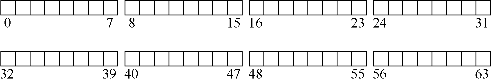
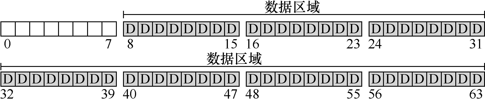
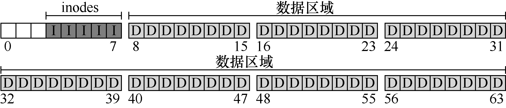
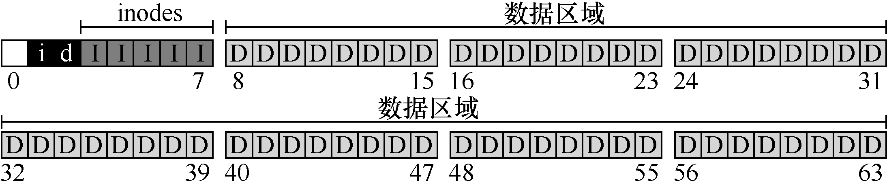
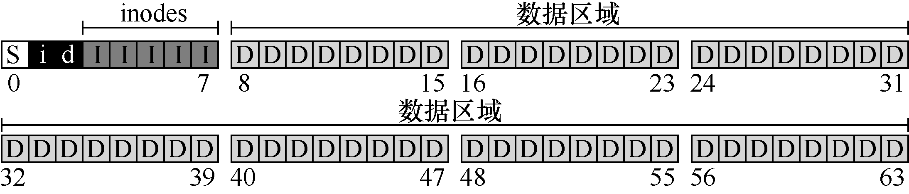

# 40.2 整体组织

我们现在来开发VSFS 文件系统在磁盘上的数据结构的整体组织。我们需要做的第一件事是将磁盘分成块（block）。简单的文件系统只使用一种块大小，这里正是这样做的。我们选择常用的4KB。

因此，我们对构建文件系统的磁盘分区的看法很简单：一系列块，每块大小为4KB。在大小为N 个4KB 块的分区中，这些块的地址为从0 到N−1。假设我们有一个非常小的磁盘，只有64 块：

现在让我们考虑一下，为了构建文件系统，需要在这些块中存储什么。当然，首先想到的是用户数据。实际上，任何文件系统中的大多数空间都是（并且应该是）用户数据。我们将用于存放用户数据的磁盘区域称为数据区域（data region），简单起见，将磁盘的固定部分留给这些块，例如磁盘上64 个块的最后56 个：

正如我们在第39 章中了解到的，文件系统必须记录每个文件的信息。该信息是元数据（metadata）的关键部分，并且记录诸如文件包含哪些数据块（在数据区域中）、文件的大小，其所有者和访问权限、访问和修改时间以及其他类似信息的事情。为了存储这些信息，文件系统通常有一个名为inode 的结构（后面会详细介绍inode）。

为了存放inode，我们还需要在磁盘上留出一些空间。我们将这部分磁盘称为inode 表（inode table），它只是保存了一个磁盘上inode 的数组。因此，假设我们将64 个块中的5 块用于inode，磁盘映像现在看起来如下：

在这里应该指出，inode 通常不是那么大，例如，只有128 或256 字节。假设每个inode有256 字节，一个4KB 块可以容纳16 个inode，而我们上面的文件系统则包含80 个inode。在我们简单的文件系统中，建立在一个小小的64 块分区上，这个数字表示文件系统中可以拥有的最大文件数量。但是请注意，建立在更大磁盘上的相同文件系统可以简单地分配更大的inode 表，从而容纳更多文件。

到目前为止，我们的文件系统有了数据块（D）和inode（I），但还缺一些东西。你可能已经猜到，还需要某种方法来记录inode 或数据块是空闲还是已分配。因此，这种分配结构（allocation structure）是所有文件系统中必需的部分。

当然，可能有许多分配记录方法。例如，我们可以用一个空闲列表（free list），指向第一个空闲块，然后它又指向下一个空闲块，依此类推。我们选择一种简单而流行的结构，称为位图（bitmap），一种用于数据区域（数据位图，data bitmap），另一种用于inode 表（inode位图，inode bitmap）。位图是一种简单的结构：每个位用于指示相应的对象/块是空闲（0）还是正在使用（1）。因此新的磁盘布局如下，包含inode 位图（i）和数据位图（d）：

你可能会注意到，对这些位图使用整个4KB 块是有点杀鸡用牛刀。这样的位图可以记录32KB 对象是否分配，但我们只有80 个inode 和56 个数据块。但是，简单起见，我们就为每个位图使用整个4KB 块。

细心的读者可能已经注意到，在极简文件系统的磁盘结构设计中，还有一块。我们将它保留给超级块（superblock），在下图中用S 表示。超级块包含关于该特定文件系统的信息，包括例如文件系统中有多少个inode 和数据块（在这个例子中分别为80 和56）、inode 表的开始位置（块3）等等。它可能还包括一些幻数，来标识文件系统类型（在本例中为VSFS）。

因此，在挂载文件系统时，操作系统将首先读取超级块，初始化各种参数，然后将该卷添加到文件系统树中。当卷中的文件被访问时，系统就会知道在哪里查找所需的磁盘上的结构。
