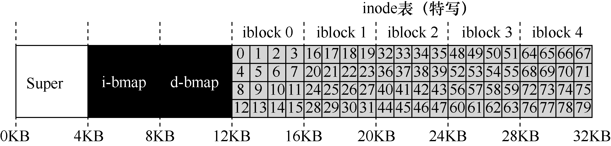
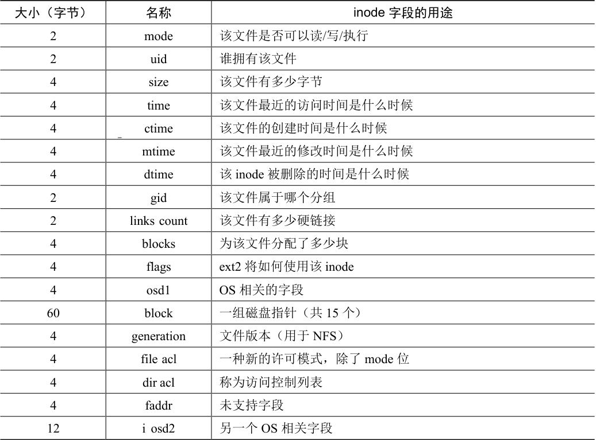

# 40.3 文件组织：inode

文件系统最重要的磁盘结构之一是inode，几乎所有的文件系统都有类似的结构。名称inode 是index node（索引节点）的缩写，它是由UNIX 开发人员Ken Thompson [RT74]给出的历史性名称，因为这些节点最初放在一个数组中，在访问特定inode 时会用到该数组的索引。

> **补充：数据结构—— inode**

> inode 是许多文件系统中使用的通用名称，用于描述保存给定文件的元数据的结构，例如其长度、权限以及其组成块的位置。这个名称至少可以追溯到UNIX（如果不是早期的系统，可能还会追溯到Multics）。它是index node（索引节点）的缩写，因为inode 号用于索引磁盘上的inode 数组，以便查找该inode 号对应的inode。我们将看到，inode 的设计是文件系统设计的一个关键部分。大多数现代系统对于它们记录的每个文件都有这样的结构，但也许用了不同的名字（如dnodes、fnodes 等）。

每个inode 都由一个数字（称为inumber）隐式引用，我们之前称之为文件的低级名称（low-level name）。在VSFS（和其他简单的文件系统）中，给定一个inumber，你应该能够直接计算磁盘上相应节点的位置。例如，如上所述，获取VSFS 的inode 表：大小为20KB（5 个4KB 块），因此由80 个inode（假设每个inode 为256 字节）组成。进一步假设inode区域从12KB 开始（即超级块从0KB 开始，inode 位图在4KB 地址，数据位图在8KB，因此inode 表紧随其后）。因此，在VSFS 中，我们为文件系统分区的开头提供了以下布局（特写视图）：



要读取inode 号32，文件系统首先会计算inode 区域的偏移量（32×inode 的大小，即8192），将它加上磁盘inode 表的起始地址（inodeStartAddr = 12KB），从而得到希望的inode块的正确字节地址：20KB。回想一下，磁盘不是按字节可寻址的，而是由大量可寻址扇区组成，通常是512 字节。因此，为了获取包含索引节点32 的索引节点块，文件系统将向节点（即40）发出一个读取请求，取得期望的inode 块。更一般地说，inode 块的扇区地址iaddr可以计算如下：

```text
blk    = (inumber * sizeof(inode_t)) / blockSize;
sector = ((blk * blockSize) + inodeStartAddr) / sectorSize;
```

在每个inode 中，实际上是所有关于文件的信息：文件类型（例如，常规文件、目录等）、大小、分配给它的块数、保护信息（如谁拥有该文件以及谁可以访问它）、一些时间信息（包括文件创建、修改或上次访问的时间文件下），以及有关其数据块驻留在磁盘上的位置的信息（如某种类型的指针）。我们将所有关于文件的信息称为元数据（metadata）。实际上，文件系统中除了纯粹的用户数据外，其他任何信息通常都称为元数据。表40.1 所示的是ext2[P09]的inode 的例子。

设计inode 时，最重要的决定之一是它如何引用数据块的位置。一种简单的方法是在inode 中有一个或多个直接指针（磁盘地址）。每个指针指向属于该文件的一个磁盘块。这种方法有局限：例如，如果你想要一个非常大的文件（例如，大于块的大小乘以直接指针数），那就不走运了。



<details markdown="1">
<summary>表格文字</summary>

| 大小（字节） | 名称 | inode 字段的用途 |
| --- | --- | --- |
| 2 | mode | 该文件是否可以读/写/执行 |
| 2 | uid | 谁拥有该文件 |
| 4 | size | 该文件有多少字节 |
| 4 | time | 该文件最近的访问时间是什么时候 |
| 4 | ctime | 该文件的创建时间是什么时候 |
| 4 | mtime | 该文件最近的修改时间是什么时候 |
| 4 | dtime | 该inode 被删除的时间是什么时候 |
| 2 | gid | 该文件属于哪个分组 |
| 2 | links count | 该文件有多少硬链接 |
| 4 | blocks | 为该文件分配了多少块 |
| 4 | flags | ext2 将如何使用该inode |
| 4 | osd1 | OS 相关的字段 |
| 60 | block | 一组磁盘指针（共15 个） |
| 4 | generation | 文件版本（用于NFS） |
| 4 | file acl | 一种新的许可模式，除了mode 位 |
| 4 | dir acl | 称为访问控制列表 |
| 4 | faddr | 未支持字段 |
| 12 | i osd2 | 另一个OS 相关字段 |

</details>

## 多级索引

为了支持更大的文件，文件系统设计者必须在inode 中引入不同的结构。一个常见的思路是有一个称为间接指针（indirect pointer）的特殊指针。它不是指向包含用户数据的块，而是指向包含更多指针的块，每个指针指向用户数据。因此，inode 可以有一些固定数量（例如 12 个）的直接指针和一个间接指针。如果文件变得足够大，则会分配一个间接块（来自磁盘的数据块区域），并将inode 的间接指针设置为指向它。假设一个块是4KB，磁盘地址是4 字节，那就增加了1024 个指针。文件可以增长到（12 + 1024）×4KB，即4144KB。

> **提示：考虑基于范围的方法**

> 另一种方法是使用范围（extent）而不是指针。范围就是一个磁盘指针加一个长度（以块为单位）。因此，不需要指向文件的每个块的指针，只需要指针和长度来指定文件的磁盘位置。只有一个范围是有局限的，因为分配文件时可能无法找到连续的磁盘可用空间块。因此，基于范围的文件系统通常允许多个范围，从而在文件分配期间给予文件系统更多的自由。

> 这两种方法相比较，基于指针的方法是最灵活的，但是每个文件使用大量元数据（尤其是大文件）。基于范围的方法不够灵活但更紧凑。特别是，如果磁盘上有足够的可用空间并且文件可以连续布局（无论如何，这实际上是所有文件分配策略的目标），基于范围的方法都能正常工作。

毫不奇怪，在这种方法中，你可能希望支持更大的文件。为此，只需添加另一个指向inode 的指针：双重间接指针（double indirect pointer）。该指针指的是一个包含间接块指针的块，每个间接块都包含指向数据块的指针。因此，双重间接块提供了可能性，允许使用额外的1024×1024 个4KB 块来增长文件，换言之，支持超过4GB 大小的文件。不过，你可能想要更多，我们打赌你知道怎么办：三重间接指针（triple indirect pointer）。

总之，这种不平衡树被称为指向文件块的多级索引（multi-level index）方法。我们来看一个例子，它有12 个直接指针，以及一个间接块和一个双重间接块。假设块大小为4KB，并且指针为4 字节，则该结构可以容纳一个刚好超过4GB 的文件，即（12 + 1024 + 1024<sup>2</sup>）×4KB。增加一个三重间接块，你是否能弄清楚支持多大的文件？（提示：很大）

许多文件系统使用多级索引，包括常用的文件系统，如Linux ext2 [P09]和ext3，NetApp的WAFL，以及原始的UNIX 文件系统。其他文件系统，包括SGI XFS 和Linux ext4，使用范围而不是简单的指针。有关基于范围的方案如何工作的详细信息，请参阅前面的内容（它们类似于讨论虚拟内存时的段）。

你可能想知道：为什么使用这样的不平衡树？为什么不采用不同的方法？好吧，事实证明，许多研究人员已经研究过文件系统以及它们的使用方式，几乎每次他们都发现了某些“真相”，几十年来都是如此。其中一个真相是，大多数文件很小。这种不平衡的设计反映了这样的现实。如果大多数文件确实很小，那么为这种情况优化是有意义的。因此，使用少量的直接指针（12 是一个典型的数字），inode 可以直接指向48KB 的数据，需要一个（或多个）间接块来处理较大的文件。参见Agrawal 等人最近的研究[A+07]。表40.2 总结了这些结果。


<details markdown="1">
<summary>表格文字</summary>

| 大多数文件很小 | 大约2KB 是常见大小 |
| --- | --- |
| 平均文件大小在增长 | 几乎平均增长200KB |
| 大多数字节保存在大文件中 | 少数大文件使用了大部分空间 |
| 文件系统包含许多文件 | 几乎平均100KB |
| 文件系统大约一半是满的 | 尽管磁盘在增长，文件系统仍保持约50%是满的 |
| 目录通常很小 | 许多只有少量条目，大多数少于20 个条目 |

</details>

> **补充：基于链接的方法**

> 设计inode 有另一个更简单的方法，即使用链表（linked list）。这样，在一个inode 中，不是有多个指针，只需要一个，指向文件的第一个块。要处理较大的文件，就在该数据块的末尾添加另一个指针等，这样就可以支持大文件。

> 你可能已经猜到，链接式文件分配对于某些工作负载表现不佳。例如，考虑读取文件的最后一个块，或者就是进行随机访问。因此，为了使链接式分配更好地工作，一些系统在内存中保留链接信息表，而不是将下一个指针与数据块本身一起存储。该表用数据块D 的地址来索引，一个条目的内容就是D 的下一个指针，即D 后面的文件中的下一个块的地址。那里也可以是空值（表示文件结束），或用其他标记来表示一个特定的块是空闲的。拥有这样的下一块指针表，使得链接分配机制可以有效地进行随机文件访问，只需首先扫描（在内存中）表来查找所需的块，然后直接访问（在磁盘上）。

> 这样的表听起来很熟悉吗？我们描述的是所谓的文件分配表（File Allocation Table，FAT）—文件系统的基本结构。是的，在NTFS [C94]之前，这款经典的旧Windows 文件系统基于简单的基于链接的分配方案。它与标准UNIX 文件系统还有其他不同之处。例如，本身没有inode，而是存储关于文件的元数据的目录条目，并且直接指向所述文件的第一个块，这导致不可能创建硬链接。参见Brouwer 的著作 [B02]，了解更多不够优雅的细节。

当然，在inode 设计的空间中，存在许多其他可能性。毕竟，inode 只是一个数据结构，任何存储相关信息并可以有效查询的数据结构就足够了。由于文件系统软件很容易改变，如果工作负载或技术发生变化，你应该愿意探索不同的设计。
