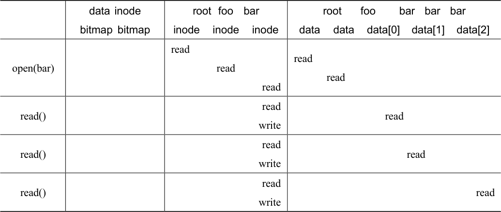
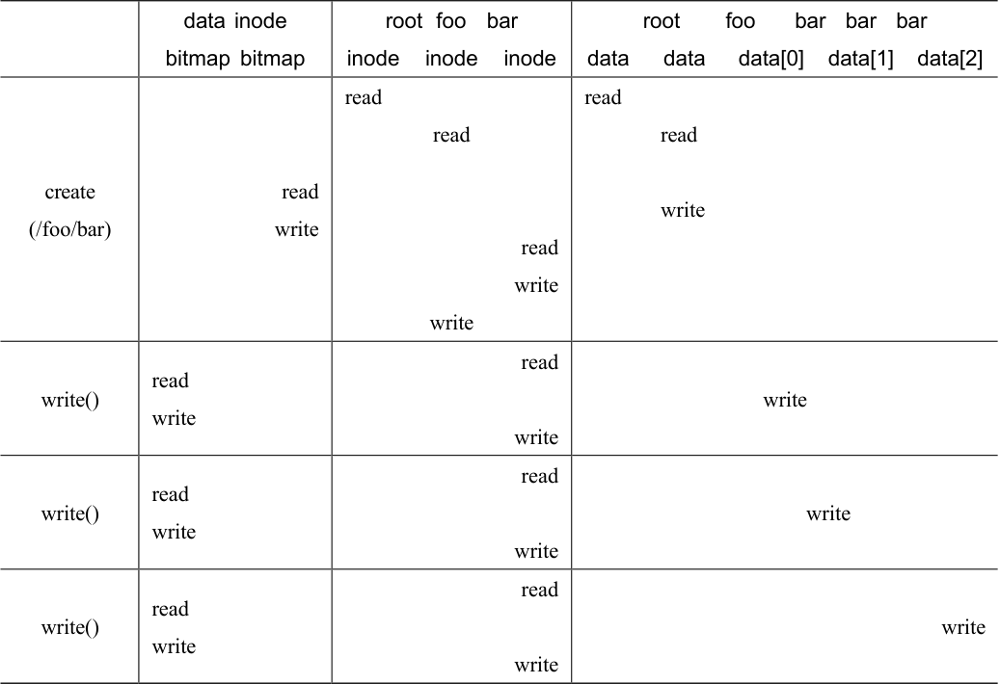

# 40.6 访问路径：读取和写入

现在我们已经知道文件和目录如何存储在磁盘上，我们应该能够明白读取或写入文件的操作过程。理解这个访问路径（access path）上发生的事情，是开发人员理解文件系统如何工作的第二个关键。请注意！

对于下面的例子，我们假设文件系统已经挂载，因此超级块已经在内存中。其他所有内容（如inode、目录）仍在磁盘上。

## 从磁盘读取文件

在这个简单的例子中，让我们先假设你只是想打开一个文件（例如/foo/bar，读取它，然后关闭它）。对于这个简单的例子，假设文件的大小只有4KB（即1 块）。

当你发出一个open("/foo/bar", O\_RDONLY)调用时，文件系统首先需要找到文件bar 的inode，从而获取关于该文件的一些基本信息（权限信息、文件大小等等）。为此，文件系统必须能够找到inode，但它现在只有完整的路径名。文件系统必须遍历（traverse）路径名，从而找到所需的inode。

所有遍历都从文件系统的根开始，即根目录（root directory），它就记为/。因此，文件系统的第一次磁盘读取是根目录的inode。但是这个inode 在哪里？要找到inode，我们必须知道它的i-number。通常，我们在其父目录中找到文件或目录的i-number。根没有父目录（根据定义）。因此，根的inode 号必须是“众所周知的”。在挂载文件系统时，文件系统必须知道它是什么。在大多数UNIX 文件系统中，根的inode 号为2。因此，要开始该过程，文件系统会读入inode 号2 的块（第一个inode 块）。

一旦inode 被读入，文件系统可以在其中查找指向数据块的指针，数据块包含根目录的内容。因此，文件系统将使用这些磁盘上的指针来读取目录，在这个例子中，寻找foo 的条目。通过读入一个或多个目录数据块，它将找到foo 的条目。一旦找到，文件系统也会找到下一个需要的foo 的inode 号（假定是44）。

下一步是递归遍历路径名，直到找到所需的inode。在这个例子中，文件系统读取包含foo 的inode 及其目录数据的块，最后找到bar 的inode 号。open()的最后一步是将bar 的inode读入内存。然后文件系统进行最后的权限检查，在每个进程的打开文件表中，为此进程分配一个文件描述符，并将它返回给用户。

打开后，程序可以发出read()系统调用，从文件中读取。第一次读取（除非lseek()已被调用，则在偏移量0 处）将在文件的第一个块中读取，查阅inode 以查找这个块的位置。它也会用新的最后访问时间更新inode。读取将进一步更新此文件描述符在内存中的打开文件表，更新文件偏移量，以便下一次读取会读取第二个文件块，等等。

> **补充：读取不会访问分配结构**

> 我们曾见过许多学生对分配结构（如位图）感到困惑。特别是，许多人经常认为，只是简单地读取文件而不分配任何新块时，也会查询位图。不是这样的！分配结构（如位图）只有在需要分配时才会访问。inode、目录和间接块具有完成读请求所需的所有信息。inode 已经指向一个块，不需要再次确认它已分配。

在某个时候，文件将被关闭。这里要做的工作要少得多。很明显，文件描述符应该被释放，但现在，这就是FS 真正要做的。没有磁盘I/O 发生。

整个过程如表40.3 所示（向下时间递增）。在该表中，打开导致了多次读取，以便最终找到文件的inode。之后，读取每个块需要文件系统首先查询inode，然后读取该块，再使用写入更新inode 的最后访问时间字段。花一些时间，试着理解发生了什么。

另外请注意，open 导致的I/O 量与路径名的长度成正比。对于路径中的每个增加的目录，我们都必须读取它的inode 及其数据。更糟糕的是，会出现大型目录。在这里，我们只需要读取一个块来获取目录的内容，而对于大型目录，我们可能需要读取很多数据块才能找到所需的条目。是的，读取文件时生活会变得非常糟糕。你会发现，写入一个文件（尤其是创建一个新文件）更糟糕。

表格文字

|  | data inode bitmap bitmap | root foo bar inode inode inode | root foo bar bar bar data data data[0] data[1] data[2] |
| --- | --- | --- | --- |
| open(bar) |  | read read read | read read |
| read() |  | read write | read |
| read() |  | read write | read |
| read() |  | read write | read |

## 写入磁盘

写入文件是一个类似的过程。首先，文件必须打开（如上所述）。其次，应用程序可以发出write()调用以用新内容更新文件。最后，关闭该文件。

与读取不同，写入文件也可能会分配（allocate）一个块（除非块被覆写）。当写入一个新文件时，每次写入操作不仅需要将数据写入磁盘，还必须首先决定将哪个块分配给文件，从而相应地更新磁盘的其他结构（例如数据位图和inode）。因此，每次写入文件在逻辑上会导致5 个I/O：一个读取数据位图（然后更新以标记新分配的块被使用），一个写入位图（将它的新状态存入磁盘），再是两次读取，然后写入inode（用新块的位置更新），最后一次写入真正的数据块本身。

考虑简单和常见的操作（例如文件创建），写入的工作量更大。要创建一个文件，文件系统不仅要分配一个inode，还要在包含新文件的目录中分配空间。这样做的I/O 工作总量非常大：一个读取inode 位图（查找空闲inode），一个写入inode 位图（将其标记为已分配），一个写入新的inode 本身（初始化它），一个写入目录的数据（将文件的高级名称链接到它的inode 号），以及一个读写目录inode 以便更新它。如果目录需要增长以容纳新条目，则还需要额外的I/O（即数据位图和新目录块）。所有这些只是为了创建一个文件！

我们来看一个具体的例子，其中创建了file/foo/bar，并且向它写入了 3 个块。表 40.4展示了在open()（创建文件）期间和在3 个4KB 写入期间发生的情况。

在该表中，对磁盘的读取和写入放在导致它们发生的系统调用之下，它们可能发生的大致顺序从表的顶部到底部依次进行。你可以看到创建该文件需要多少工作：在这种情况下，有10 次I/O，用于遍历路径名，然后创建文件。你还可以看到每个分配写入需要5 次I/O：一对读取和更新inode，另一对读取和更新数据位图，最后写入数据本身。文件系统如何以合理的效率完成这些任务？

表格文字

|  | data inode bitmap bitmap | root foo bar inode inode inode | root foo bar bar bar data data data[0] data[1] data[2] |
| --- | --- | --- | --- |
| create (/foo/bar) | read write | read read read write write | read read write |
| write() | read write | read write | write |
| write() | read write | read write | write |
| write() | read write | read write | write |

> **关键问题：如何降低文件系统I/O 成本**

> 即使是最简单的操作，如打开、读取或写入文件，也会产生大量I/O 操作，分散在磁盘上。文件系统可以做些什么，来降低执行如此多I/O 的高成本？
