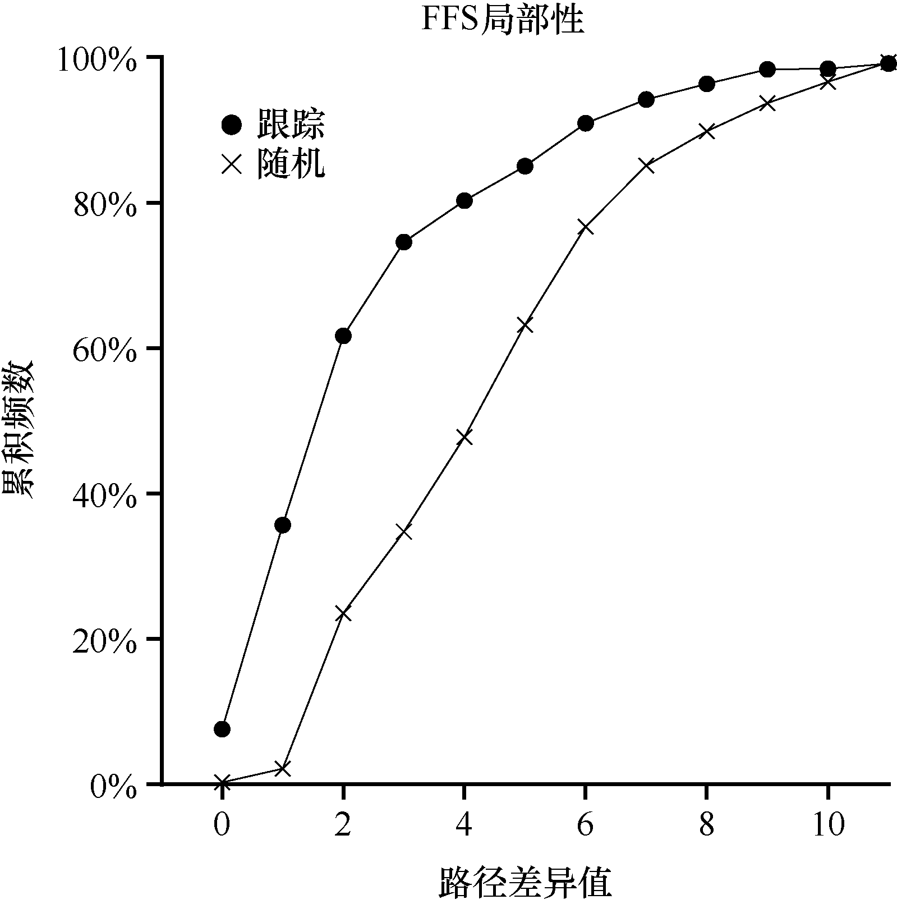

# 41.5 测量文件的局部性

为了更好地理解这些推断方法是否有意义，我们决定分析文件系统访问的一些跟踪记录，看看是否确实存在命名空间的局部性。出于某种原因，文献中似乎没有对这个主题进行过很好的研究。

具体来说，我们进行了SEER 跟踪[K94]，并分析了目录树中不同文件的访问有多“遥远”。例如，如果打开文件f，然后跟踪到它重新打开（在打开任何其他文件之前），则在目录树中打开的这两个文件之间的距离为零（因为它们是同一文件）。如果打开目录dir 中的文件f（即dir/f），然后在同一目录中打开文件g（即dir/g），则两个文件访问之间的距离为1，因为它们共享相同的目录，但不是同一个文件。换句话说，我们的距离度量标准衡量为了找到两个文件的共同祖先，必须在目录树上走多远。它们在树上越靠近，度量值越低。

图41.1展示了SEER跟踪中看到的局部性，针对SEER集群中所有工作站上的所有SEER跟踪。其中的x 轴是差异度量值，y 轴是具有该差异值的文件打开的累积百分比。具体来说，对于SEER 跟踪（图中标记为“跟踪”），你可以看到大约7%的文件访问是先前打开的文件，并且近40%的文件访问是相同的文件或同一目录中的文件（即0 或1 的差异值）。因此，FFS的局部性假设似乎有意义（至少对于这些跟踪）。

有趣的是，另外25%左右的文件访问是距

离为2 的文件。当用户以多级方式构造一组相关目录，并不断在它们之间跳转时，就会发生这种类型的局部性。例如，如果用户有一个src目录，并将目标文件（.o 文件）构建到obj 目录中，并且这两个目录都是主proj 目录的子目录，则常见访问模式就是proj/src/foo .c 后跟着proj/obj/foo.o。这两个访问之间的距离是2，因为proj 是共同的祖先。FFS 在其策略中没有考虑这种类型的局部性，因此在这种访问之间会发生更多的寻道。

为了进行比较，我们还展示了“随机”跟踪的局部性。我们以随机的顺序，从原有的SEER 跟踪中选择文件，计算这些随机顺序访问之间的距离度量值，从而生成随机跟踪。如你所见，随机跟踪中的命名空间局部性较少，和预期的一样。但是，因为最终每个文件共享一个共同的祖先（即根），总会有一些局部性，因此随机跟踪可以作为比较点。
