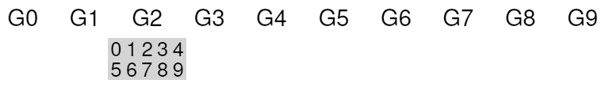
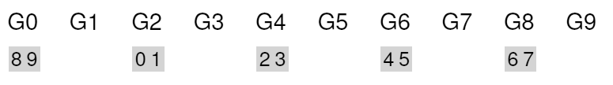
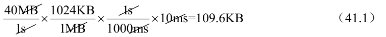
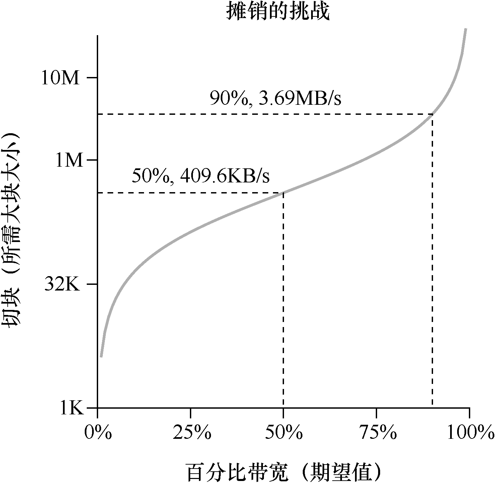

# 41.6 大文件例外

在FFS 中，文件放置的一般策略有一个重要的例外，它出现在大文件中。如果没有不同的规则，大文件将填满它首先放入的块组（也可能填满其他组）。以这种方式填充块组是不符合需要的，因为它妨碍了随后的“相关”文件放置在该块组内，因此可能破坏文件访问的局部性。

因此，对于大文件，FFS 执行以下操作。在将一定数量的块分配到第一个块组（例如，12 个块，或inode 中可用的直接指针的数量）之后，FFS 将文件的下一个“大”块（即第一个间接块指向的那些部分）放在另一个块组中（可能因为它的利用率低而选择）。然后，文件的下一个块放在另一个不同的块组中，依此类推。

让我们看一些图片，更好地理解这个策略。如果没有大文件例外，单个大文件会将其所有块放入磁盘的一部分。我们使用一个包含10 个块的文件的小例子，来直观地说明该行为。

以下是FFS 没有大文件例外时的图景：

有了大文件例外，我们可能会看到像这样的情形，文件以大块的形式分布在磁盘上：

聪明的读者会注意到，在磁盘上分散文件块会损害性能，特别是在顺序文件访问的相对常见的情况下（例如，当用户或应用程序按顺序读取块0～9 时）。你是对的！确实会。我们可以通过仔细选择大块大小，来改善这一点。

具体来说，如果大块大小足够大，我们大部分时间仍然花在从磁盘传输数据上，而在大块之间寻道的时间相对较少。每次开销做更多工作，从而减少开销，这个过程称为摊销（amortization），它是计算机系统中的常用技术。

举个例子：假设磁盘的平均定位时间（即寻道和旋转）是10ms。进一步假设磁盘以40 MB/s 的速率传输数据。如果我们的目标是花费一半的时间来寻找数据块，一半时间传输数据（从而达到峰值磁盘性能的50%），那么需要每10ms 定位开销导致10ms 的传输数据。所以问题就变成了：为了在传输中花费10ms，大块必须有多大？简单，只需使用数学，特别是我们在磁盘章节中提到的量纲分析：

基本上，这个等式是说：如果你以40 MB/s 的速度传输数据，每次寻找时只需要传输409.6KB，就能花费一半的时间寻找，一半的时间传输。同样，你可以计算达到90%峰值带宽所需的块大小（结果大约为3.69MB），甚至达到99%的峰值带宽（40.6MB！）。正如你所看到的，越接近峰值，这些块就越大（图41.2 展

示了这些值）。

但是，FFS 没有使用这种类型的计算来跨组分布大文件。相反，它采用了一种简单的方法，基于inode 本身的结构。前12 个直接块与inode 放在同一组中。每个后续的间接块，以及它指向的所有块都放在不同的组中。如果块大小为4KB，磁盘地址是32 位，则此策略意味着文件的每1024个块（4MB）放在单独的组中，唯一的例外是直接指针所指向的文件的前48KB。

我们应该注意到，磁盘驱动器的趋势是传输速率相当快，因为磁盘制造商擅长将更多位填塞到同一表面。但驱动器的机械方面与寻道相关（磁盘臂速度和旋转速度），改善相当缓慢[P98]。这意味着随着时间的推移，机械成本变得相对昂贵，因此，为了摊销所述成本，你必须在寻道之间传输更多数据。
