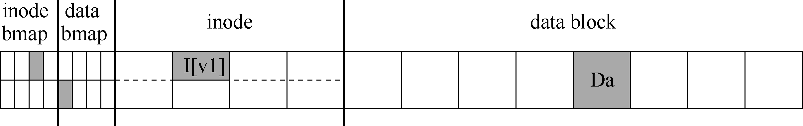
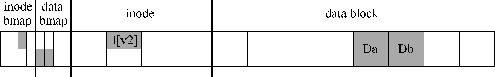

# 42.1 一个详细的例子

为了开始对日志的调查，先看一个例子。我们需要一种工作负载（workload），它以某种方式更新磁盘结构。这里假设工作负载很简单：将单个数据块附加到原有文件。通过打开文件，调用lseek()将文件偏移量移动到文件末尾，然后在关闭文件之前，向文件发出单个4KB 写入来完成追加。

我们还假定磁盘上使用标准的简单文件系统结构，类似于之前看到的文件系统。这个小例子包括一个inode 位图（inode bitmap，只有8 位，每个inode 一个），一个数据位图（data bitmap，也是8 位，每个数据块一个），inode（总共8 个，编号为0 到7，分布在4 个块上），以及数据块（总共8 个，编号为0～7）。以下是该文件系统的示意图：



查看图中的结构，可以看到分配了一个inode（inode 号为2），它在inode 位图中标记，单个分配的数据块（数据块4）也在数据中标记位图。inode 表示为I [v1]，因为它是此inode的第一个版本。它将很快更新（由于上述工作负载）。

再来看看这个简化的inode。在I[v1]中，我们看到：

```text
owner       : remzi
permissions : read-write
size        : 1
pointer     : 4
pointer     : null
pointer     : null
pointer     : null
```

在这个简化的inode 中，文件的大小为1（它有一个块位于其中），第一个直接指针指向块4（文件的第一个数据块，Da），并且所有其他3 个直接指针都被设置为null（表示它们未被使用）。当然，真正的inode 有更多的字段。更多相关信息，请参阅前面的章节。

向文件追加内容时，要向它添加一个新数据块，因此必须更新3 个磁盘上的结构：inode（必须指向新块，并且由于追加而具有更大的大小），新数据块Db 和新版本的数据位图（称之为B[v2]）表示新数据块已被分配。

因此，在系统的内存中，有3 个块必须写入磁盘。更新的inode（inode 版本2，或简称为I [v2]）现在看起来像这样：

```text
owner       : remzi
permissions : read-write
size        : 2
pointer     : 4
pointer     : 5
pointer     : null
pointer     : null
```

更新的数据位图（B[v2]）现在看起来像这样：00001100。最后，有数据块（Db），它只是用户放入文件的内容。

我们希望文件系统的最终磁盘映像如下所示：



要实现这种转变，文件系统必须对磁盘执行3 次单独写入，分别针对inode（I[v2]），位图（B[v2]）和数据块（Db）。请注意，当用户发出write()系统调用时，这些写操作通常不会立即发生。脏的inode、位图和新数据先在内存（页面缓存，page cache，或缓冲区缓存，buffer cache）中存在一段时间。然后，当文件系统最终决定将它们写入磁盘时（比如说5s或30s），文件系统将向磁盘发出必要的写入请求。遗憾的是，可能会发生崩溃，从而干扰磁盘的这些更新。特别是，如果这些写入中的一个或两个完成后发生崩溃，而不是全部 3个，则文件系统可能处于有趣的状态。

## 崩溃场景

为了更好地理解这个问题，让我们看一些崩溃情景示例。想象一下，只有一次写入成功。因此有以下3 种可能的结果。

只将数据块（Db）写入磁盘。在这种情况下，数据在磁盘上，但是没有指向它的

inode，也没有表示块已分配的位图。因此，就好像写入从未发生过一样。从文件

系统崩溃一致性的角度来看，这种情况根本不是问题[^p400-1]。

只有更新的inode（I[v2]）写入了磁盘。在这种情况下，inode 指向磁盘地址（5），

其中Db 即将写入，但Db 尚未写入。因此，如果我们信任该指针，我们将从磁盘

读取垃圾数据（磁盘地址5 的旧内容）。

此外，遇到了一个新问题，我们将它称为文件系统不一致（file-system inconsistency）。磁盘上的位图告诉我们数据块5 尚未分配，但是inode 说它已经分配了。文件系统数据结构中的这种不同意见，是文件系统的数据结构不一致。要使用文件系统，我们必须以某种方式解决这个问题。

只有更新后的位图（B [v2]）写入了磁盘。在这种情况下，位图指示已分配块5，

但没有指向它的inode。因此文件系统再次不一致。如果不解决，这种写入将导致

空间泄露（space leak），因为文件系统永远不会使用块5。

在这个向磁盘写入3 次的尝试中，还有3 种崩溃场景。在这些情况下，两次写入成功，最后一次失败。

inode（I[v2]）和位图（B[v2]）写入了磁盘，但没有写入数据（Db）。在这种情

况下，文件系统元数据是完全一致的：inode 有一个指向块5 的指针，位图指示5

正在使用，因此从文件系统的元数据的角度来看，一切看起来都很正常。但是有

一个问题：5 中又是垃圾。

写入了inode（I[v2]）和数据块（Db），但没有写入位图（B[v2]）。在这种情况

下，inode 指向了磁盘上的正确数据，但同样在inode 和位图（B1）的旧版本之间

存在不一致。因此，我们在使用文件系统之前，又需要解决问题。

写入了位图（B[v2]）和数据块（Db），但没有写入inode（I[v2]）。在这种情况

下，inode 和数据位图之间再次存在不一致。但是，即使写入块并且位图指示其使

用，我们也不知道它属于哪个文件，因为没有inode 指向该块。

## 崩溃一致性问题

希望从这些崩溃场景中，你可以看到由于崩溃而导致磁盘文件系统映像可能出现的许多问题：在文件系统数据结构中可能存在不一致性。可能有空间泄露，可能将垃圾数据返回给用户，等等。理想的做法是将文件系统从一个一致状态（在文件被追加之前），原子地（atomically）移动到另一个状态（在inode、位图和新数据块被写入磁盘之后）。遗憾的是，做到这一点不容易，因为磁盘一次只提交一次写入，而这些更新之间可能会发生崩溃或断电。我们将这个一般问题称为崩溃一致性问题（crash-consistency problem，也可以称为一致性更新问题，consistent-update problem）。

[^p400-1]: 但是，对于刚丢失一些数据的用户来说，这可能是一个问题！
