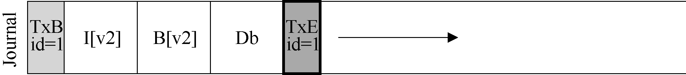
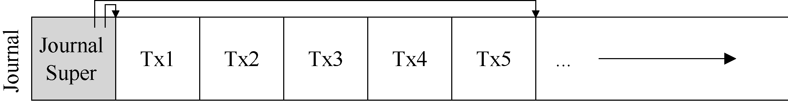
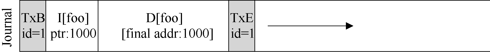
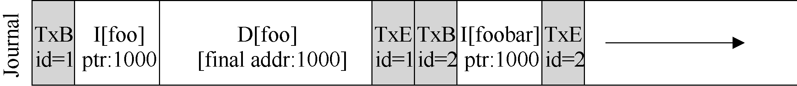
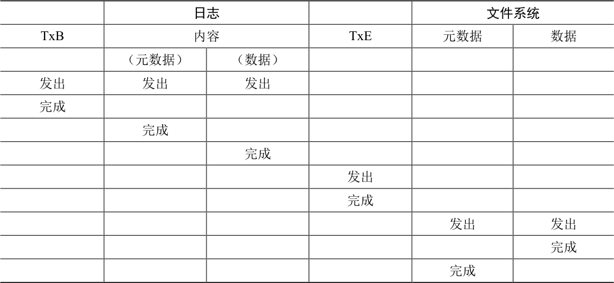
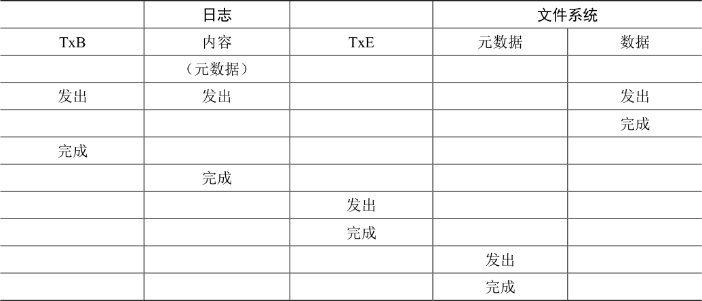

# 42.3 解决方案2：日志（或预写日志）

对于一致更新问题，最流行的解决方案可能是从数据库管理系统的世界中借鉴的一个想法。这种名为预写日志（write-ahead logging）的想法，是为了解决这类问题而发明的。在文件系统中，出于历史原因，我们通常将预写日志称为日志（journaling）。第一个实现它的文件系统是Cedar [H87]，但许多现代文件系统都使用这个想法，包括Linux ext3 和ext4、reiserfs、IBM 的JFS、SGI 的XFS 和Windows NTFS。

基本思路如下。更新磁盘时，在覆写结构之前，首先写下一点小注记（在磁盘上的其他地方，在一个众所周知的位置），描述你将要做的事情。写下这个注记就是“预写”部分，我们把它写入一个结构，并组织成“日志”。因此，就有了预写日志。

通过将注释写入磁盘，可以保证在更新（覆写）正在更新的结构期间发生崩溃时，能够返回并查看你所做的注记，然后重试。因此，你会在崩溃后准确知道要修复的内容（以及如何修复它），而不必扫描整个磁盘。因此，通过设计，日志功能在更新期间增加了一些工作量，从而大大减少了恢复期间所需的工作量。

我们现在将描述Linux ext3（一种流行的日志文件系统）如何将日志记录到文件系统中。大多数磁盘上的结构与Linux ext2 相同，例如，磁盘被分成块组，每个块组都有一个inode和数据位图以及inode 和数据块。新的关键结构是日志本身，它占用分区内或其他设备上的少量空间。因此，ext2 文件系统（没有日志）看起来像这样：

假设日志放在同一个文件系统映像中（虽然有时将它放在单独的设备上，或作为文件系统中的文件），带有日志的ext3 文件系统如下所示：

真正的区别只是日志的存在，当然，还有它的使用方式。

## 数据日志

看一个简单的例子，来理解数据日志（data journaling）的工作原理。数据日志作为Linux ext3 文件系统的一种模式提供，本讨论的大部分内容都来自于此。

假设再次进行标准的更新，我们再次希望将inode（I[v2]）、位图（B[v2]）和数据块（Db）写入磁盘。在将它们写入最终磁盘位置之前，现在先将它们写入日志。这就是日志中的样子：

你可以看到，这里写了5 个块。事务开始（TxB）告诉我们有关此更新的信息，包括对文件系统即将进行的更新的相关信息（例如，块I[v2]、B[v2]和Db 的最终地址），以及某种事务标识符（transaction identifier，TID）。中间的3 个块只包含块本身的确切内容，这被称为物理日志（physical logging），因为我们将更新的确切物理内容放在日志中（另一种想法，逻辑日志（logical logging），在日志中放置更紧凑的更新逻辑表示，例如，“这次更新希望将数据块Db 追加到文件X”，这有点复杂，但可以节省日志中的空间，并可能提高性能）。最后一个块（TxE）是该事务结束的标记，也会包含TID。

一旦这个事务安全地存在于磁盘上，我们就可以覆写文件系统中的旧结构了。这个过程称为加检查点（checkpointing）。因此，为了对文件系统加检查点（checkpoint，即让它与日志中即将进行的更新一致），我们将I[v2]、B[v2]和Db 写入其磁盘位置，如上所示。如果这些写入成功完成，我们已成功地为文件系统加上了检查点，基本上完成了。因此，我们的初始操作顺序如下。

1．日志写入：将事务（包括事务开始块，所有即将写入的数据和元数据更新以及事务结束块）写入日志，等待这些写入完成。

2．加检查点：将待处理的元数据和数据更新写入文件系统中的最终位置。

在我们的例子中，先将TxB、I[v2]、B[v2]、Db 和TxE 写入日志。这些写入完成后，我们将加检查点，将I[v2]、B[v2]和Db 写入磁盘上的最终位置，完成更新。

在写入日志期间发生崩溃时，事情变得有点棘手。在这里，我们试图将事务中的这些块（即TxB、I[v2]、B[v2]、Db、TxE）写入磁盘。一种简单的方法是一次发出一个，等待每个完成，然后发出下一个。但是，这很慢。理想情况下，我们希望一次发出所有 5 个块写入，因为这会将 5 个写入转换为单个顺序写入，因此更快。然而，由于以下原因，这是不安全的：给定如此大的写入，磁盘内部可以执行调度并以任何顺序完成大批写入的小块。因此，磁盘内部可以（1）写入TxB、I[v2]、B[v2]和TxE，然后才写入Db。遗憾的是，如果磁盘在（1）和（2）之间断电，那么磁盘上会变成：

> **补充：强制写入磁盘**

> 为了在两次磁盘写入之间强制执行顺序，现代文件系统必须采取一些额外的预防措施。在过去，强制在两个写入A 和B 之间进行顺序很简单：只需向磁盘发出A 写入，等待磁盘在写入完成时中断OS，然后发出写入B。

> 由于磁盘中写入缓存的使用增加，事情变得有点复杂了。启用写入缓冲后（有时称为立即报告，immediate reporting），如果磁盘已经放入磁盘的内存缓存中、但尚未到达磁盘，磁盘就会通知操作系统写入完成。如果操作系统随后发出后续写入，则无法保证它在先前写入之后到达磁盘。因此，不再保证写入之间的顺序。一种解决方案是禁用写缓冲。然而，更现代的系统采取额外的预防措施，发出明确的写入屏障（write barrier）。这样的屏障，当它完成时，能确保在屏障之前发出的所有写入，先于在屏障之后发出的所有写入到达磁盘。

> 所有这些机制都需要对磁盘的正确操作有很大的信任。遗憾的是，最近的研究表明，为了提供“性能更高”的磁盘，一些磁盘制造商显然忽略了写屏障请求，从而使磁盘看起来运行速度更快，但存在操作错误的风险[C+13, R+11]。正如Kahan 所说，快速几乎总是打败慢速，即使快速是错的。

为什么这是个问题？好吧，事务看起来像一个有效的事务（它有一个匹配序列号的开头和结尾）。此外，文件系统无法查看第四个块并知道它是错误的。毕竟，它是任意的用户数据。因此，如果系统现在重新启动并运行恢复，它将重放此事务，并无知地将垃圾块“??”的内容复制到Db 应该存在的位置。这对文件中的任意用户数据不利。如果它发生在文件系统的关键部分上，例如超级块，可能会导致文件系统无法挂装，那就更糟了。

> **补充：优化日志写入**

> 你可能已经注意到，写入日志的效率特别低。也就是说，文件系统首先必须写出事务开始块和事务的内容。只有在这些写入完成后，文件系统才能将事务结束块发送到磁盘。如果你考虑磁盘的工作方式，性能影响很明显：通常会产生额外的旋转（请考虑原因）。

> 我们以前的一个研究生Vijayan Prabhakaran，用一个简单的想法解决了这个问题[P+05]。将事务写入日志时，在开始和结束块中包含日志内容的校验和。这样做可以使文件系统立即写入整个事务，而不会产生等待。如果在恢复期间，文件系统发现计算的校验和与事务中存储的校验和不匹配，则可以断定在写入事务期间发生了崩溃，从而丢弃了文件系统更新。因此，通过写入协议和恢复系统中的小调整，文件系统可以实现更快的通用情况性能。最重要的是，系统更可靠了，因为来自日志的任何读取现在都受到校验和的保护。

> 这个简单的修复很吸引人，足以引起Linux 文件系统开发人员的注意。他们后来将它合并到下一代Linux 文件系统中，称为Linux ext4（你猜对了！）。它现在可以在全球数百万台机器上运行，包括Android手持平台。因此，每次在许多基于Linux 的系统上写入磁盘时，威斯康星大学开发的一些代码都会使你的系统更快、更可靠。

为避免该问题，文件系统分两步发出事务写入。首先，它将除TxE 块之外的所有块写入日志，同时发出这些写入。当这些写入完成时，日志将看起来像这样（假设又是文件追加的工作负载）：

当这些写入完成时，文件系统会发出TxE 块的写入，从而使日志处于最终的安全状态：

此过程的一个重要方面是磁盘提供的原子性保证。事实证明，磁盘保证任何512 字节写入都会发生或不发生（永远不会半写）。因此，为了确保TxE 的写入是原子的，应该使它成为一个512 字节的块。因此，我们当前更新文件系统的协议如下，3 个阶段中的每一个都标上了名称。

1．日志写入：将事务的内容（包括TxB、元数据和数据）写入日志，等待这些写入完成。

2．日志提交：将事务提交块（包括TxE）写入日志，等待写完成，事务被认为已提交（committed）。

3．加检查点：将更新内容（元数据和数据）写入其最终的磁盘位置。

## 恢复

现在来了解文件系统如何利用日志内容从崩溃中恢复（recover）。在这个更新序列期间，任何时候都可能发生崩溃。如果崩溃发生在事务被安全地写入日志之前（在上面的步骤2完成之前），那么我们的工作很简单：简单地跳过待执行的更新。如果在事务已提交到日志之后但在加检查点完成之前发生崩溃，则文件系统可以按如下方式恢复（recover）更新。系统引导时，文件系统恢复过程将扫描日志，并查找已提交到磁盘的事务。然后，这些事务被重放（replayed，按顺序），文件系统再次尝试将事务中的块写入它们最终的磁盘位置。这种形式的日志是最简单的形式之一，称为重做日志（redo logging）。通过在日志中恢复已提交的事务，文件系统确保磁盘上的结构是一致的，因此可以继续工作，挂载文件系统并为新请求做好准备。

请注意，即使在某些更新写入块的最终位置之后，在加检查点期间的任何时刻发生崩溃，都没问题。在最坏的情况下，其中一些更新只是在恢复期间再次执行。因为恢复是一种罕见的操作（仅在系统意外崩溃之后发生），所以几次冗余写入无须担心[^p406-1]。

## 批处理日志更新

你可能已经注意到，基本协议可能会增加大量额外的磁盘流量。例如，假设我们在同一目录中连续创建两个文件，称为file1 和file2。要创建一个文件，必须更新许多磁盘上的结构，至少包括：inode 位图（分配新的inode），新创建的文件inode，包含新文件目录条目的父目录的数据块，以及父目录的inode（现在有一个新的修改时间）。通过日志，我们将所有这些信息逻辑地提交给我们的两个文件创建的日志。因为文件在同一个目录中，我们假设在同一个inode 块中都有inode，这意味着如果不小心，我们最终会一遍又一遍地写入这些相同的块。

为了解决这个问题，一些文件系统不会一次一个地向磁盘提交每个更新（例如，Linux ext3）。与此不同，可以将所有更新缓冲到全局事务中。在上面的示例中，当创建两个文件时，文件系统只将内存中的inode 位图、文件的inode、目录数据和目录inode 标记为脏，并将它们添加到块列表中，形成当前的事务。当最后应该将这些块写入磁盘时（例如，在超时5s 之后），会提交包含上述所有更新的单个全局事务。因此，通过缓冲更新，文件系统在许多情况下可以避免对磁盘的过多的写入流量。

## 使日志有限

因此，我们已经了解了更新文件系统磁盘结构的基本协议。文件系统缓冲内存中的更新一段时间。最后写入磁盘时，文件系统首先仔细地将事务的详细信息写入日志（即预写日志）。事务完成后，文件系统会加检查点，将这些块写入磁盘上的最终位置。

但是，日志的大小有限。如果不断向它添加事务（如下所示），它将很快填满。你觉得会发生什么？

日志满时会出现两个问题。第一个问题比较简单，但不太重要：日志越大，恢复时间越长，因为恢复过程必须重放日志中的所有事务（按顺序）才能恢复。第二个问题更重要：当日志已满（或接近满）时，不能向磁盘提交进一步的事务，从而使文件系统“不太有用”（即无用）。

为了解决这些问题，日志文件系统将日志视为循环数据结构，一遍又一遍地重复使用。这就是为什么日志有时被称为循环日志（circular log）。为此，文件系统必须在加检查点之后的某个时间执行操作。具体来说，一旦事务被加检查点，文件系统应释放它在日志中占用的空间，允许重用日志空间。有很多方法可以达到这个目的。例如，你只需在日志超级块（journal superblock）中标记日志中最旧和最新的事务。所有其他空间都是空闲的。以下是这种机制的图形描述：

在日志超级块中（不要与主文件系统的超级块混淆），日志系统记录了足够的信息，以了解哪些事务尚未加检查点，从而减少了恢复时间，并允许以循环的方式重新使用日志。因此，我们在基本协议中添加了另一个步骤。

1．日志写入：将事务的内容（包括TxB 和更新内容）写入日志，等待这些写入完成。

2．日志提交：将事务提交块（包括TxE）写入日志，等待写完成，事务被认为已提交（committed）。

3．加检查点：将更新内容写入其最终的磁盘位置。

4．释放：一段时间后，通过更新日志超级块，在日志中标记该事务为空闲。

因此，我们得到了最终的数据日志协议。但仍然存在一个问题：我们将每个数据块写入磁盘两次，这是沉重的成本，特别是为了系统崩溃这样罕见的事情。你能找到一种方法来保持一致性，而无须两次写入数据吗？

## 元数据日志

尽管恢复现在很快（扫描日志并重放一些事务而不是扫描整个磁盘），但文件系统的正常操作比我们想要的要慢。特别是，对于每次写入磁盘，我们现在也要先写入日志，从而使写入流量加倍。在顺序写入工作负载期间，这种加倍尤为痛苦，现在将以驱动器峰值写入带宽的一半进行。此外，在写入日志和写入主文件系统之间，存在代价高昂的寻道，这为某些工作负载增加了显著的开销。

由于将每个数据块写入磁盘的成本很高，人们为了提高性能，尝试了一些不同的东西。例如，我们上面描述的日志模式通常称为数据日志（data journaling，如在Linux ext3 中），因为它记录了所有用户数据（除了文件系统的元数据之外）。一种更简单（也更常见）的日志形式有时称为有序日志（ordered journaling，或称为元数据日志，metadata journaling），它几乎相同，只是用户数据没有写入日志。因此，在执行与上述相同的更新时，以下信息将写入日志：

先前写入日志的数据块Db 将改为写入文件系统，避免额外写入。考虑到磁盘的大多数I/O 流量是数据，不用两次写入数据会大大减少日志的I/O 负载。然而，修改确实提出了一个有趣的问题：我们何时应该将数据块写入磁盘？

再考虑一下文件追加的例子，以更好地理解问题。更新包含3 个块：I[v2]、B[v2]和Db。前两个都是元数据，将被记录，然后加检查点。后者只会写入文件系统一次。什么时候应该把Db 写入磁盘？这有关系吗？

事实证明，数据写入的顺序对于仅元数据日志很重要。例如，如果我们在事务（包含I[v2]和B [v2]）完成后将Db 写入磁盘如何？遗憾的是，这种方法存在一个问题：文件系统是一致的，但I[v2]可能最终指向垃圾数据。具体来说，考虑写入了I[v2]和B[v2]，但Db 没有写入磁盘的情况。然后文件系统将尝试恢复。由于Db 不在日志中，因此文件系统将重放对I[v2]和B[v2]的写入，并生成一致的文件系统（从文件系统元数据的角度来看）。但是，I[v2]将指向垃圾数据，即指向Db 中的任何数据。

为了确保不出现这种情况，在将相关元数据写入磁盘之前，一些文件系统（例如，Linux ext3）先将数据块（常规文件）写入磁盘。具体来说，协议有以下几个。

1．数据写入：将数据写入最终位置，等待完成（等待是可选的，详见下文）。

2．日志元数据写入：将开始块和元数据写入日志，等待写入完成。

3．日志提交：将事务提交块（包括TxE）写入日志，等待写完成，现在认为事务（包括数据）已提交（committed）。

4．加检查点元数据：将元数据更新的内容写入文件系统中的最终位置。

5．释放：稍后，在日志超级块中将事务标记为空闲。

通过强制先写入数据，文件系统可以保证指针永远不会指向垃圾。实际上，这个“先写入被指对象，再写入指针对象”的规则是崩溃一致性的核心，并且被其他崩溃一致性方案[GP94]进一步利用。

在大多数系统中，元数据日志（类似于ext3 的有序日志）比完整数据日志更受欢迎。例如，Windows NTFS 和SGI 的XFS 都使用无序的元数据日志。Linux ext3 为你提供了选择数据、有序或无序模式的选项（在无序模式下，可以随时写入数据）。所有这些模式都保持元数据一致，它们的数据语义各不相同。

最后，请注意，在发出写入日志（步骤2）之前强制数据写入完成（步骤1）不是正确性所必需的，如上面的协议所示。具体来说，可以发出数据写入，并向日志写入事务开始块和元数据。唯一真正的要求，是在发出日志提交块之前完成步骤1 和步骤2（步骤3）。

## 棘手的情况：块复用

一些有趣的特殊情况让日志更加棘手，因此值得讨论。其中一些与块复用有关。正如Stephen Tweedie（ext3 背后的主要开发者之一）说的：“整个系统的可怕部分是什么？……是删除文件。与删除有关的一切都令人毛骨悚然。与删除有关的一切……如果块被删除然后重新分配，你会做噩梦。”[T00]

Tweedie 给出的具体例子如下。假设你正在使用某种形式的元数据日志（因此不记录文件的数据块）。假设你有一个名为foo 的目录。用户向foo 添加一个条目（例如通过创建文件），因此foo 的内容（因为目录被认为是元数据）被写入日志。假设foo 目录数据的位置是块1000。因此日志包含如下内容：

此时，用户删除目录中的所有内容以及目录本身，从而释放块1000 以供复用。最后，用户创建了一个新文件（比如foobar），结果复用了过去属于foo 的相同块（1000）。foobar的inode 提交给磁盘，其数据也是如此。但是，请注意，因为正在使用元数据日志，所以只有foobar 的inode 被提交给日志，文件foobar 中块1000 中新写入的数据没有写入日志。

现在假设发生了崩溃，所有这些信息仍然在日志中。在重放期间，恢复过程简单地重放日志中的所有内容，包括在块1000 中写入目录数据。因此，重放会用旧目录内容覆盖当前文件foobar 的用户数据！显然，这不是一个正确的恢复操作，当然，在阅读文件foobar时，用户会感到惊讶。

这个问题有一些解决方案。例如，可以永远不再重复使用块，直到所述块的删除加上检查点，从日志中清除。Linux ext3 的做法是将新类型的记录添加到日志中，称为撤销（revoke）记录。在上面的情况中，删除目录将导致撤销记录被写入日志。在重放日志时，系统首先扫描这样的重新记录。任何此类被撤销的数据都不会被重放，从而避免了上述问题。

## 总结日志：时间线

在结束对日志的讨论之前，我们总结一下讨论过的协议，用时间线来描述每个协议。表42.1展示了日志数据和元数据时的协议，表42.2 展示了仅记录元数据时的协议。

表格文字

|  | 日志 |  |  | 文件系统 |  |
| --- | --- | --- | --- | --- | --- |
| TxB | 内容 |  | TxE | 元数据 | 数据 |
|  | （元数据） | （数据） |  |  |  |
| 发出 | 发出 | 发出 |  |  |  |
| 完成 |  |  |  |  |  |
|  | 完成 |  |  |  |  |
|  |  | 完成 |  |  |  |
|  |  |  | 发出 |  |  |
|  |  |  | 完成 |  |  |
|  |  |  |  | 发出 | 发出 |
|  |  |  |  |  | 完成 |
|  |  |  |  | 完成 |  |

表格文字

|  | 日志 |  | 文件系统 |  |
| --- | --- | --- | --- | --- |
| TxB | 内容 | TxE | 元数据 | 数据 |
|  | （元数据） |  |  |  |
| 发出 | 发出 |  |  | 发出 |
|  |  |  |  | 完成 |
| 完成 |  |  |  |  |
|  | 完成 |  |  |  |
|  |  | 发出 |  |  |
|  |  | 完成 |  |  |
|  |  |  | 发出 |  |
|  |  |  | 完成 |  |

在每个表中，时间向下增加，表中的每一行显示可以发出或可能完成写入的逻辑时间。例如，在数据日志协议（见表42.1）中，事务开始块（TxB）的写入和事务的内容可以在逻辑上同时发出，因此可以按任何顺序完成。但是，在上述写入完成之前，不得发出对事务结束块（TxE）的写入。同样，在事务结束块提交之前，写入数据和元数据块的加检查点无法开始。水平虚线表示必须遵守的写入顺序要求。

对元数据日志协议也显示了类似的时间线。请注意，在逻辑上，数据写入可以与对事务开始的写入和日志的内容一起发出。但是，必须在事务结束发出之前发出并完成。

最后，请注意，时间线中每次写入标记的完成时间是任意的。在实际系统中，完成时间由I/O 子系统确定，I/O 子系统可能会重新排序写入以提高性能。对于顺序的唯一保证，是那些必须强制执行，才能保证协议正确性的顺序。

[^p406-1]: 除非你担心一切，在这种情况下我们无法帮助你。不要太担心，这是不健康的！但现在你可能担心自己会过度担心。
