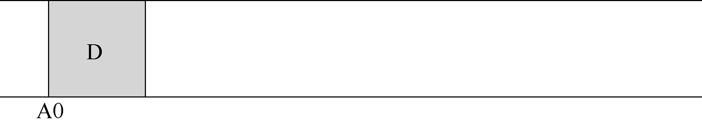
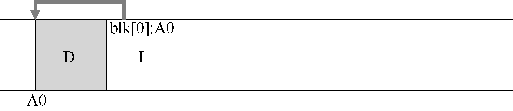

# 43.1 按顺序写入磁盘

因此，我们遇到了第一个挑战：如何将文件系统状态的所有更新转换为对磁盘的一系列顺序写入？为了更好地理解这一点，让我们举一个简单的例子。想象一下，我们正在将数据块D 写入文件。将数据块写入磁盘可能会导致以下磁盘布局，其中D 写在磁盘地址A0：

但是，当用户写入数据块时，不仅是数据被写入磁盘；还有其他需要更新的元数据（metadata）。在这个例子中，让我们将文件的inode（I）也写入磁盘，并将其指向数据块D。写入磁盘时，数据块和inode 看起来像这样（注意inode 看起来和数据块一样大，但通常情况并非如此。在大多数系统中，数据块大小为4KB，而inode 小得多，大约128B）：

> **提示：细节很重要**

> 所有有趣的系统都包含一些一般性的想法和一些细节。有时，在学习这些系统时，你会对自己说，“哦，我抓住了一般的想法，其余的只是细节说明。”你这样想时，对事情是如何运作的只是一知半解。不要这样做！很多时候，细节至关重要。正如我们在LFS 中看到的那样，一般的想法很容易理解，但要真正构建一个能工作的系统，必须仔细考虑所有棘手的情况。

简单地将所有更新（例如数据块、inode 等）顺序写入磁盘的这一基本思想是LFS 的核心。如果你理解这一点，就抓住了基本的想法。但就像所有复杂的系统一样，魔鬼藏在细节中。
