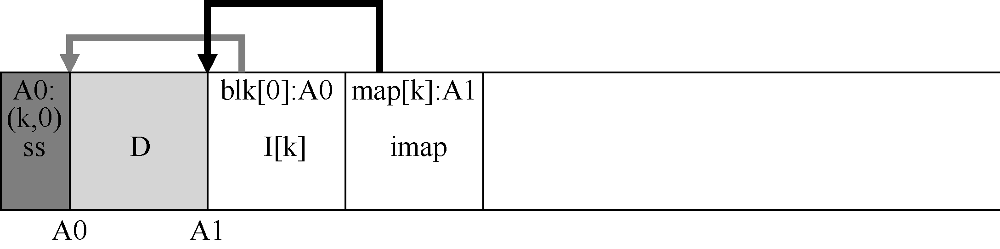

# 43.10 确定块的死活

我们首先关注这个问题。给定磁盘段S 内的数据块D，LFS 必须能够确定D 是不是活的。为此，LFS 会为描述每个块的每个段添加一些额外信息。具体地说，对于每个数据块D，LFS 包括其inode 号（它属于哪个文件）及其偏移量（这是该文件的哪一块）。该信息记录在一个数据结构中，位于段头部，称为段摘要块（segment summary block）。

根据这些信息，可以直接确定块的死活。对于位于地址A 的磁盘上的块D，查看段摘要块并找到其inode 号N 和偏移量T。接下来，查看imap 以找到N 所在的位置，并从磁盘读取N（可能它已经在内存中，这更好）。最后，利用偏移量T，查看inode（或某个间接块），看看inode 认为此文件的第T 个块在磁盘上的位置。如果它刚好指向磁盘地址A，则LFS可以断定块D 是活的。如果它指向其他地方，LFS 可以断定D 未被使用（即它已经死了），因此知道不再需要该版本。下面的伪代码总结了这个过程：

```text
(N, T) = SegmentSummary[A];
inode = Read(imap[N]);
if (inode[T] == A)
    // block D is alive
else
    // block D is garbage
```

下面是一个描述机制的图，其中段摘要块（标记为SS）记录了地址A0 处的数据块，实际上是文件k 在偏移0 处的部分。通过检查imap 的k，可以找到inode，并且看到它确实指向该位置。



LFS 走了一些捷径，可以更有效地确定死活。例如，当文件被截断或删除时，LFS 会增加其版本号（version number），并在imap 中记录新版本号。通过在磁盘上的段中记录版本号，LFS 可以简单地通过将磁盘版本号与imap 中的版本号进行比较，跳过上述较长的检查，从而避免额外的读取。
