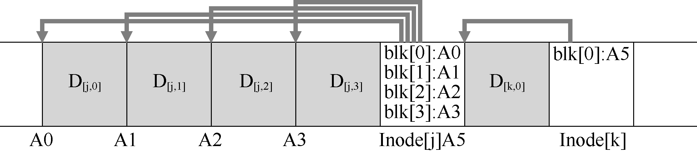

# 43.2 顺序而高效地写入

遗憾的是，（单单）顺序写入磁盘并不足以保证高效写入。例如，假设我们在时间T 向地址A 写入一个块。然后等待一会儿，再向磁盘写入地址A+1（下一个块地址按顺序），但是在时间T+δ。遗憾的是，在第一次和第二次写入之间，磁盘已经旋转。当你发出第二次写入时，它将在提交之前等待一大圈旋转（具体地说，如果旋转需要时间Trotation，则磁盘将等待Trotation−δ，然后才能将第二次写入提交到磁盘表面）。因此，你可以希望看到简单地按顺序写入磁盘不足以实现最佳性能。实际上，你必须向驱动器发出大量连续写入（或一次大写入）才能获得良好的写入性能。

为了达到这个目的，LFS 使用了一种称为写入缓冲[^p415-1]（write buffering）的古老技术。在写入磁盘之前，LFS 会跟踪内存中的更新。收到足够数量的更新时，会立即将它们写入磁盘，从而确保有效使用磁盘。

LFS 一次写入的大块更新被称为段（segment）。虽然这个术语在计算机系统中被过度使用，但这里的意思是LFS 用来对写入进行分组的大块。因此，在写入磁盘时，LFS 会缓冲内存段中的更新，然后将该段一次性写入磁盘。只要段足够大，这些写入就会很有效。

下面是一个例子，其中LFS 将两组更新缓冲到一个小段中。实际段更大（几MB）。第一次更新是对文件j 的4 次块写入，第二次是添加到文件k 的一个块。然后，LFS 立即将整个七个块的段提交到磁盘。这些块的磁盘布局如下：

[^p415-1]: 实际上，很难找到关于这个想法的好引用，因为它很可能是很多人在计算史早期发明的。有关写入缓冲的好处的研究，请参阅Solworth 和Orji [SO90]。要了解它的潜在危害，请参阅Mogul [M94]。
