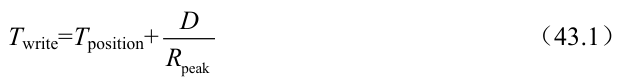
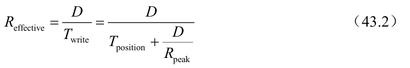
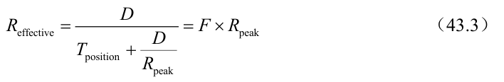
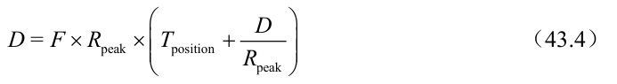
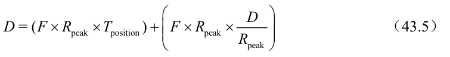
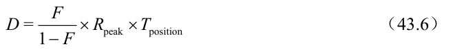

# 43.3 要缓冲多少

这提出了以下问题：LFS 在写入磁盘之前应该缓冲多少次更新？答案当然取决于磁盘本身，特别是与传输速率相比定位开销有多高。有关类似的分析，请参阅FFS 相关的章节。

例如，假设在每次写入之前定位（即旋转和寻道开销）大约需要Tposition s。进一步假设磁盘传输速率是Rpeak MB / s。在这样的磁盘上运行时，LFS 在写入之前应该缓冲多少？

考虑这个问题的方法是，每次写入时，都需要支付固定的定位成本。因此，为了摊销（amortize）这笔成本，你需要写入多少？写入越多就越好（显然），越接近达到峰值带宽。

为了得到一个具体的答案，假设要写入 D MB 数据。写数据块的时间 Twrite 是定位时间 Tposition 的加上 D 的传输时间（D/Rpeak），即

因此，有效写入速率（Reffective）就是写入的数据量除以写入的总时间，即

我们感兴趣的是，让有效速率（Reffective）接近峰值速率。具体而言，我们希望有效速率与峰值速率的比值是某个分数F，其中0 &lt;F &lt;1（典型的F 可能是0.9，即峰值速率的90%）。用数学表示，这意味着我们需要Reffective = F×Rpeak。

此时，我们可以解出D：

举个例子，一个磁盘的定位时间为10ms，峰值传输速率为100MB/s。假设我们希望有效带宽达到峰值的90%（F = 0.9）。在这种情况下，D = 0.9×100MB/s×0.01s= 9MB。请尝试一些不同的值，看看需要缓冲多少才能接近峰值带宽，达到95%的峰值需要多少，达到99%呢？
