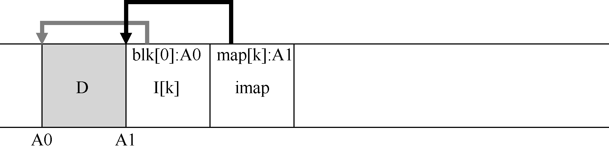

# 43.5 通过间接解决方案：inode 映射

为了解决这个问题，LFS 的设计者通过名为inode 映射（inode map，imap）的数据结构，在inode 号和inode 之间引入了一个间接层（level of indirection）。imap 是一个结构，它将inode号作为输入，并生成最新版本的inode 的磁盘地址。因此，你可以想象它通常被实现为一个简单的数组，每个条目有4 个字节（一个磁盘指针）。每次将inode 写入磁盘时，imap 都会使用其新位置进行更新。

> **提示：使用一个间接层**

> 人们常说，计算机科学中所有问题的解决方案就是一个间接层（level of indirection）。这显然不是真的，它只是大多数问题的解决方案。你当然可以将我们研究的每个虚拟化（例如虚拟内存）视为间接层。当然LFS 中的inode 映射是inode 号的虚拟化。希望你可以在这些示例中看到间接的强大功能，允许我们自由移动结构（例如VM 例子中的页面，或LFS 中的inode），而无需更改对它们的每个引用。当然，间接也可能有一个缺点：额外的开销。所以下次遇到问题时，请尝试使用间接解决方案。但请务必先考虑这样做的开销。

遗憾的是，imap 需要保持持久（写入磁盘）。这样做允许LFS 在崩溃时仍能记录inode位置，从而按设想运行。因此有一个问题：imap 应该驻留在磁盘上的哪个位置？

当然，它可以存在于磁盘的固定部分。遗憾的是，由于它经常更新，因此需要更新文件结构，然后写入imap，因此性能会受到影响（每次的更新和imap 的固定位置之间，会有更多的磁盘寻道）。

与此不同，LFS 将inode 映射的块放在它写入所有其他新信息的位置旁边。因此，当将数据块追加到文件k 时，LFS 实际上将新数据块，其inode 和一段inode 映射一起写入磁盘，如下所示：

在该图中，imap 数组存储在标记为imap 的块中，它告诉LFS，inode k 位于磁盘地址A1。接下来，这个inode 告诉LFS 它的数据块D 在地址A0。
