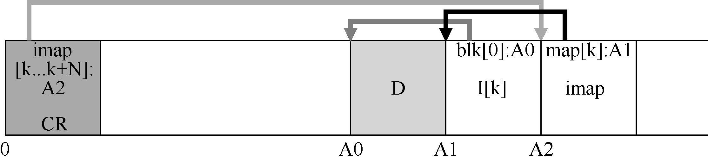

# 43.6 检查点区域

聪明的读者（就是你，对吗？）可能已经注意到了这里的问题。我们如何找到inode 映射，现在它的各个部分现在也分布在整个磁盘上？归根到底：文件系统必须在磁盘上有一些固定且已知的位置，才能开始文件查找。

LFS 在磁盘上只有这样一个固定的位置，称为检查点区域（checkpoint region，CR）。检查点区域包含指向最新的inode 映射片段的指针（即地址），因此可以通过首先读取CR 来找到inode 映射片段。请注意，检查点区域仅定期更新（例如每30s 左右），因此性能不会受到影响。因此，磁盘布局的整体结构包含一个检查点区域（指向内部映射的最新部分），每个inode映射块包含inode 的地址，inode 指向文件（和目录），就像典型的UNIX 文件系统一样。

下面的例子是检查点区域（注意它始终位于磁盘的开头，地址为0），以及单个imap 块，inode 和数据块。一个真正的文件系统当然会有一个更大的CR（事实上，它将有两个，我们稍后会理解），许多imap 块，当然还有更多的inode、数据块等。

