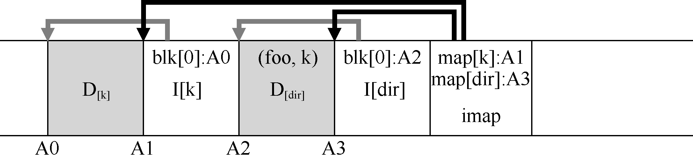

# 43.8 目录如何

到目前为止，我们通过仅考虑inode 和数据块，简化了讨论。但是，要访问文件系统中的文件（例如/home/remzi/foo，我们最喜欢的伪文件名之一），也必须访问一些目录。那么LFS 如何存储目录数据呢？

幸运的是，目录结构与传统的UNIX 文件系统基本相同，因为目录只是（名称，inode号）映射的集合。例如，在磁盘上创建文件时，LFS 必须同时写入新的inode，一些数据，以及引用此文件的目录数据及其inode。请记住，LFS 将在磁盘上按顺序写入（在缓冲更新一段时间后）。因此，在目录中创建文件foo，将导致磁盘上的以下新结构：

inode 映射的片段包含目录文件dir 以及新创建的文件f 的位置信息。因此，访问文件foo（具有inode 号f）时，你先要查看inode 映射（通常缓存在内存中），找到目录dir（A3）的inode 的位置。然后读取目录的inode，它给你目录数据的位置（A2）。读取此数据块为你提供名称到inode 号的映射（foo，k）。然后再次查阅inode 映射，找到inode 号k（A1）的位置，最后在地址A0 处读取所需的数据块。

inode 映射还解决了LFS 中存在的另一个严重问题，称为递归更新问题（recursive update problem）[Z+12]。任何永远不会原地更新的文件系统（例如LFS）都会遇到该问题，它们将更新移动到磁盘上的新位置。

具体来说，每当更新inode 时，它在磁盘上的位置都会发生变化。如果我们不小心，这也会导致对指向该文件的目录的更新，然后必须更改该目录的父目录，依此类推，一路沿文件系统树向上。

LFS 巧妙地避免了inode 映射的这个问题。即使inode 的位置可能会发生变化，更改也不会反映在目录本身中。事实上，imap 结构被更新，而目录保持相同的名称到inumber 的映射。因此，通过间接，LFS 避免了递归更新问题。
