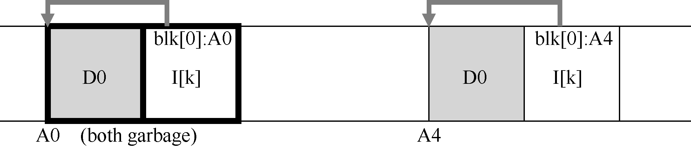
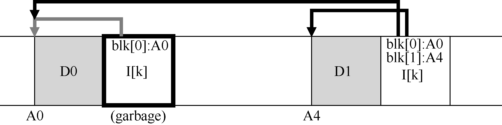

# 43.9 一个新问题：垃圾收集

你可能已经注意到LFS 的另一个问题；它会反复将最新版本的文件（包括其inode 和数据）写入磁盘上的新位置。此过程在保持写入效率的同时，意味着LFS 会在整个磁盘中分散旧版本的文件结构。我们（毫不客气地）将这些旧版本称为垃圾（garbage）。

例如，假设有一个由inode 号k 引用的现有文件，该文件指向单个数据块D0。我们现在覆盖该块，生成新的inode 和新的数据块。由此产生的LFS 磁盘布局看起来像这样（注意，简单起见，我们省略了imap 和其他结构。还需要将一个新的imap 大块写入磁盘，以指向新的inode）：

在图中，可以看到inode 和数据块在磁盘上有两个版本，一个是旧的（左边那个），一个是当前的，因此是活的（live，右边那个）。对于覆盖数据块的简单行为，LFS 必须持久许多新结构，从而在磁盘上留下上述块的旧版本。

另外举个例子，假设我们将一块添加到该原始文件k 中。在这种情况下，会生成新版本的inode，但旧数据块仍由旧inode 指向。因此，它仍然存在，并且与当前文件系统分离：

那么，应该如何处理这些旧版本的inode、数据块等呢？可以保留那些旧版本并允许用户恢复旧文件版本（例如，当他们意外覆盖或删除文件时，这样做可能非常方便）。这样的文件系统称为版本控制文件系统（versioning file system），因为它跟踪文件的不同版本。

但是，LFS 只保留文件的最新活版本。因此（在后台），LFS 必须定期查找文件数据，索引节点和其他结构的旧的死版本，并清理（clean）它们。因此，清理应该使磁盘上的块再次空闲，以便在后续写入中使用。请注意，清理过程是垃圾收集（garbage collection）的一种形式，这种技术在编程语言中出现，可以自动为程序释放未使用的内存。

之前我们讨论过的段很重要，因为它们是在LFS 中实现对磁盘的大段写入的机制。事实证明，它们也是有效清理的重要组成部分。想象一下，如果LFS 清理程序在清理过程中简单地通过并释放单个数据块，索引节点等，会发生什么。结果：文件系统在磁盘上分配的空间之间混合了一些空闲洞（hole）。写入性能会大幅下降，因为LFS 无法找到一个大块连续区域，以便顺序地写入磁盘，获得高性能。

实际上，LFS 清理程序按段工作，从而为后续写入清理出大块空间。基本清理过程的工作原理如下。LFS 清理程序定期读入许多旧的（部分使用的）段，确定哪些块在这些段中存在，然后写出一组新的段，只包含其中活着的块，从而释放旧块用于写入。具体来说，我们预期清理程序读取M 个现有段，将其内容打包（compact）到N 个新段（其中N &lt; M），然后将N 段写入磁盘的新位置。然后释放旧的M 段，文件系统可以使用它们进行后续写入。

但是，我们现在有两个问题。第一个是机制：LFS 如何判断段内的哪些块是活的，哪些块已经死了？第二个是策略：清理程序应该多久运行一次，以及应该选择清理哪些部分？
