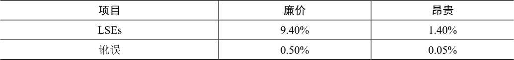

# 44.1 磁盘故障模式

正如你在关于RAID 的章节中所了解到的，磁盘并不完美，并且可能会发生故障（有时）。在早期的RAID 系统中，故障模型非常简单：要么整个磁盘都在工作，要么完全失败，而且检测到这种故障很简单。这种磁盘故障的故障—停止（fail-stop）模型使构建RAID 相对简单[S90]。

你不知道的是现代磁盘展示的所有其他类型的故障模式。具体来说，正如Bairavasundaram等人的详细研究[B+07，B+08]，现代磁盘似乎大部分时间正常工作，但是无法成功访问一个或几个块。具体来说，两种类型的单块故障是常见的，值得考虑：潜在扇区错误（Latent-Sector Errors，LSE）和块讹误（block corruption）。接下来分别详细地讨论。

当磁盘扇区（或扇区组）以某种方式讹误时，会出现LSE。例如，如果磁头由于某种原因接触到表面（磁头碰撞，head crash，在正常操作期间不应发生的情况），则可能会讹误表面，使得数据位不可读。宇宙射线也会导致数据位翻转，使内容不正确。幸运的是，驱动器使用磁盘内纠错码（Error Correcting Code，ECC）来确定块中的磁盘位是否良好，并且在某些情况下，修复它们。如果它们不好，并且驱动器没有足够的信息来修复错误，则在发出请求读取它们时，磁盘会返回错误。

还存在一些情况，磁盘块出现讹误（corrupt），但磁盘本身无法检测到。例如，有缺陷的磁盘固件可能会将块写入错误的位置。在这种情况下，磁盘ECC 指示块内容很好，但是从客户端的角度来看，在随后访问时返回错误的块。类似地，当一个块通过有故障的总线从主机传输到磁盘时，它可能会讹误。由此产生的讹误数据会存入磁盘，但它不是客户所希望的。这些类型的故障特别隐蔽，因为它们是无声的故障（silent fault）。返回故障数据时，磁盘没有报告问题。

Prabhakaran 等人将这种更现代的磁盘故障视图描述为故障—部分（fail-partial）磁盘故障模型[P+05]。在此视图中，磁盘仍然可以完全失败（像传统的故障停止模型中的情况）。然而，磁盘也可以似乎正常工作，并有一个或多个块变得不可访问（即LSE）或保存了错误的内容（即讹误）。因此，当访问看似工作的磁盘时，偶尔会在尝试读取或写入给定块时返回错误（非无声的部分故障），偶尔可能只是返回错误的数据（一个无声的部分错误）。

这两种类型的故障都有点罕见，但有多罕见？表44.1 总结了Bairavasundaram 的两项研究[B+07，B+08]的一些结果。

表格文字

| 项目 | 廉价 | 昂贵 |
| --- | --- | --- |
| LSEs | 9.40% | 1.40% |
| 讹误 | 0.50% | 0.05% |

该表显示了在研究过程中至少出现一次LSE 或块讹误的驱动器百分比（大约3 年，超过150 万个磁盘驱动器）。该表进一步将结果细分为“廉价”驱动器（通常为SATA 驱动器）和“昂贵”驱动器（通常为SCSI 或FibreChannel）。如你所见，虽然购买更好的驱动器可以减少两种类型问题的频率（大约一个数量级），但它们的发生频率仍然足够高，你需要仔细考虑如何在存储系统中处理它们。

关于LSE 的一些其他发现如下：

具有多个LSE 的昂贵驱动器可能会像廉价驱动器一样产生附加错误。

对于大多数驱动器，第二年的年度错误率会增加。

LSE 随磁盘大小增加。

大多数磁盘的LSE 少于50 个。

具有LSE 的磁盘更有可能发生新增的LSE。

存在显著的空间和时间局部性。

磁盘清理很有用（大多数LSE 都是这样找到的）。

关于讹误的一些发现如下：

同一驱动器类别中不同驱动器型号的讹误机会差异很大。

老化效应因型号而异。

工作负载和磁盘大小对讹误几乎没有影响。

大多数具有讹误的磁盘只有少数讹误。

讹误不是与一个磁盘或RAID 中的多个磁盘无关的。

存在空间局部性和一些时间局部性。

与LSE 的相关性较弱。

要了解有关这些故障的更多信息，应该阅读原始论文[B+07，B+08]。但主要观点应该已经明确：如果真的希望建立一个可靠的存储系统，必须包括一些机制来检测和恢复LSE并阻止讹误。
