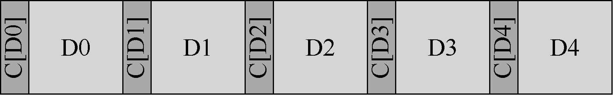
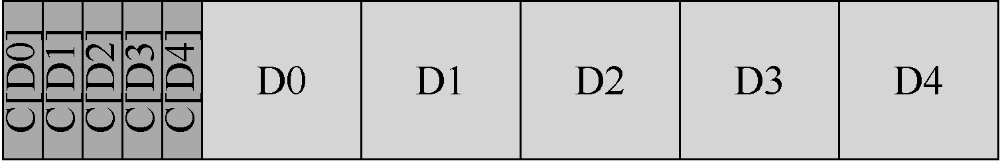

# 44.3 检测讹误：校验和

现在让我们解决更具挑战性的问题，即数据讹误导致的无声故障。在出现讹误导致磁盘返回错误数据时，如何阻止用户获取错误数据？

> **关键问题：尽管有讹误，如何保护数据完整性**

> 鉴于此类故障的无声性，存储系统可以做些什么来检测何时出现讹误？需要什么技术？如何有效地实现？

与潜在的扇区错误不同，检测讹误是一个关键问题。客户如何判断一个块坏了？一旦知道特定块是坏的，恢复就像以前一样：你需要有该块的其他副本（希望没有讹误！）。因此，我们将重点放在检测技术上。

现代存储系统用于保持数据完整性的主要机制称为校验和（checksum）。校验和就是一个函数的结果，该函数以一块数据（例如4KB 块）作为输入，并计算这段数据的函数，产生数据内容的小概要（比如4 字节或8 字节）。此摘要称为校验和。这种计算的目的在于，让系统将校验和与数据一起存储，然后在访问时确认数据的当前校验和与原始存储值匹配，从而检测数据是否以某种方式被破坏或改变。

> **提示：没有免费午餐**

> 没有免费午餐这种事，或简称TNSTAAFL，是一句古老的美国谚语，暗示当你似乎在免费获得某些东西时，实际上你可能会付出一些代价。以前，餐馆会向顾客宣传免费午餐，希望能吸引他们。只有当你进去时，才会意识到要获得“免费”午餐，必须购买一种或多种含酒精的饮料。

## 常见的校验和函数

许多不同的函数用于计算校验和，并且强度（即它们在保护数据完整性方面有多好）和速度（即它们能够以多快的速度计算）不同。系统中常见的权衡取决于此：通常，你获得的保护越多，成本就越高。没有免费午餐这种事。

有人使用一个简单的校验和函数，它基于异或（XOR）。使用基于XOR 的校验和，只需对需要校验和的数据块的每个块进行异或运算，从而生成一个值，表示整个块的XOR。

为了使这更具体，想象一下在一个16 字节的块上计算一个4 字节的校验和（这个块当然太小而不是真正的磁盘扇区或块，但它将用作示例）。十六进制的16 个数据字节如下所示：

```text
365e c4cd ba14 8a92 ecef 2c3a 40be f666
```

如果以二进制形式查看它们，会看到：

```text
0110 0101 1110    1100 0100 1100 1101
1010 0001 0100    1000 1010 1001 0010
1100 1110 1111    0010 1100 0011 1010
0000 1011 1110    1111 0110 0110 0110
```

因为我们以每行4 个字节为一组排列数据，所以很容易看出生成的校验和是什么。只需对每列执行XOR 以获得最终的校验和值：

```text
0000 0001 1011    1001 0100 0000 0011
```

十六进制的结果是0x201b9403。

XOR 是一个合理的校验和，但有其局限性。例如，如果每个校验和单元内相同位置的两个位发生变化，则校验和将不会检测到讹误。出于这个原因，人们研究了其他校验和函数。

另一个简单的校验和函数是加法。这种方法具有快速的优点。计算它只需要在每个数据块上执行二进制补码加法，忽略溢出。它可以检测到数据中的许多变化，但如果数据被移位，则不好。

稍微复杂的算法被称为Fletcher 校验和（Fletcher checksum），命名基于（你可能会猜到）发明人John G. Fletcher [F82]。它非常简单，涉及两个校验字节s1 和s2 的计算。具体来说，假设块D 由字节d1,…, dn 组成。s1 简单地定义如下：s1 = s1 + di mod 255（在所有di 上计算）。s2 依次为：s2 = s2 + s1 mod 255（同样在所有di 上）[F04]。已知fletcher 校验和几乎与CRC（下面描述）一样强，可以检测所有单比特错误，所有双比特错误和大部分突发错误[F04]。

最后常用的校验和称为循环冗余校验（CRC）。虽然听起来很奇特，但基本想法很简单。假设你希望计算数据块D 的校验和。你所做的只是将D 视为一个大的二进制数（毕竟它只是一串位）并将其除以约定的值（k）。该除法的其余部分是CRC 的值。事实证明，人们可以相当有效地实现这种二进制模运算，因此也可以在网络中普及CRC。有关详细信息，请参见其他资料[M13]。

无论使用何种方法，很明显没有完美的校验和：两个具有不相同内容的数据块可能具有相同的校验和，这被称为碰撞（collision）。这个事实应该是直观的：毕竟，计算校验和会使某种很大的东西（例如，4KB）产生很小的摘要（例如，4 或8 个字节）。在选择良好的校验和函数时，我们试图找到一种函数，能够在保持易于计算的同时，最小化碰撞机会。

## 校验和布局

既然你已经了解了如何计算校验和，接下来就分析如何在存储系统中使用校验和。我们必须解决的第一个问题是校验和的布局，即如何将校验和存储在磁盘上？

最基本的方法就是为每个磁盘扇区（或块）存储校验和。给定数据块D，我们称该数据的校验和为C（D）。因此，没有校验和，磁盘布局如下所示：


有了校验和，布局为每个块添加一个校验和：



因为校验和通常很小（例如，8 字节），并且磁盘只能以扇区大小的块（512 字节）或其倍数写入，所以出现的一个问题是如何实现上述布局。驱动器制造商采用的一种解决方案是使用520 字节扇区格式化驱动器，每个扇区额外的8 个字节可用于存储校验和。

在没有此类功能的磁盘中，文件系统必须找到一种方法来将打包的校验和存储到512字节的块中。一种可能性如下：



在该方案中，n 个校验和一起存储在一个扇区中，后跟n 个数据块，接着是后n 块的另一个校验和扇区，依此类推。该方案具有在所有磁盘上工作的优点，但效率较低。例如，如果文件系统想要覆盖块D1，它必须读入包含C（D1）的校验和扇区，更新其中的C（D1），然后写出校验和扇区以及新的数据块 D1（因此，一次读取和两次写入）。前面的方法（每个扇区一个校验和）只执行一次写操作。
