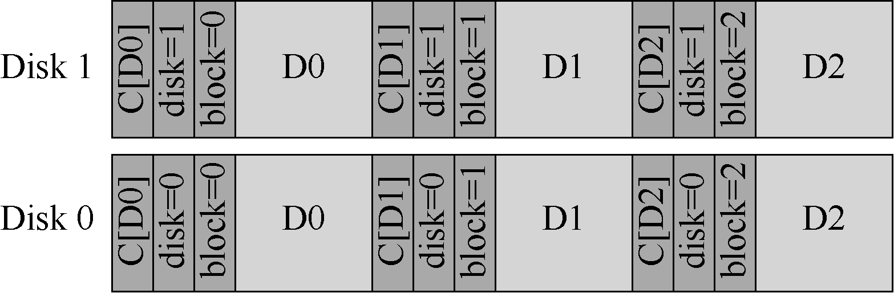

# 44.5 一个新问题：错误的写入

上述基本方案对一般情况的讹误块工作良好。但是，现代磁盘有几种不同的故障模式，需要不同的解决方案。

第一种感兴趣的失败模式称为“错误位置的写入（misdirected write）”。这出现在磁盘和RAID 控制器中，它们正确地将数据写入磁盘，但位置错误。在单磁盘系统中，这意味着磁盘写入块Dx 不是在地址x（像期望那样），而是在地址y（因此是“讹误的”Dy）。另外，在多磁盘系统中，控制器也可能将Di，x 不是写入磁盘i 的x，而是写入另一磁盘j。因此问题是：

> **关键问题：如何处理错误的写入**

> 存储系统或磁盘控制器应该如何检测错误位置的写入？校验和需要哪些附加功能？

毫不奇怪，答案很简单：在每个校验和中添加更多信息。在这种情况下，添加物理标识符（Physical Identifier，物理ID）非常有用。例如，如果存储的信息现在包含校验和C（D）以及块的磁盘和扇区号，则客户端很容易确定块内是否存在正确的信息。具体来说，如果客户端正在读取磁盘10 上的块4（D10,4），则存储的信息应包括该磁盘号和扇区偏移量，如下所示。如果信息不匹配，则发生了错误位置写入，并且现在检测到讹误。以下是在双磁盘系统上添加此信息的示例。注意，该图与之前的其他图一样，不是按比例绘制的，因为校验和通常很小（例如，8 个字节），而块则要大得多（例如，4KB 或更大）：

可以从磁盘格式看到，磁盘上现在有相当多的冗余：对于每个块，磁盘编号在每个块中重复，并且相关块的偏移量也保留在块本身旁边。但是，冗余信息的存在应该是不奇怪。冗余是错误检测（在这种情况下）和恢复（在其他情况下）的关键。一些额外的信息虽然不是完美磁盘所必需的，但可以帮助检测出现问题的情况。
