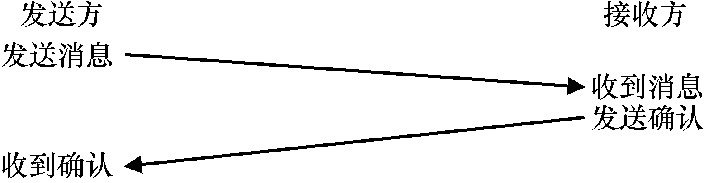
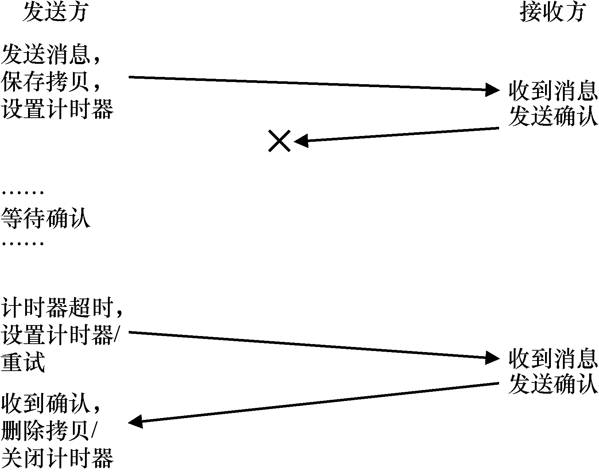
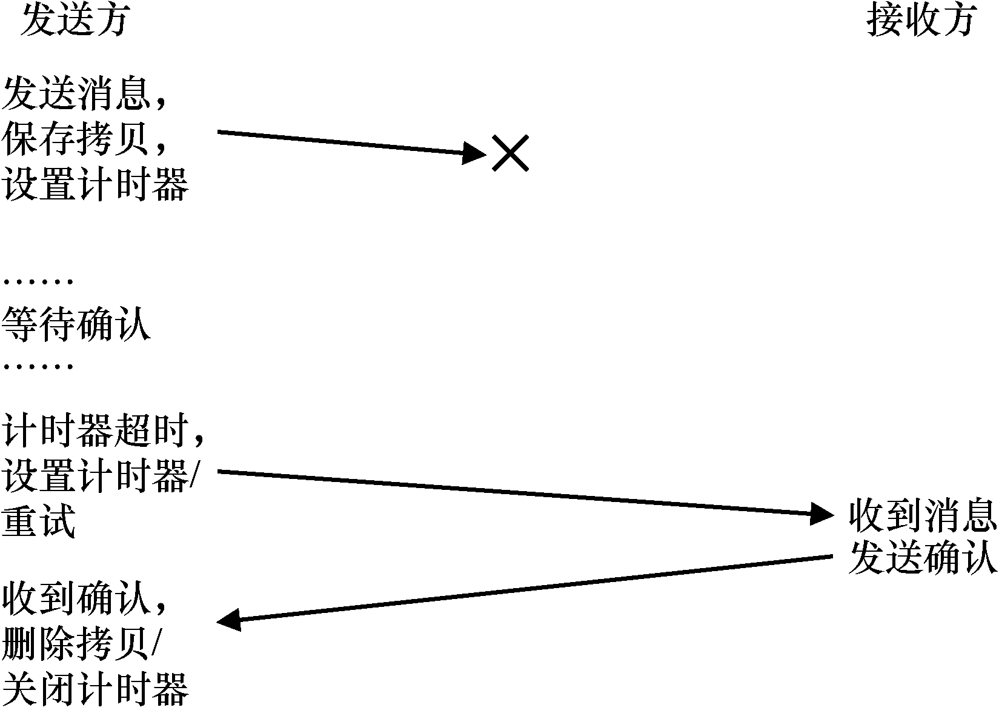

# 47.3 可靠的通信层

为了构建可靠的通信层，我们需要一些新的机制和技术来处理数据包丢失。考虑一个简单的示例，其中客户端通过不可靠的连接向服务器发送消息。我们必须回答的第一个问题是：发送方如何知道接收方实际收到了消息？

我们要使用的技术称为确认（acknowledgment），或简称为ack。这个想法很简单：发送方向接收方发送消息，接收方然后发回短消息确

认收到。图47.3 描述了该过程。

当发送方收到该消息的确认时，它可以放心接收方确实收到了原始消息。但是，如果没有收到确认，发送方应该怎么办？

为了处理这种情况，我们需要一种额外的机制，称为超时（timeout）。当发送方发送消息时，发送方现在将计时器设置为在一段时间后关闭。如果在此时间内未收到确认，则发送方断定该消息已丢失。发送方然后就重试（retry）发送，再次发送相同的消息，希望这次它能送达。要让这种方法起作用，发送方必须保留一份消息副本，以防它需要再次发送。超时和重试的组合导致一些人称这种方法为超时/重试（timeout/retry）。非常聪明的一群人，那些搞网络的，不是吗？图47.4 展示了一个例子。

遗憾的是，这种形式的超时/重试还不够。图47.5 展示了可能导致故障的数据包丢失示例。在这个例子中，丢失的不是原始消息，而是确认消息。从发送方的角度来看，情况似乎是相同的：没有收到确认，因此超时和重试是合适的。但是从接收方的角度来看，完全不同：现在相同的消息收到了两次！虽然可能存在这种情况，但通常情况并非如此。设想下载文件时，在下载过程中重复多个数据包，会发生什么。因此，如果目标是可靠的消息层，我们通常还希望保证接收方每个消息只接收一次（exactly once）。

为了让接收方能够检测重复的消息传输，发送方必须以某种独特的方式标识每个消息，并且接收方需要某种方式来追踪它是否已经看过每个消息。当接收方看到重复传输时，它只是简单地响应消息，但（严格地说）不会将消息传递给接收数据的应用程序。因此，发送方收到确认，但消息未被接收两次，保证了上面提到的一次性语义。

有许多方法可以检测重复的消息。例如，发送方可以为每条消息生成唯一的ID。接收方可以追踪它所见过的每个ID。这种方法可行，但它的成本非常高，需要无限的内存来跟踪所有ID。

一种更简单的方法，只需要很少的内存，解决了这个问题，该机制被称为顺序计数器（sequence counter）。利用顺序计数器，发送方和接收方就每一方将维护的计数器的起始值达成一致（例如1）。无论何时发送消息，计数器的当前值都与消息一起发送。此计数器值（N）作为消息的ID。发送消息后，发送方递增该值（到N + 1）。

接收方使用其计数器值，作为发送方传入消息的ID 的预期值。如果接收的消息（N）的ID 与接收方的计数器匹配（也是N），它将确认该消息，将其传递给上层的应用程序。在这种情况下，接收方断定这是第一次收到此消息。接收方然后递增其计数器（到N + 1），并等待下一条消息。

如果确认丢失，则发送方将超时，并重新发送消息N。这次，接收器的计数器更高（N+1），因此接收器知道它已经接收到该消息。因此它会确认该消息，但不会将其传递给应用程序。以这种简单的方式，顺序计数器可以避免重复。

最常用的可靠通信层称为TCP/IP，或简称为TCP。TCP 比上面描述的要复杂得多，包括处理网络拥塞的机制[VJ88]，多个未完成的请求，以及数百个其他的小调整和优化。如果你很好奇，请阅读更多相关信息。参加一个网络课程并很好地学习这些材料，这样更好。
